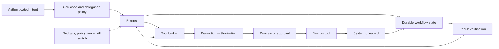

# Agentic AI architecture

An agent uses a model to choose or sequence actions toward a goal. The important architectural property is not the label “agent”; it is the authority the system receives, the state it retains, and the consequences it can create.

## Autonomy and consequence

Classify both dimensions:

| Autonomy | Description |
|---|---|
| Suggest | Produces information or options only |
| Draft | Prepares content or a transaction for review |
| Execute with approval | A person approves a specific action and parameters |
| Execute within policy | Acts without per-action approval inside explicit boundaries |
| Adapt objectives | May change plans or subordinate goals within delegated intent |

| Consequence | Examples |
|---|---|
| Read-only | Search, summarize, inspect status |
| Reversible | Create a draft, place a temporary hold, modify recoverable state |
| Material | Send externally, change access, spend money, affect a customer |
| Safety- or rights-critical | Physical control, clinical, employment, credit, legal status |

Controls should increase with the highest combination of autonomy, consequence, exposure, data sensitivity, and scale. High capability is not a justification for high autonomy.

## Reference pattern

### Planner and executor

Separate probabilistic planning from deterministic execution. The planner may propose a typed action; an executor validates schema, state, policy, authorization, and business invariants before the owning service acts.

For consequential workflows, use a durable workflow engine rather than relying on conversational history as state. Durable state supports retries, timeouts, compensation, approvals, replay, and incident investigation.

## Identity delegation

Agents should not inherit ambient authority. Every action needs:

- originating human or client identity;
- executing workload identity;
- tenant and resource boundary;
- delegated purpose and scopes;
- credential audience and expiration;
- approval identity, if applicable;
- authorization result from the resource-owning service.

Prefer just-in-time credentials for one tool or transaction. Never place reusable secrets in model context, long-term memory, tool output, or trace content.

Complete the
[identity and permission matrix](../worksheets/identity-and-permission-matrix.md)
for each production environment and tenant or isolation boundary.

## Tool architecture

Maintain an approved tool registry containing:

- semantic purpose and owning team;
- input and output schema;
- read/write and consequence classification;
- required identity and authorization;
- supported tenants and data classes;
- idempotency and compensation behavior;
- rate, time, concurrency, and cost limits;
- approval policy;
- version, provenance, support, and revocation state.

Tool discovery is a security boundary. A poisoned registry or malicious tool description can redirect an agent. Sign or otherwise protect registry changes, separate publication from approval, and pin approved versions for production releases.

## Memory and context

Distinguish:

- **turn context** — data needed for one inference;
- **session memory** — temporary state for one user interaction;
- **workflow state** — authoritative progress and action results;
- **user memory** — retained preferences or facts about a person;
- **shared knowledge** — governed enterprise sources;
- **agent learning** — changes to policy, prompts, or behavior.

Each store needs an owner, allowed content, tenant key, provenance, retention, correction, deletion, and poisoning defense. Do not allow the model to promote arbitrary content into long-term memory without deterministic policy and, where appropriate, user confirmation.

## Side effects and transactions

Classify every tool operation as read-only, reversible, compensatable, or irreversible.

For writes:

- show the exact target and material parameters before approval;
- bind approval to those parameters and an expiration;
- use idempotency keys and replay protection;
- re-check preconditions at commit time;
- return an authoritative transaction identifier;
- verify the postcondition;
- define compensation when atomic rollback is impossible;
- stop on ambiguity rather than guessing.

An approval for a plan is not blanket approval for every later action if the plan or parameters change.

Complete the
[agent execution and telemetry contract](../worksheets/agent-execution-and-telemetry-contract.md)
to keep proposal, authorization, dispatch, cancellation, authoritative
transaction state, postcondition readback, privacy-minimized evidence, and
reconciliation distinct across the entire root execution.

## Single-agent and multi-agent systems

Use multiple agents only when specialization, isolation, parallelism, or independent checking creates measurable value. Multi-agent designs add:

- more identities, messages, and trust boundaries;
- inconsistent goals or policies;
- delegation and authority ambiguity;
- emergent loops and cost amplification;
- harder evaluation and incident reconstruction.

Treat agent-to-agent messages as untrusted. Carry provenance and delegation metadata, validate schemas, constrain topology and hop count, and ensure downstream agents cannot acquire greater authority than the originator delegated.

### Model-tiered coordinator-worker pattern

A capable coordinator may decompose ambiguous or high-context work and
dispatch bounded tasks to smaller, faster, or cheaper workers. This pattern
creates value only when specialization or parallelism offsets routing,
duplicated context, verification, synthesis, and failure-recovery overhead.

Model selection is a delegated control decision, not worker discretion:

1. classify the task, data, risk, and required authority;
2. resolve an approved coordinator or worker capability profile through
   central policy;
3. issue a bounded task with inputs, tools, budget, output schema, and
   acceptance criteria;
4. validate the worker artifact with a deterministic check, protected
   verifier, or qualified human;
5. retry, escalate to a stronger profile, abstain, or ask a human only under
   explicit limits and observable conditions.

A worker must not select an unapproved provider, region, model, preview, tool,
or higher authority. Record the delegation chain, route policy, actual model
revision, rejected or fallback routes, evidence produced, and final
disposition.

Use the
[governed model routing and agent dispatch](model-portfolio-and-routing.md)
pattern for deployment approval, total-cost controls, adapter enforcement, and
escalation criteria. Use the separate
[dated candidate catalog](model-and-provider-candidate-catalog.md) for current
model, price-plan, provider-statement, and product-feature examples.

## Containment

Set:

- step, time, token, tool, spend, and concurrency budgets;
- destination, resource, and data allowlists;
- maximum delegation depth and message hops;
- approval checkpoints by consequence;
- retry and loop detection;
- circuit breakers for error, quality, security, and cost signals;
- per-run pause, cancel, and enterprise kill switches;
- safe behavior when state or authorization is uncertain.

Generated code, files, browser activity, and interpreters should run in disposable sandboxes with controlled network and filesystem access.

## Evaluation

Evaluate trajectories, not only final answers:

- intent interpretation;
- plan quality and policy compliance;
- tool choice and argument validity;
- data-access and authorization behavior;
- recovery from partial failure;
- approval and escalation behavior;
- state consistency and idempotency;
- stop behavior;
- outcome quality, latency, and cost;
- resistance to prompt injection, tool poisoning, and misleading results.

Use simulation and test doubles for destructive or external actions. Maintain adversarial scenarios and historical incidents. Sample privacy-minimized production traces and compare behavior across model, prompt, tool, and policy changes.

## Production evidence

Before release, require:

- autonomy and consequence classification;
- tool, memory, and data inventory plus a completed
  [identity and permission matrix](../worksheets/identity-and-permission-matrix.md);
- trust-boundary and delegation design;
- threat model and adversarial results;
- trajectory and failure-recovery evaluation;
- action budgets and approval policy;
- a current
  [agent execution and telemetry contract](../worksheets/agent-execution-and-telemetry-contract.md)
  with cancellation, unknown-outcome, event-completeness, minimization,
  retention, alert, and reconciliation evidence;
- pause, kill-switch, rollback, and credential-revocation exercise;
- incident replay and audit demonstration;
- named owner for every tool and long-running workflow.
