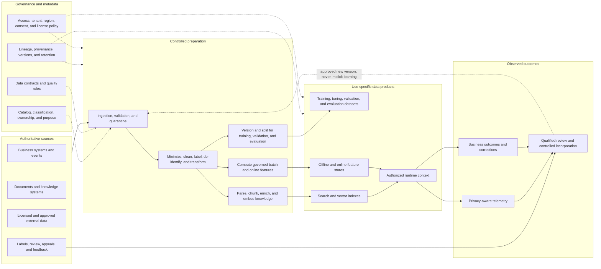

# Data architecture

Enterprise AI data architecture governs more than training data. It includes
business inputs, features, knowledge sources, embeddings, indexes, prompts,
context, outputs, human feedback, evaluation sets, operational telemetry, and
derived artifacts. Each has an owner, purpose, authority, lifecycle, and access
boundary.

The goal is not to copy all available data into an AI platform. The goal is to
provide the minimum authoritative data required for an approved use case, with
quality, provenance, entitlement, and lifecycle controls that remain effective
after transformation.

## Conceptual data flow

Catalog, policy, and lineage are cross-cutting capabilities, not a claim that one
tool must implement them. The diagram also separates operational feedback from
automatic learning: production interactions do not enter training or tuning
without an approved, reviewed, versioned path.

## Data categories and authority

| Category | Examples | Authoritative source | Primary concerns |
|---|---|---|---|
| Business input | records, transactions, sensor events, user requests | owning business service or source system | purpose, accuracy, identity, minimization |
| Knowledge | policies, manuals, cases, product information | named content owner and repository | freshness, permissions, provenance, conflicts |
| Training or tuning data | examples, labels, demonstrations, preferences | approved dataset version and manifest | license, consent, representativeness, contamination |
| Validation and evaluation data | holdouts, edge cases, adversarial cases | controlled evaluation repository | independence, leakage, subgroup coverage, reviewer quality |
| Features | aggregates, transformations, encodings | governed feature definition plus source lineage | point-in-time correctness, leakage, training-serving skew |
| Embeddings and indexes | vectors, chunks, sparse indexes, metadata | derived from versioned sources; not a system of record | source ACLs, reconstruction risk, freshness, deletion |
| Runtime context | prompts, retrieved passages, session or agent state | assembled for a bounded request or workflow | authorization, injection, retention, tenant isolation |
| Outputs and actions | predictions, generated content, proposed transactions | AI output until accepted by an owning workflow | uncertainty, provenance, validation, record status |
| Feedback and outcomes | ratings, corrections, appeals, downstream results | feedback or outcome system with known collection method | consent, manipulation, selection bias, label validity |
| Telemetry | traces, route decisions, versions, cost, safety events | observability system | sensitive content, access, retention, evidentiary integrity |

Derived data inherits relevant restrictions from its sources unless an approved
analysis demonstrates otherwise. Transformation, embedding, aggregation, or
de-identification does not automatically remove confidentiality, personal-data,
license, tenant, or residency obligations.

## Ownership, purpose, and data contracts

Every data product used by an AI system should identify:

- a business or source owner with authority to permit the use;
- an engineering custodian responsible for availability and controls;
- the approved purposes, users, regions, and environments;
- classification, privacy, consent, contractual, license, and retention terms;
- authoritative fields and acceptable transformation;
- a schema and semantic contract;
- quality objectives, freshness objectives, and stop conditions;
- downstream consumers and deletion or correction obligations.

A data contract should cover semantics as well as shape. A field can remain
syntactically valid while changing units, population, collection method,
defaults, or business meaning. Contract changes should notify affected feature,
training, index, evaluation, and monitoring pipelines before release.

Do not infer authorization from technical availability. Being able to query a
warehouse, copy a document, or call a source API does not establish a permitted
AI purpose.

## Knowledge and retrieval architecture

A vector database or search index is a derived access path, not the source of
truth. A governed retrieval pipeline should:

1. identify authoritative repositories and content owners;
2. use a dedicated connector identity with minimum read scope;
3. validate source type, classification, license, and allowed use before ingest;
4. scan or quarantine malformed, malicious, or unsupported content;
5. normalize, parse, chunk, and enrich through versioned code;
6. attach source identifier, content version, owner, classification, tenant,
   permissions, effective dates, and deletion state;
7. record the embedding model, transformation, chunking, and index versions;
8. publish through an atomic or staged index release;
9. test retrieval relevance, entitlement enforcement, freshness, and deletion;
10. carry source provenance and evidence sufficiency into the response.

### Entitlement preservation

Retrieval must not broaden access. Design the authorization path so that:

- source identities and groups map to stable enterprise principals;
- tenant, user, purpose, and resource policy are evaluated for each request;
- filtering occurs before content is returned whenever the technology permits;
- post-filtering is not the sole barrier when it can expose content, counts, or
  ranking information;
- document or passage-level enforcement matches the granularity of source
  permissions;
- caches, rerankers, conversation memory, and generated citations preserve the
  same tenant and authorization context;
- permission revocation and group changes propagate within a defined objective;
- tests cover revoked users, deleted sources, policy conflicts, nested groups,
  stale indexes, and cross-tenant queries.

If source permissions cannot be represented safely in the retrieval service,
use a broker that re-authorizes against the source, segregate indexes by the
required boundary, or do not ingest that content.

### Freshness, conflict, and insufficient evidence

Define source-specific refresh objectives and monitor ingestion lag, index lag,
failed documents, and stale permissions. The application must have explicit
behavior when sources are missing, outdated, conflicting, superseded, or below
an evidence threshold. Depending on the use case, it may abstain, identify the
conflict, route to an authoritative workflow, or require human review.

## Feature architecture for predictive systems

Reusable features are governed data products. Whether implemented through a
feature store or ordinary pipelines, record:

- source fields, transformation code, owner, semantic definition, and valid
  population;
- event time, processing time, point-in-time join behavior, and freshness;
- training, batch-serving, and online-serving versions;
- default, missing, late, and outlier handling;
- permitted use cases and restrictions on sensitive or proxy attributes;
- dependency lineage from source through model release;
- quality, distribution, drift, and training-serving-skew monitoring;
- retention, correction, and deletion behavior.

Prevent target leakage and future-data leakage with point-in-time-correct
training sets. Test parity between offline and online computation rather than
assuming identical code produces identical data. A shared feature must not
silently become authorized for every consumer merely because it is reusable.

## Training, tuning, and evaluation data

Before training or tuning, document:

- source provenance and acquisition method;
- permitted use, consent, license, attribution, region, and retention;
- collection period, population, known gaps, and likely biases;
- deduplication, filtering, labeling, de-identification, and quality methods;
- separation of training, validation, tuning, calibration, and sequestered
  evaluation sets;
- measures against benchmark or evaluation contamination;
- subgroup, language, accessibility, edge, and high-impact case coverage;
- versioned manifests, hashes, transformation code, and reproducible split
  logic;
- who may access raw data, intermediate artifacts, checkpoints, and outputs.

Human labels and preferences are measurements, not unquestioned ground truth.
Record instructions, reviewer qualifications, conflicts of interest, agreement,
adjudication, and working conditions where relevant. Protect reviewers from
unnecessary exposure to harmful or personal content.

Training can make later removal from model parameters difficult or impossible
with available techniques. Resolve deletion, withdrawal, consent, license, and
retention expectations before training. Where removal cannot be guaranteed,
document that limitation, prevent further use when required, evaluate leakage,
and follow the accountable legal and data-governance decision.

## Lineage and reproducibility

Lineage should connect a production release to:

- application, orchestration, prompt, policy, and tool versions;
- model provider, family, revision or documented mutable alias;
- training, tuning, validation, and evaluation dataset manifests;
- feature definitions and source snapshots;
- knowledge sources, transformation and embedding versions, and index release;
- build environment, dependencies, configuration, approvals, and exceptions.

Bind compatible components in a release manifest. A registry records versions,
relationships, evidence, and lifecycle state; authorized people and workflows
make approval decisions.

Per-request traces should reference the release and the data or sources needed
for the use case's audit and explanation requirements. Do not retain raw content
solely for reproducibility when doing so violates minimization or retention
policy. Content hashes, source identifiers, decision records, and protected
samples may provide proportionate evidence.

## Retention, correction, and deletion

Set schedules separately for raw sources, curated datasets, labels, features,
embeddings, indexes, prompts, outputs, session or agent memory, feedback,
telemetry, model artifacts, checkpoints, and backups. For each derived artifact,
define:

- whether source correction or deletion must propagate;
- the propagation objective and monitoring method;
- behavior while an index or feature view is stale;
- whether a full rebuild is required;
- tombstone and cache invalidation behavior;
- backup expiration and restore safeguards;
- evidence that deletion completed or an approved limitation applies.

Deletion from a source without deletion from an index, cache, evaluation corpus,
or feedback store is incomplete. Conversely, removing an index entry must not be
mistaken for deleting the authoritative source.

Test end-to-end correction and deletion with representative records and
permissions. Include failed pipeline stages, restored backups, search caches,
and disaster-recovery copies.

## Data quality and freshness

Quality requirements are use-case specific. Consider:

- completeness, validity, consistency, uniqueness, accuracy, and timeliness;
- source authority and conflict;
- label quality and uncertainty;
- representativeness and subgroup coverage;
- feature distribution and training-serving skew;
- document parse success, chunk quality, permission accuracy, and index lag;
- feedback selection bias and outcome delay.

Define warning and stop thresholds at the point where bad data can still be
contained. A quality dashboard without automated quarantine, safe degradation,
or an accountable response path is only a detector.

Schema validation should not be the only test. Semantic and distribution changes
can materially alter model behavior while every record remains valid.

## Poisoning and integrity

Threats include compromised connectors, malicious documents, manipulated labels
or feedback, vulnerable parsers, source spoofing, unauthorized dataset changes,
evaluation tampering, dependency compromise, and replacement of model or index
artifacts.

Use proportionate controls such as:

- approved source and connector inventories;
- authenticated ingestion and restricted write paths;
- malware and content scanning, parser isolation, and quarantine;
- immutable raw snapshots where permitted;
- content hashes, signed manifests, artifact signatures, and protected build
  identities;
- change review for high-impact sources, labels, features, and evaluation sets;
- anomaly, distribution, duplication, and outlier detection;
- separation of duties between data production, evaluation, and release;
- canary index or dataset releases and rollback;
- incident procedures that identify every dependent model, index, and use case.

Treat retrieved text and external metadata as untrusted content even when the
source repository is approved. Source authority does not make embedded
instructions safe for an agent or model.

## Feedback and continuous improvement

Do not enable implicit online learning by default. A controlled feedback loop
should:

1. state the purpose and collection notice;
2. minimize and protect content;
3. distinguish user preference from objective correctness;
4. account for who can and cannot provide feedback;
5. detect manipulation, duplication, retaliation, and selection bias;
6. route consequential labels or corrections through qualified review;
7. create a versioned candidate dataset;
8. re-run evaluation and approval before changing production;
9. measure whether the change improved outcomes without creating new harms.

Keep user feedback, business outcomes, incidents, complaints, and appeals
distinguishable. They may have different owners, reliability, access, retention,
and evidentiary value.

## Privacy, confidentiality, and regional controls

Apply privacy and security controls throughout the data path:

- minimize fields and context before transfer, not only in the user interface;
- enforce purpose, identity, tenant, environment, and regional boundaries;
- encrypt data in transit and at rest with appropriate key separation;
- tokenize, pseudonymize, aggregate, redact, or de-identify where those
  techniques meet the use-case requirement;
- prevent sensitive values from entering prompts, logs, caches, or feedback
  stores unnecessarily;
- document provider retention, service-improvement use, support access,
  subprocessors, regions, deletion, and incident obligations;
- test inference, memorization, membership, reconstruction, and cross-tenant
  leakage risks when relevant;
- apply access review, audit, and break-glass controls to sensitive datasets and
  production samples.

De-identification is a risk-reduction measure, not a universal release from
obligations. Evaluate re-identification risk in the context of available
auxiliary data and model behavior.

## Intellectual property, licensing, and external data

For datasets, documents, code, media, labels, models, embeddings, and generated
outputs, record:

- origin and provenance;
- owner or licensor;
- license terms, restrictions, attribution, and expiration;
- permitted training, tuning, retrieval, evaluation, and output uses;
- geographic, export, sector, or customer restrictions;
- provider terms for inputs, outputs, service improvement, and abuse review;
- obligations that must propagate to downstream artifacts or users;
- the response to withdrawal, dispute, or license termination.

Link applicable privacy, records, transfer, license, attribution, and
downstream duties to stable IDs in the
[regulatory obligation register](../worksheets/regulatory-obligation-register.md).
The data inventory preserves asset-level facts and rights evidence; the
obligation register owns the source-specific applicability and timing
decision.

Public availability does not establish permission to ingest, train on, or
redistribute content. Open-source and open-weight assets still have licenses,
provenance, security, and maintenance risks. Legal interpretation belongs to the
accountable legal function; architecture must preserve enough provenance and
lineage for that function to make and revisit the decision.

## Minimum evidence

For each production use case, retain or link:

- data and knowledge inventory with owners and approved purposes;
- classifications, regions, licenses, retention, and deletion requirements;
- source-to-model, feature, index, evaluation, and output lineage;
- data contracts and quality or freshness objectives;
- identity, tenant, entitlement, and connector design;
- training, tuning, evaluation, and knowledge manifests;
- poisoning, leakage, cross-tenant, correction, and deletion tests;
- approved feedback and production-sampling design;
- open exceptions, limitations, owners, and review dates.

Use the [reference architecture](reference-architecture.md) for plane and trust
boundary placement, the
[AI system lifecycle](../delivery/ai-lifecycle.md) for release
gates, and the [use-case assessment](../worksheets/use-case-assessment.md) to
capture purpose, impact, and initial data obligations.
For transfer or retirement, the data inventory and obligation decisions remain
authoritative for disposition; the
[transfer, decommissioning, and retirement record](../worksheets/transfer-decommissioning-and-retirement.md)
owns sequencing, successor acceptance, restore and deletion readback, residual
ownership, and closure evidence.
