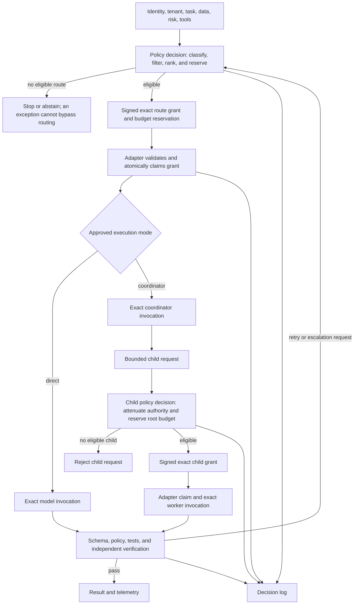

# Governed model routing and agent dispatch

Use a small, centrally governed portfolio of exact model deployments. It may
contain supplier-operated or jointly managed cloud services and, where
justified, enterprise-operated deployments in an enterprise cloud, data
center, edge site, or device. Route each request to the least-expensive
approved deployment that has demonstrated the required quality, security,
latency, availability, and tool behavior for that task class.

A capable coordinator dispatching bounded work to smaller, faster, or cheaper
workers is a useful starting hypothesis. It is not a guarantee: coordination,
duplicated context, tool calls, verification, retries, and escalation can cost
more or take longer than one capable-model call.

This page owns the durable provider-neutral control design: capability
profiles, central route decisions, route grants, strict delegation, adapter
conformance, whole-task economics, exact-deployment approval fields, and
acceptance tests. Refresh the separate
[dated model and provider candidate catalog](model-and-provider-candidate-catalog.md)
without rewriting this control contract.

!!! warning "A capability profile is not a deployment approval"
    The central policy service may resolve a profile only to an exact deployment
    whose serving-boundary ID, operating responsibility, location, tenancy,
    connectivity, artifact control, exact invocation target, model revision or
    digest, runtime/configuration revision, region, data configuration,
    processing or capacity plan, tool scope, evaluation bundle, owner, and
    review date are accepted.
    A catalog candidate, profile match, or harness setting cannot authorize a
    route.

The organization must designate exactly one named decision authority for each
routing-plan decision and each exact-deployment admission decision. Those
decisions may name different authorities. Each authority records the single
authoritative disposition and binds it to the exact plan or deployment
records, routing rules, policy and catalog revisions, scope, evidence,
conditions, expiry, and invalidation or supersession triggers. Required
business, platform, security, privacy, model-risk, and commercial roles provide
constraints, advice, or duty acknowledgements; their rows are not a vote. An
unresolved required-role blocker or conflict with controlling policy defaults
the decision to **Hold** unless the owner of that reserved decision right or a
separately authorized, policy-permitted exception resolves it. The decision
authority cannot waive a prohibition, missing required approval, or another
authority's reserved decision right. AI-generated review remains advisory.

Expiry, invalidation, blocking, or supersession stops new grants under the
affected decision and invokes its recorded revocation-epoch, in-flight,
fallback, and reassessment controls.

## Portfolio objectives

- preserve a high-capability path for ambiguous decomposition, synthesis,
  architecture, critical review, and exception handling;
- reduce cost and latency where evaluated balanced or economical workers meet
  the complete acceptance threshold;
- prevent applications, skills, coordinators, and workers from selecting
  arbitrary providers, aliases, regions, previews, or processing plans;
- make routing, delegation, verification, fallback, and escalation attributable;
- change service tier without changing the application-facing task contract;
- replace a model safely when capability, price, policy, region, or lifecycle
  changes.

## Stable capability profiles

Applications and skills request a logical profile, not a provider model name.

| Profile | Intended use | Typical constraints |
|---|---|---|
| `frontier-coordinator` | ambiguous decomposition, high-context synthesis, architecture, critical review | strongest evaluated reasoning; bounded tools; higher cost ceiling; independent verification |
| `balanced-worker` | general coding, analysis, tool use, and moderate judgment | task-specific quality floor; controlled tools; normal latency and spend |
| `economical-worker` | extraction, classification, search, transformation, and other narrow high-volume tasks | strict schema and scope; low fan-out cost; deterministic validation |
| `protected-verifier` | reject or escalate incomplete, unsafe, or unsupported worker output | protected configuration; no change-production authority; calibrated against seeded defects; advisory if model-based |
| `embedding` | governed retrieval representation | dimensionality, language, retrieval, privacy, region, and lifecycle requirements |
| `safety` | content, policy, PII, injection, or grounding checks | defense in depth only; measured false-positive and false-negative behavior |

The model gateway resolves an approved profile to an exact deployment. A skill
may narrow the profile set but cannot broaden the enterprise allowlist.

## Candidate discovery boundary

The
[dated model and provider candidate catalog](model-and-provider-candidate-catalog.md)
owns public prices, lifecycle dates, named service plans, product-specific
harness claims, and provider data statements. Treat those entries as
evaluation inputs only. An application or agent may use only the approved
deployment records selected by the policy flow below.

Preview or otherwise non-production candidates are sandbox-only by default. A
preview exception must have a named owner, bounded data and authority, stronger
monitoring, an expiration, and a tested production fallback. The exception
changes an approval record; it does not let an application or agent bypass the
policy decision or route grant.

During evaluation, measure actual time to first token, generation time, tool
time, queueing, and end-to-end p50/p95/p99. A lower per-token rate can still be
slower or more expensive if it causes longer output, more retries, or more
escalation.

## Serving boundary and final invocation enforcement

Routing consumes the independent deployment axes defined in
[deployment patterns](deployment-patterns.md#model-deployment-choices); it does
not collapse them into a `managed` or `self-hosted` label. Every exact
deployment approval must reference one immutable version of a serving-boundary
record and bind its `serving_boundary_id`, `serving_boundary_revision`, and
`serving_boundary_digest` to:

- operating responsibility: supplier-operated, jointly managed, or
  enterprise-operated;
- deployment location: supplier cloud, enterprise cloud, data center, edge, or
  device;
- tenancy, connectivity, region or site, and data path;
- artifact control and the exact model, weights, snapshot, adapter, or
  monitored mutable-service identity;
- the inference runtime image, build, configuration, quantization, safety
  policy, and cluster, namespace, node pool, accelerator or device class where
  the enterprise operates them; and
- for enterprise operation, a serving trusted computing base (TCB) that
  separates the final invocation-admission PEP identity from the
  least-privileged serving-runtime identity that may read the approved
  artifacts and use the approved accelerator, plus an authenticated,
  freshness-bounded deployment/load measurement source; and
- the exact invocation target, final model-invocation policy enforcement point
  (PEP), enforcement owner, required measurement policy, observed-state source,
  and approved cost meter.

This serving-boundary schema and the lease topology below are guide-defined
control patterns. Zero-trust, secure-delivery, and provider guidance inform
them, but no cited source mandates this exact design or proves that an
implementation is effective; adopters must apply system-specific threat
modeling, engineering, and negative testing.

| Serving path | Exclusive last-mile authority | Required bypass denial and readback |
|---|---|---|
| Supplier-operated or jointly managed service | Approved adapter or gateway holds the provider credential and controls provider-bound network egress | Workloads cannot reach the provider endpoint or credential directly; read back the provider service, account/project, endpoint, region, plan, observed model revision where exposed, monitored mutable-service record and its limitation, and provider usage record |
| Enterprise-operated deployment | Approved serving gateway, scheduler, or runtime PEP exclusively holds invocation-admission authority; a separate decision-bound runtime identity has only the artifact and accelerator access needed to serve the approved deployment | Workloads cannot reach either identity or an alternate endpoint, IPC path, embedded library, weights path, or accelerator runtime. Before admission, verify an authenticated, fresh measurement of the loaded model/weights, serving image, runtime/configuration, infrastructure location, and safety policy from the platform control plane, an attestation service, or another independently protected integrity source; runtime self-report alone is insufficient |

Both paths use the same signed route grant, audience and presenter binding,
atomic consume record, root budget, per-approval revocation epoch, single-use
invocation lease, fallback rules, and reconciliation contract. Immediately
before crossing the final model-invocation boundary, the PEP must
transactionally validate the target approval and epoch, boundary ID, revision
and digest, and required freshness-bounded observed-state measurement, then
change the lease from `issued` to `committed-to-invoke`; only then may it send,
queue, or execute the request. If an enterprise-operated runtime cannot supply
an authenticated measurement, exact-runtime enforcement is **unsupported**.
A direct in-process or embedded path that cannot enforce this contract is also
**unsupported**, not implicitly trusted.

Connected PEPs perform the authoritative live check. A disconnected or
intermittently connected PEP may operate only under a separately approved,
signed, bounded-validity policy package. The package binds the exact boundary
ID, revision and digest, deployment and epoch, PEP/device/workload
proof-of-possession key, measured runtime, monotonically increasing package
version, permitted uses, and a pre-carved non-overlapping time, token, cost,
and resource allocation. Its maximum validity cannot exceed the approved
offline revocation-exposure objective. The PEP keeps consume, invocation-lease,
package-version, epoch, and trusted-clock state in durable rollback-resistant
storage; copying the package or restoring a VM/device snapshot invalidates it.
Central policy reserves the offline allocation before issue and does not
refresh or reuse it until observed use and residual headroom reconcile.

If the platform cannot enforce that holder binding, allocation isolation,
anti-rollback state, measurement freshness, and reconciliation, disconnected
model invocation is **unsupported**. A supported package still fails closed
after expiry, exhaustion, missed refresh, measurement failure, clock
uncertainty, local-state corruption, or block uncertainty. A block is effective
for new work only after every connected PEP acknowledges the new epoch or is
independently verified drained or disabled, and every outstanding disconnected
package and lease is acknowledged, independently verified locally or physically
disabled, or expired or exhausted. An administrative status change alone is
not disablement proof; cached weights or a running local process do not
authorize another invocation.

Changing operating responsibility, location, connectivity, artifact identity,
runtime/configuration, or final PEP is a material deployment change. A
fallback or migration across serving boundaries requires its own current
deployment approval, data decision, evaluation, capacity and cost record,
adapter conformance, rollback, source-drain, and artifact/data disposition
evidence. An isolated or on-premises route never falls back to a cloud service
implicitly. Enterprise operation can increase direct control, but it also
transfers patching, model/runtime integrity, safety, capacity, reliability,
physical security, and lifecycle duties; it is not inherently safer.

## Central policy routing



The policy decision point must:

1. classify tenant, environment, data, task, risk, modality, tools, and intended
   action;
2. eliminate deployments that violate serving-boundary, operating
   responsibility, location, connectivity, provider, region, retention,
   residency, artifact, runtime, lifecycle, preview, tool, or data-use
   restrictions;
3. consider only deployments that passed the relevant task and critical-case
   evaluation;
4. rank eligible deployments using measured quality, latency, availability,
   concentration risk, and expected total cost;
5. apply per-run token, time, cost, concurrency, fan-out, retry, and delegation
   limits;
6. issue a short-lived decision containing the exact deployment and
   constraints;
7. record policy version, route, serving-boundary ID, exact model or artifact
   and runtime identity, location, region or site, processing or capacity plan,
   normalized usage and cost, latency, tools, retries, verifier, escalation,
   and outcome;
8. deny or fail safely when no deployment meets every hard constraint.

A coordinator can propose a child profile and task. The central policy layer,
not the coordinator or worker, resolves it to an exact deployment.

### Portable route-grant contract

Every model invocation and child dispatch must be authorized by a
machine-readable **route grant** issued by the central policy service. The
grant is the portable boundary between enterprise policy and a
product-specific harness adapter. Product configuration may differ, but an
adapter must not reinterpret or widen the grant.

A route grant authorizes one bounded route; it is not the complete execution,
tool-outcome, cancellation, transaction, or telemetry record. Join those
states across the root run with the
[agent execution and telemetry contract](../worksheets/agent-execution-and-telemetry-contract.md).

An illustrative payload is:

```json
{
  "schema_version": "route-grant/v1",
  "grant_id": "grant-01...",
  "decision_id": "route-01...",
  "policy_version": "routing-policy-v17",
  "issuer": "enterprise-routing-policy",
  "audience": "codex-adapter-prod",
  "sender_constraint": {
    "presenter_workload_id": "workload-research-assistant",
    "confirmation_key_thumbprint": "sha256:..."
  },
  "issued_at": "2026-07-28T17:00:00Z",
  "expires_at": "2026-07-28T17:05:00Z",
  "subject": {
    "workload_id": "workload-research-assistant",
    "tenant_id": "tenant-123",
    "parent_decision_id": "route-parent-01...",
    "parent_grant_id": "grant-parent-01...",
    "root_execution_id": "execution-root-789"
  },
  "task": {
    "task_id": "task-456",
    "class": "repository-search",
    "risk_tier": "low",
    "environment": "evaluation",
    "data_classes": ["internal"]
  },
  "route": {
    "profile": "economical-worker",
    "catalog_revision": "model-catalog-v83",
    "primary": {
      "deployment_id": "approved-deployment-42",
      "deployment_approval_id": "deployment-approval-42",
      "deployment_record_revision": "deployment-record-v9",
      "revocation_epoch": 12,
      "serving_boundary": {
        "serving_boundary_id": "serving-boundary-42",
        "serving_boundary_revision": "serving-boundary-rev-7",
        "serving_boundary_digest": "sha256:...",
        "operating_responsibility": "supplier-operated",
        "deployment_location": "supplier-cloud",
        "tenancy": "logically-isolated",
        "connectivity": "private-controlled-endpoint",
        "artifact_identity": "mutable-service-record-v9",
        "runtime_config_revision": "provider-managed-record-v4",
        "invocation_target_id": "endpoint-42",
        "final_invocation_pep_id": "model-gateway-prod",
        "required_observed_state_policy_id": "provider-readback-policy-v4"
      }
    },
    "approved_fallbacks": []
  },
  "budget": {
    "ledger_id": "routing-budget-ledger",
    "reservation_id": "reservation-012...",
    "reservation_digest": "sha256:..."
  },
  "constraints": {
    "regions": ["approved-region-1"],
    "data_scopes": ["repository:approved-repository:read"],
    "tools": ["repository.read"],
    "network_destinations": [],
    "side_effect_class": "none",
    "max_input_tokens_per_attempt": 20000,
    "max_output_tokens_per_attempt": 4000,
    "timeout_ms_per_attempt": 60000,
    "max_total_input_tokens": 30000,
    "max_total_output_tokens": 6000,
    "max_total_cost_usd_micros": 150000,
    "execution_deadline": "2026-07-28T17:04:30Z",
    "idempotency_key": "exec-789",
    "max_uses": 1,
    "max_concurrency": 1,
    "max_fanout": 0,
    "max_depth": 1,
    "max_retries": 1
  },
  "verification": {
    "output_schema_id": "repository-search-result/v2",
    "verifier_profile": "protected-verifier"
  }
}
```

The production grant format must:

- use a versioned schema inside an authenticated, tamper-evident envelope;
  verify the approved signer, algorithm, key, issuer, audience, payload
  integrity, issue and expiry times, and permitted clock skew before any model
  invocation;
- treat the envelope as sensitive authorization material. Transmit it only
  over an authenticated encrypted channel, exclude it from prompts, artifacts,
  caches, traces, and ordinary logs, and retain only the decision ID or an
  approved one-way grant hash in routine telemetry;
- bind the grant separately to an exact adapter audience and to the presenting
  workload identity and confirmation key using mTLS, DPoP, or an equivalent
  platform-enforced proof-of-possession mechanism. The adapter must verify the
  caller's proof against that holder constraint; a signature without presenter
  binding is a replayable bearer credential;
- be minted only by the policy service. Applications, models, coordinators,
  workers, and adapters may request a decision but cannot sign or alter one;
- bind workload, tenant, environment, task, data classes, exact deployment,
  deployment approval, catalog revision, revocation epoch, serving-boundary
  ID, revision, digest and axes, exact artifact and runtime/configuration
  identity, required observed-state measurement policy, invocation target,
  final PEP, region or site, tools, budgets, verifier, and parent delegation;
- treat the catalog revision as immutable decision provenance, not a
  requirement to equal the latest catalog after unrelated updates. Bind every
  primary or fallback target to its own deployment ID, approval ID, deployment
  record revision, and revocation epoch;
- scope the revocation epoch to the named deployment approval and increase it
  monotonically whenever that approval is blocked, revoked, or replaced. Stop
  issuing invocation leases when a block is requested. Declare the block
  effective only after every connected final invocation PEP acknowledges the
  new epoch or is independently verified drained or disabled, and each
  outstanding disconnected package and lease is acknowledged, independently
  verified locally or physically disabled, or expired or exhausted;
- require the final model-invocation policy enforcement point to
  transactionally compare the selected target's approval and epoch, boundary
  ID/revision/digest, and authenticated freshness-bounded deployment/load
  measurement with authoritative state and change a short-lived single-use
  invocation lease from `issued` to `committed-to-invoke`; only then may it
  send, queue, or execute the request.
  That durable lease transition is the portable linearization point, not an
  impossible transaction with every downstream managed or enterprise-operated
  runtime. A block committed first denies the attempt; an invocation committed
  first is treated as in flight. Approval-state or lease-service
  unavailability fails closed;
- cancel already-committed work when the serving boundary supports it,
  quarantine results
  that return after a block request until the owning control process decides
  their disposition, and retain their budget reservation and audit evidence;
- make the adapter or final PEP the exclusive holder of the managed-service
  provider credential or enterprise-operated invocation-admission identity.
  Give a separate decision-bound serving-runtime identity only the approved
  artifact-read and accelerator execution access. Separately restrict
  artifact-registry administration, control-plane signing/lease, update, tool,
  telemetry, and outbound-egress identities. Deny applications, models,
  workers, skills, and unapproved workloads direct access to either identity
  or to a provider, internal endpoint, DNS, loopback, IPC, socket,
  embedded-library, weights path, or accelerator runtime;
- require an authenticated freshness-bounded deployment/load measurement from
  a protected control plane, attestation service, or integrity monitor for
  enterprise-operated serving. Bind it to the boundary revision and digest,
  target, artifact, serving image, runtime/configuration, safety policy, and
  infrastructure identity. Reject stale, missing, tampered, or runtime-only
  self-reported state;
- require each child to receive a separately signed grant whose authority and
  budgets are subsets of its parent. Coordinator-produced task JSON is not an
  authorization artifact;
- bind every parent and child grant to one root execution and an atomic
  reservation in a shared aggregate budget ledger. Before issuing a child
  grant, reserve its fan-out slot, concurrency, token, retry, time, and cost
  ceilings from the root's remaining headroom; reject concurrent sibling
  requests that would exceed any root limit even when each child is
  individually valid;
- require the reservation record to bind the grant ID, parent grant and
  decision IDs, canonical root execution ID, signed allocation vector, state,
  expiry, and reservation digest. Reject a missing or mismatched binding and
  fail closed when the budget ledger is unavailable;
- distinguish per-attempt limits from total execution allocations. Primary,
  retry, and fallback attempts share the signed total token, cost, retry, and
  root-deadline allocation; an attempt must not reset those totals, and is
  rejected when remaining grant or root headroom is insufficient;
- release an expired reservation only if it was never claimed. Once claimed,
  retain its full upper bound until authoritative terminal or cancellation
  state and delayed usage or billing have settled. Quarantine permanently
  unknown outcomes for owner reconciliation or transfer to an explicitly
  approved loss reserve; never silently reuse their headroom;
- use a shared atomic consume or claim record keyed by grant ID across all
  adapter instances. Retain consumption state through expiry plus clock skew,
  reject concurrent or excess use, fail closed when the consume store is
  unavailable, and bind an allowed provider retry to the same idempotency key,
  claimed execution, and retry budget;
- allow disconnected consume only when a signed package is bound to one
  PEP/device/workload proof key and measured runtime, carries a monotonic
  version and a pre-reserved non-overlapping allocation, and updates
  rollback-resistant local package, epoch, consume, lease, and clock state.
  Clone, snapshot restore, state corruption, or allocation overlap fails closed;
  reconcile use before refresh or central reuse;
- prevent the adapter from replacing the deployment, broadening tools or data,
  increasing limits, or adding fallback routes;
- allow an unavailable deployment to use only an explicitly authorized
  fallback carrying its own signed deployment ID, approval ID, deployment
  record revision, and revocation epoch. The selected fallback must pass the
  same final invocation check and remaining-total-budget test. A cross-boundary
  fallback must carry its separately approved serving boundary and may not
  create an unapproved data transfer. If policy requires a replacement grant,
  or no listed fallback is eligible, the adapter must abstain rather than
  choose a provider or local runtime default;
- return the decision ID with the observed deployment, serving-boundary ID,
  revision, digest and axes, exact model/artifact and runtime/configuration
  identity, authenticated measurement reference and freshness result, final
  PEP, location and region/site, processing or capacity plan, normalized meter
  source, usage, total allocated cost, latency, tools, verification, fallback,
  and outcome so expected and actual execution can be reconciled;
- exclude provider credentials, model-serving identities, artifact-registry
  credentials, and sensitive prompt or result content. The grant still conveys
  authorization and must be protected accordingly.

The adapter must reject an expired, altered, over-used or replayed,
wrong-audience, wrong-presenter, wrong-tenant, wrong-workload,
authority-widening, revoked-deployment, stale-epoch, or unreserved-budget grant
before invoking a model or tool.

A retry after an ambiguous downstream result is permitted only when the
provider or tool durably enforces the same idempotency key, or the exact
operation has tested retry safety and its possible duplicate cost remains
inside budget. Consequential tool actions require owning-system transaction
status or durable idempotency; otherwise the adapter must stop and reconcile
rather than retry. After expiry or exhausted retry budget, the policy service
must issue a new decision rather than allowing grant reuse.

Use one shared conformance fixture across every supported adapter:

| Case | Expected adapter behavior |
|---|---|
| Valid grant | Invoke only the exact deployment with the recorded constraints and return required telemetry |
| Expired, altered, replayed, over-used, or untrusted signer | Reject before model invocation |
| Stolen grant presented by the wrong workload or key | Reject holder binding before model invocation |
| Concurrent presentation to separate adapter instances | Only one atomic claim succeeds; every other presentation fails closed |
| Consume or replay store unavailable | Fail closed before model or tool access |
| Direct managed-service provider call | Deny through absent provider credentials and workload egress policy; alert on the bypass attempt |
| Direct enterprise-operated PEP, serving-runtime identity, endpoint, socket, IPC, library, weights, or accelerator-runtime access | Deny through invocation-admission identity, separate runtime identity, network, process, filesystem, and runtime isolation; alert on the bypass attempt |
| Grant replayed at a different serving-boundary revision, digest, mode, or PEP | Reject the boundary, audience, target, and holder mismatch |
| Approved weights, model, adapter, image, runtime/configuration, quantization, safety policy, site, cluster, namespace, node/device class, or target changed after minting | Reject the deployment revision at final invocation and require reassessment |
| Deployment/load measurement is missing, stale, tampered, or only self-reported by the serving runtime | Reject before the invocation lease commits; alert on the integrity/readback failure |
| Block commits before the invocation lease reaches `committed-to-invoke` | The lease transition fails and no managed or enterprise-operated invocation starts |
| Invocation lease reaches `committed-to-invoke` before the block commits | Treat the attempt as in flight; stop new leases, cancel where supported, quarantine later results, and retain budget and audit evidence |
| One connected PEP misses epoch acknowledgement | Independently verify it drained or disabled; do not declare the block effective or permit stale-epoch work based on an administrative flag |
| Disconnected policy package expires, is exhausted, misses refresh, or has uncertain clock, measurement, local state, or block state | Fail closed before another invocation |
| Disconnected package or VM/device snapshot is copied, cloned, or rolled back | Reject the holder, package-version, measured-runtime, or monotonic local-state mismatch; do not reuse the offline allocation |
| Disconnected package has an overlapping allocation or un-reconciled predecessor | Reject issue or refresh and preserve the reserved headroom until authoritative reconciliation |
| Disconnected PEP is marked disabled without acknowledgement, independently verified local/physical disablement, or expiry/exhaustion of every package and lease | Keep the block pending and treat the maximum outstanding offline validity and allocation as exposure |
| Tenant, workload, task, or audience mismatch | Reject and record the mismatch without forwarding protected data |
| Model or deployment override attempt | Ignore the request and reject the invocation |
| Tool, data, budget, fan-out, depth, or retry expansion | Reject rather than clamp silently |
| Concurrent sibling grants exceed a root limit | Atomically reserve only within remaining root headroom; reject every oversubscribing request |
| Reservation has mismatched grant, parent, root, allocation, state, expiry, or digest | Reject before model access |
| Unclaimed grant expires | Release only the never-claimed reservation through the authoritative ledger |
| Grant expires during in-flight work or usage is delayed | Retain the full reservation until terminal state and usage settlement |
| Aggregate budget ledger unavailable or result permanently unknown | Fail closed; quarantine the reservation for authorized reconciliation rather than reuse |
| Approved deployment unavailable | Use only policy-authorized fallback behavior; otherwise abstain |
| Fallback changed, revoked, or crosses a serving boundary after grant minting | Reject its approval, boundary, or epoch at final invocation and require another authorized route |
| Retry or fallback lacks remaining total allocation or exceeds root deadline | Reject; do not reset per-attempt limits or borrow unreserved headroom |
| Observed route or telemetry mismatch | Fail the verification gate, alert, and preserve incident evidence |
| Ambiguous downstream result with durable idempotency | Reuse only the claimed idempotency scope within the recorded retry budget |
| Ambiguous downstream result without proven retry safety | Stop, reconcile, and require an authorized recovery decision |

## Coordinator-worker dispatch

Use a coordinator only when decomposition, specialization, isolation,
parallelism, or independent checking creates measured value.

1. The policy layer selects an approved coordinator profile.
2. The coordinator issues a bounded task with minimal inputs, output schema,
   tools, data, budget, and acceptance criteria.
3. The policy layer selects the smallest approved worker profile that passed
   that task class and atomically reserves its authority and budget from the
   root execution before issuing the child grant.
4. A protected deterministic gate accepts or rejects machine-checkable
   postconditions. A model verifier may advise, reject, or escalate but cannot
   approve a material change. Qualified humans provide consequential inputs
   within their adopted-policy authority; retaining residual risk requires one
   current category-bound decision for every policy-reserved category, and
   supporting rows are not votes.
5. An observable failure may trigger one bounded retry, a stronger profile,
   or human escalation.
6. Exhausted limits, ambiguous authority, or no eligible route fails safely.

Suitable worker tasks include repository search, extraction, classification,
test execution, documentation drafts, mechanical refactors, and evidence
collection. Production deployment, identity or access changes, destructive
migrations, risk exceptions, and material external actions retain their normal
authorization gates.

Do not rely on model-reported confidence alone. Prefer observable triggers:
invalid schema, missing evidence, failed test or policy check, insufficient
permissions, contradictory outputs, coordinator-only classification, or retry
limit exhaustion.

### Harness adapter boundary

The
[dated candidate catalog](model-and-provider-candidate-catalog.md#product-specific-harness-capabilities)
owns examples of current product configuration features. Regardless of product
semantics, each integration must consume the enterprise route grant, map only
its permitted fields to the product-specific configuration, reject unsupported
or widened constraints, and return conformance telemetry. A product-level
model override is an implementation mechanism, not a second policy authority.
Adapters must strip or allowlist product configuration fields, accept skill or
other extension sources only through their approved immutable records,
prevent unauthorized role assumption, enforce the approved final
model-invocation boundary and every separate outbound egress path, and fail
closed when a product or embedded runtime cannot represent every grant
constraint.

## Total task economics

Compare whole-task cost, not only model input price:

```text
total task cost =
  routing
  + coordination
  + input, cache reads, cache writes, and output
  + duplicated context and cache population
  + tools and grounding
  + synthesis
  + verification
  + expected retries, fallback, and escalation
  + storage, network, guardrails, and capacity commitments
  + allocated accelerator, CPU, memory, energy, facility, license,
    platform-operation, patching, and idle-resilience cost
```

For parallel work, wall-clock latency may approach routing time plus the
slowest worker plus synthesis and verification. Aggregate tokens and tool use
still increase.

Track cache reads and cache writes separately. Some services charge cache
population at a rate different from both uncached input and cache reads, so
assuming every cached token is discounted can materially understate cost.

Track quality-adjusted cost per accepted outcome, false low-tier routing,
unnecessary high-tier routing, escalation recall, retry and verifier rates,
coordination overhead, and savings against a single capable-model baseline.
The
[dated catalog arithmetic](model-and-provider-candidate-catalog.md#illustrative-price-arithmetic)
shows one refreshable price example; recalculate it from the applicable meter
before using it in a decision.

Managed-service token or request meters and enterprise-operated
capacity/resource meters must normalize into the same root-execution cost
record. A token-only estimate is incomplete for a capacity-backed route.

## Deployment approval record

For each exact deployment, record:

| Category | Required fields |
|---|---|
| Serving boundary | immutable boundary ID, revision and digest; operating responsibility; deployment location; tenancy; connectivity; region/site; data path; artifact control; exact invocation target; final invocation PEP and owner |
| Model, runtime, and serving TCB identity | provider/service/account/project for managed services; exact model/snapshot where exposed or monitored mutable-service record and limitation; for enterprise operation, separate invocation-admission and serving-runtime identities, weights/model digest, provenance and license, adapters/quantization, serving image, runtime/configuration and safety-policy digests, patch/vulnerability state, cluster/namespace/node or device class, authenticated deployment/load measurement source and maximum age; GA/preview/internal lifecycle |
| Data boundary | region or data zone, permitted classes, training use, retention, abuse monitoring, ZDR eligibility, encryption, deletion |
| Capability | task classes, context, modalities, structured output, tools, grounding, safety configuration |
| Authority | tools, MCP servers, network, data sources, side effects, and maximum autonomy |
| Service or capacity plan | processing tier or hardware/capacity pool, quota, concurrency, availability, support/on-call, rate or allocation basis, meter source, and lifecycle dates |
| Budgets | tokens, fan-out, depth, retries, time, cost per run, project and tenant ceilings |
| Assurance | evaluation bundle, critical thresholds, verifier, fallback, escalation, known limits, exception |
| Ownership | business use owner, platform owner, security/privacy review, FinOps owner, approval and expiry |
| Decision | decision ID and time; named authority and basis; routing-plan, policy, catalog, deployment-record, and evidence revisions or digests; exact scope and disposition; conditions and exception IDs; effective date, expiry, invalidation, and supersession; protected decision-evidence URI and digest |
| Operations | final-PEP and epoch acknowledgement, route telemetry, exact-boundary revision/digest and authenticated-measurement readback, artifact/runtime drift, change monitoring, emergency block; for disconnected packages, exact holder/device/runtime binding, rollback-resistant local state, non-overlapping allocation, maximum offline revocation exposure, disablement proof, expiry/exhaustion and reconciliation; fallback, cross-boundary migration, source drain, and next review |

## Acceptance tests

A production route must demonstrate:

- parent and child profiles can be configured independently;
- serving-boundary, data, provider, location, region/site, retention, artifact,
  runtime, tool, and authority constraints propagate to every child;
- a child cannot select an unapproved model, provider, serving boundary,
  location, artifact/runtime revision, preview, or region;
- the actual serving-boundary ID/revision/digest, model/artifact,
  runtime/configuration, authenticated measurement and freshness result, final
  PEP, location, region/site, plan or capacity, normalized usage, total cost,
  latency, tools, and outcome are observable;
- fan-out, recursion, concurrency, retries, duration, and spend have enforced
  ceilings;
- cancellation terminates or accounts for outstanding child work;
- the verifier rejects seeded incomplete, incorrect, and unsafe outputs;
- fallback and stronger-model escalation are explicit and bounded;
- when no route is eligible, the system abstains or fails safely rather than
  using an uncontrolled provider, local-runtime, or cross-boundary fallback;
- shadow and progressive production evaluation meet the complete task,
  critical-case, safety, authorization, latency, reliability, and cost
  thresholds.

Use the
[model routing and agent dispatch plan](../worksheets/model-routing-and-agent-dispatch-plan.md)
to record the decision.

## Supplier, artifact, and data-boundary admission

The
[dated provider statements](model-and-provider-candidate-catalog.md#provider-data-boundary-statements)
are discovery evidence, not control operation. For every exact deployment,
validate the current contract, settings, feature-specific data behavior,
processing locations, logs, and negative tests against the approved data and
obligation records. For enterprise-operated deployments, also validate model
and runtime provenance, license, integrity, patch state, serving isolation,
capacity, support, and disposal. A provider statement, catalog row, or
self-hosting label cannot satisfy that gate.
