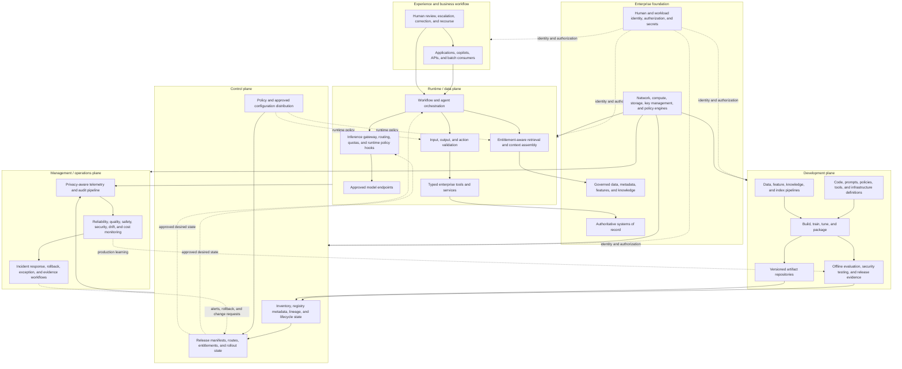
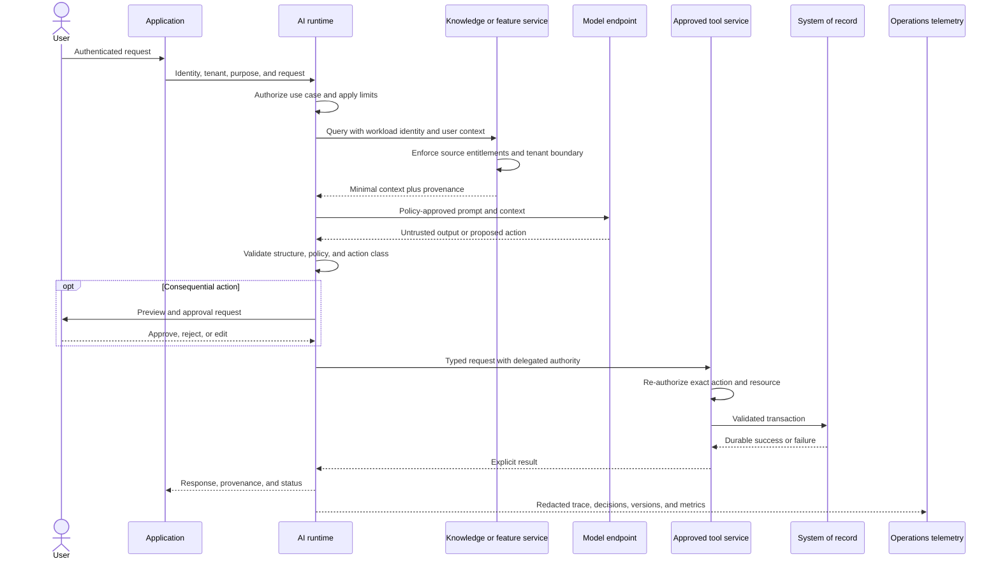

# Reference architecture

The reference architecture defines enterprise capabilities, planes, and trust
boundaries. It is not a mandate for one product, cloud, model, or deployment
topology. Use it to assign responsibility, make data and authority flows
explicit, and identify evidence needed to operate an AI system safely.

The planes are logical separations. They may share infrastructure in a small
deployment, but their identities, permissions, change paths, and failure domains
should remain distinguishable.

## Enterprise capability view

This view deliberately separates four concerns:

- the **runtime/data plane** handles user, application, and batch requests;
- the **development plane** produces candidate artifacts and evidence;
- the **control plane** distributes approved desired state and records lifecycle
  metadata;
- the **management/operations plane** observes behavior and coordinates
  operational response.

Governance is not a software plane. Adopted policy designates one named,
category-bound residual-risk decision authority for each required decision
record. Review processes supply required discipline inputs, not votes; a
majority cannot create authority. Control-plane services record and enforce
those attributable decisions, but a registry does not approve an artifact by
itself.

## Plane responsibilities

### Runtime / data plane

The runtime/data plane is the production serving path. It should:

- authenticate the initiating human or workload and preserve tenant and purpose;
- authorize use-case access before accepting a request;
- apply approved capability profiles, exact model routes, limits, and policies;
- retrieve only entitled, task-relevant context;
- validate model output before display or downstream use;
- authorize every tool action independently of the model's request;
- isolate request, conversation, tenant, and agent state;
- fail safely when identity, policy, model, retrieval, or tool dependencies are
  unavailable.

Keep broad administrative capabilities out of the runtime identity. A model may
propose an action, but deterministic services must validate its schema, policy,
authority, and business invariants.

### Development plane

The development plane covers experimentation, data preparation, feature and
knowledge pipelines, training or tuning, prompt and policy development,
evaluation, security testing, and packaging. It should:

- use isolated environments with explicit data and model access;
- make builds and evaluations reproducible from versioned inputs;
- prevent production credentials and unrestricted production data from entering
  experimentation;
- keep evaluation holdouts separate from tuning;
- produce immutable or content-addressed candidate artifacts;
- attach lineage, limitations, test results, and dependency metadata to each
  candidate.

Development access must not imply permission to release. Promotion should use a
separate workload identity and an authorized, auditable workflow.

### Control plane

The control plane manages approved desired state rather than carrying ordinary
inference payloads. Typical capabilities include:

- inventory and lifecycle metadata for use cases, models, prompts, policies,
  data, indexes, skills, plugins, hooks, MCP servers, tools, route profiles,
  prices, and evaluation suites;
- approved release manifests that bind compatible artifact versions;
- policy, route, quota, region, and rollout configuration;
- approval and exception records produced by accountable review workflows;
- environment promotion and rollback state;
- revocation of models, tools, connectors, credentials, or releases.

The control plane admits exact extension and model-deployment records, using
immutable identifiers where exposed and explicit monitored records for
provider-managed mutable services; it does not trust a marketplace listing or
model alias. Use
[agent extension supply-chain security](../security/agent-extension-supply-chain.md)
and [governed model routing and agent dispatch](model-portfolio-and-routing.md) for
the corresponding admission and route decisions.

Control-plane availability requirements differ from runtime requirements. A
runtime may continue briefly on a last-known-good signed configuration, but
only inside a separately approved, low-consequence, time-bounded envelope.
Last-known-good state cannot mint or renew a grant, widen authority, bypass
current revocation, reserve unavailable aggregate budget, claim an unavailable
consume record, or authorize a new managed-service or enterprise-operated
model invocation or consequential tool egress.
Revocation and emergency-stop paths need defined propagation objectives.

### Management / operations plane

The management/operations plane receives signals from the other planes. It
should support:

- correlated reliability, quality, safety, security, outcome, and cost signals;
- immutable or tamper-evident audit events for consequential actions;
- drift, abuse, data-quality, quota, and anomalous-spend detection;
- incident, complaint, appeal, exception, and rollback workflows;
- operating-effectiveness evidence and periodic review;
- privacy-aware production sampling and feedback into evaluation.

Do not copy sensitive prompts, retrieved content, or outputs into telemetry by
default. Classify fields, minimize content, separate operational metrics from
restricted review samples, and apply redaction, encryption, access control,
retention, and audit.

Use the
[agent execution and telemetry contract](../worksheets/agent-execution-and-telemetry-contract.md)
to bind root and child state, typed effects, expected events, minimization,
pipeline failure behavior, alerts, reconciliation, and closure without
treating an audit event as authorization or authoritative business state.

### Enterprise foundation

The foundation supplies shared identity, data governance, network, compute,
storage, key management, secrets, systems of record, and enterprise policy
services. AI-specific controls should extend these capabilities rather than
creating an independent security or data-governance island.

## Request and authority flow

Not every request uses retrieval, a tool, or human approval. When those
capabilities are present, the corresponding trust boundary remains mandatory.

## Capability responsibilities

| Capability | Primary plane | Responsibility | Important evidence |
|---|---|---|---|
| Experience and workflow | Experience | User intent, disclosure, recourse, accessibility, and business outcome | UX tests, workflow metrics, user feedback |
| Orchestration | Runtime | State, sequencing, retries, timeouts, tool selection, and human checkpoints | Execution traces, state transitions, failure tests |
| Inference gateway | Runtime | Model access, routing, quotas, request policy hooks, and provider abstraction | Access logs, route decisions, service-level metrics |
| Retrieval | Runtime | Entitlement-aware search, context minimization, freshness, and provenance | Retrieval traces, source permissions, deletion and freshness tests |
| Tool layer | Runtime | Narrow, typed actions into enterprise services | Tool contracts, authorization logs, idempotency and compensation tests |
| Model services | Runtime | Inference under approved data-handling, region, capacity, and version conditions | Provider review, model documentation, route and version inventory |
| Build and training | Development | Reproducible code, prompt, model, feature, and index production | Build manifests, dataset lineage, artifact signatures |
| Evaluation | Development and operations | Offline, pre-release, online, and incident-driven testing | Test sets, thresholds, results, waivers, production samples |
| Inventory and registry metadata | Control | Lifecycle state, dependencies, lineage, approval records, and revocation state | Approval history, versions, dependency graph |
| Policy and release management | Control | Approved bundles, routes, limits, rollout, rollback, and exception state | Signed release manifest, policy version, deployment history |
| Observability and response | Management | Technical, quality, safety, security, cost, outcome, and incident signals | Dashboards, alerts, audit trail, exercises |
| Enterprise foundation | Foundation | Data governance, IAM, secrets, network, compute, storage, and keys | Platform control evidence |

## Non-negotiable trust boundaries

1. **User to application:** authenticate identity, bind tenant and purpose, and
   communicate AI use and recourse where appropriate.
2. **Application to runtime:** authorize the requested use case, not merely
   access to an endpoint.
3. **Runtime to data:** re-check source entitlements at request time; do not rely
   on indexed content or a prior session alone.
4. **Runtime to model:** enforce serving-boundary revision/digest,
   data-handling, region/site, route, quota, model/artifact and runtime
   identity, authenticated state measurement, and logging policy at the final
   invocation boundary.
5. **Model output to application or action:** treat output as untrusted input;
   validate format, evidence, policy, and business rules.
6. **Runtime to tool:** use workload or delegated identity, authorize each action
   and resource, constrain parameters, and prevent replay.
7. **Tool to system of record:** enforce business invariants in the owning
   service and return an explicit transaction state.
8. **Development to control:** promote only versioned artifacts with required
   evidence; prevent self-approval and direct production writes.
9. **Control to runtime:** authenticate configuration, verify integrity, and
   define propagation and last-known-good behavior.
10. **Runtime to management:** minimize and protect content while preserving
    enough correlation for operations, assurance, and incident response.
11. **Tenant to tenant:** isolate identity, state, cache, retrieval, tools,
    telemetry, and encryption context; test both direct and inferred leakage.
12. **Enterprise to third party:** enforce contractual, network, identity, data,
    region, retention, incident, and exit requirements.

## Deployment, tenancy, and resilience

### Choose topology on explicit axes

Do not treat "hosted," "managed," and "self-hosted" as complete architecture
categories. Record decisions across independent axes:

| Axis | Example choices |
|---|---|
| Operating responsibility | provider-operated, jointly managed, enterprise-operated |
| Deployment location | provider service, enterprise cloud account, data center, edge or device |
| Tenancy | shared logical tenancy, dedicated service, dedicated infrastructure |
| Connectivity | public controlled endpoint, private connectivity, isolated or disconnected |
| Region | single region, active-passive regions, active-active regions |
| Artifact control | provider-selected model, pinned revision, enterprise-owned weights |
| Data path | direct request, gateway-mediated, local preprocessing, no external data transfer |

The choice should follow data classification, latency, availability, regulatory,
capacity, operational-skill, and exit requirements rather than a blanket
preference for one topology. Carry the selected axes into one exact
decision-bound serving-boundary record; a label such as "cloud," "on-premises,"
or "self-hosted" is not a sufficient route approval.

### Environment and tenant isolation

- separate experimentation, build, test, staging, and production identities and
  data paths;
- prohibit implicit promotion through mutable tags or provider aliases;
- bind cache keys, conversation state, vector namespaces, encryption context,
  quotas, and telemetry to tenant and use case;
- use stronger physical or account-level isolation when logical isolation cannot
  meet the impact or regulatory requirement;
- test cross-tenant retrieval, state reuse, shared throttling, observability
  access, and support tooling;
- document which operators and provider personnel can cross an isolation
  boundary and how that access is approved and audited.

### Resilience and recovery

Define end-to-end objectives for availability, latency, recovery time, recovery
point, data and index freshness, configuration propagation, and safe degradation.
The design should address:

- provider, model, region, network, identity, data, index, and tool failures;
- timeouts, bounded retries, idempotency, queues, backpressure, rate limits, and
  concurrency controls;
- last-known-good policy and release configuration, with emergency revocation;
- fallback to a compatible model, deterministic workflow, read-only mode, human
  queue, or safe refusal;
- backup and rebuild procedures for metadata, release manifests, workflow state,
  feature stores, and indexes;
- dependency capacity, quotas, failover warm-up, and correlated provider risk;
- periodic recovery and failover exercises using representative workloads.

Model substitution is not automatically safe. A fallback model may differ in
quality, context length, safety behavior, tool syntax, regional availability,
and terms. Evaluate each supported route and bind it to an approved release
manifest.

## The system-of-record rule

Probabilistic output, conversation memory, a vector index, or an agent's internal
state must not become the accidental authoritative record for a business entity
or transaction. An AI system may prepare a transaction, but the owning service
must:

- authenticate the caller;
- authorize the exact action and resource;
- validate schema and business rules;
- prevent replay or duplicate execution;
- apply concurrency and transaction controls;
- emit a durable audit event;
- return an explicit success or failure state.

This boundary is a principal containment mechanism for tool-using systems. It
also makes correction, reconciliation, rollback, and independent audit possible.

## Architecture evidence

For each production system, retain or link:

- a current context, component, data-flow, deployment, and trust-boundary view;
- the use-case classification and named business, technical, data, and assurance
  owners;
- identities, permissions, network routes, tenant boundaries, and third-party
  dependencies;
- release manifests and artifact lineage;
- non-functional objectives and capacity assumptions;
- failure, fallback, recovery, and rollback tests;
- monitoring, incident, exception, and periodic-review evidence.

Use the [data architecture](data-architecture.md) for data and knowledge
decisions, the [deployment patterns](deployment-patterns.md) for use-case pattern
selection, and the [production readiness review](../worksheets/production-readiness-review.md)
as the release evidence index. Use the
[transfer, decommissioning, and retirement record](../worksheets/transfer-decommissioning-and-retirement.md)
for successor, disposition, removal, readback, residual, and reopen evidence.
The
[fictional procurement-evidence golden thread](../examples/worked-golden-thread.md)
shows how the planes, system-of-record boundary, route decisions, release
manifest, observed-state readback, incident, and retirement records connect.
