# MLOps, LLMOps, and AgentOps

MLOps, LLMOps, and AgentOps are extensions of secure software delivery for different AI artifacts and behavior. A coherent enterprise pipeline should manage them through shared release, evidence, and operations contracts rather than isolated toolchains.

## Artifact model

Track these independently:

| Artifact | Examples | Key controls |
|---|---|---|
| Code and infrastructure | application, runtime, IaC, containers | review, build provenance, scanning, deployment |
| Data | training, validation, evaluation, retrieval, feedback | ownership, lineage, quality, access, retention |
| Model | base, fine-tune, adapter, quantized artifact | provenance, license, evaluation, signing, approval |
| Prompt and policy | system prompts, templates, guardrail rules | version, tests, change impact, rollback |
| Knowledge | chunker, embedding, index, graph, source snapshot | ACL, freshness, deletion, retrieval evaluation |
| Tool and workflow | schemas, connectors, state machines | ownership, authorization, side effects, compatibility |
| Agent extension | skill, plugin, hook, helper, MCP server, startup command | full-package admission, authority diff, sandbox test, runtime policy, revocation |
| Model route | capability profile, exact deployment and serving boundary, router policy, fallback | operating responsibility, location, artifact/runtime identity, data/region allowlist, final invocation enforcement, task evaluation, total cost, lifecycle, telemetry, emergency block |
| Evaluation | cases, graders, rubrics, thresholds | independence, holdout protection, calibration, history |

## Shared delivery pipeline

```mermaid
flowchart LR
    Source["Controlled sources"] --> Build["Reproducible build"]
    Build --> Verify["Integrity and security checks"]
    Verify --> Evaluate["Task, impact, and failure evaluation"]
    Evaluate --> Evidence["Release evidence"]
    Evidence --> Approve["Authorized decision"]
    Approve --> Deploy["Progressive deployment"]
    Deploy --> Observe["Outcome and operations"]
    Observe --> Promote["Promote, hold, or roll back"]
```

The pipeline should produce a release manifest connecting all deployed artifact revisions to evaluation results, approvals, known limitations, and rollback targets.

Use the canonical [code deployment and release](code-deployment.md) procedure
to assign repository and release ownership, build enterprise-produced
artifacts once, promote the approved release manifest through protected
environments, record mutable dependencies, verify the deployed state, and
choose rollback, forward recovery, or compensation.

## MLOps

MLOps adds:

- experiment tracking;
- reproducible feature and dataset generation;
- training and validation pipelines;
- model and feature registries;
- batch and online serving;
- champion/challenger comparison;
- data, concept, performance, and impact drift;
- governed retraining.

Retraining is a new release, not routine maintenance. It can change subgroup behavior and business impact even when code is unchanged.

## LLMOps

LLMOps adds:

- provider and model catalog;
- prompt and policy management;
- retrieval and index pipeline;
- evaluation of open-ended output;
- model routing and fallbacks;
- safety and abuse testing;
- token, latency, and cost observability;
- provider alias and behavior-drift monitoring.

Separate retrieval quality, context assembly, generation quality, and workflow success so failures can be diagnosed.

## AgentOps

AgentOps adds:

- skill, extension, tool, agent, and model-route registries;
- identity delegation and credential lifecycle;
- workflow and memory schemas;
- trajectory and side-effect evaluation;
- simulation and test doubles;
- step, time, tool, and spend budgets;
- pause, cancel, compensation, and kill switches;
- trace replay and partial-failure recovery.

Version the allowed topology, tools, permissions, delegation rules, and maximum autonomy as part of the release.
Reconcile dynamic tool schemas and actual model routes with the approved
release. Use the
[agent extension supply-chain](../security/agent-extension-supply-chain.md)
and [model routing](../architecture/model-portfolio-and-routing.md) patterns.

## Change classification

Classify change by behavioral and operational impact, not file size or semantic-version label.

Material changes may include:

- model behavior or provider data terms;
- prompt, policy, tool, or routing changes;
- source, chunking, embedding, or index changes;
- feature or label definitions;
- autonomy, permissions, regions, or affected population;
- evaluation method or threshold;
- infrastructure that changes isolation or resilience.

Low-risk changes can follow an automated path only when bounded scope, regression coverage, and rollback have been demonstrated.

## Environment promotion

- use separate identities, data, and infrastructure for development, evaluation, staging, and production;
- prohibit direct promotion from personal experiments;
- evaluate with production-representative but governed data;
- carry immutable release manifests between environments;
- require environment-specific policy and capacity checks;
- do not rebuild a different artifact after approval;
- verify post-deployment versions and behavior.

## Continuous evaluation

Run:

- fast component checks on every change;
- integration and security checks before merge;
- representative scenario evaluation for a release candidate;
- independent or high-assurance review for consequential systems;
- canary and online evaluation after deployment;
- scheduled regression against current dependencies;
- incident-driven additions to protected test sets.

Prevent teams from tuning repeatedly against a release holdout. Measure grader agreement and drift when automated evaluators are used.

## Rollback and forward recovery

Rollback units include code, infrastructure, model, prompt, policy, index, tool, and workflow schema. Verify compatibility between versions; rolling back one component may not restore the system if state or other artifacts changed.

For stateful or side-effecting workflows, define forward recovery and compensation in addition to artifact rollback.

## Evidence automation

Automate collection of:

- source and build provenance;
- dependency and vulnerability results;
- artifact checksums and signatures;
- data and model lineage;
- test and evaluation results;
- approvals and exceptions;
- deployment and configuration state;
- production monitoring and incidents.

Automation improves freshness but does not make an irrelevant control effective. Owners must review evidence and act on failure.
