# Predictive machine learning

Predictive ML classifies, ranks, forecasts, detects, or recommends. Its architecture differs from generative AI because behavior depends heavily on training data, feature pipelines, labels, decision thresholds, and feedback from the operational process.

## Reference lifecycle

```mermaid
flowchart LR
    Sources["Authoritative sources"] --> Features["Validated features"]
    Labels["Labeling and outcomes"] --> Dataset["Versioned dataset"]
    Features --> Dataset
    Dataset --> Train["Reproducible training"]
    Train --> Validate["Technical and impact validation"]
    Validate --> Registry["Model registry"]
    Registry --> Deploy["Batch or online deployment"]
    Deploy --> Decisions["Decision workflow"]
    Decisions --> Outcomes["Observed outcomes"]
    Outcomes --> Monitor["Performance, drift, and impact"]
    Monitor --> Labels
```

Keep historical point-in-time correctness: training features must represent what would have been known at prediction time. Prevent target leakage, future leakage, and train-serving skew.

## Data and feature architecture

Document:

- source owner, permitted purpose, population, time range, and sampling;
- label definition, collection process, uncertainty, and reviewer agreement;
- feature meaning, transformations, freshness, lineage, and sensitivity;
- missingness, outliers, duplicates, imbalance, and subgroup coverage;
- point-in-time joins and leakage controls;
- training, validation, test, and sequestered holdout boundaries;
- retention, deletion, consent, and reproducibility constraints.

A feature store can improve reuse and consistency, but it also concentrates sensitive derived data. Enforce ownership, tenant isolation, offline/online consistency, deletion, and access policy.

## Training and experiment management

Record:

- source code and environment;
- algorithm, initial model, and hyperparameters;
- dataset and feature versions;
- random seeds and nondeterministic limitations;
- compute environment and resource use;
- training metrics and artifacts;
- experiment owner and intended decision context.

Separate exploration from controlled training. Production candidates should be produced by a reproducible pipeline using protected identities and trusted artifacts.

## Validation

Evaluate:

- discrimination metrics appropriate to the task;
- calibration and confidence;
- threshold behavior and business cost;
- subgroup performance and fairness;
- robustness to missing, shifted, or adversarial inputs;
- explainability appropriate to affected users and reviewers;
- stability over time and across locations;
- comparison with the current process and simpler baselines;
- human use, automation bias, override, and recourse.

Aggregate accuracy can conceal unacceptable critical or subgroup behavior. Document threshold selection and the consequences of false positives and false negatives.

For consequential models, validation should be organizationally independent from model development to the degree required by policy.

## Batch and online serving

### Batch

Use for periodic scoring when freshness and latency permit. Control:

- input snapshot and output version;
- partial reruns and duplicate prevention;
- stale-score expiration;
- downstream consumption and correction;
- completion, quality, and reconciliation checks.

### Online

Use for synchronous decisions where current data and latency matter. Control:

- feature freshness and online/offline parity;
- request validation and fallback;
- capacity, timeout, and dependency failure;
- model and threshold version;
- decision logging and post-outcome linkage.

The consuming business service owns the final decision invariant and should handle unavailable or abstaining models safely.

## Release

Use shadow evaluation, canary, A/B tests with ethical safeguards, or champion/challenger deployment. Do not let an experimental model create unapproved differential treatment.

Pin immutable model and feature revisions where possible. Release criteria should cover technical performance, impact, security, reliability, and business outcome.

## Monitoring and retraining

Distinguish:

- **data drift:** input distribution changes;
- **concept drift:** relationship between input and outcome changes;
- **prediction drift:** output distribution changes;
- **performance drift:** measured outcome quality changes;
- **operational drift:** workflow, policy, or user behavior changes.

Monitor feature quality, prediction distribution, calibration, subgroup metrics, delayed outcomes, overrides, complaints, and downstream effects. A drift alert does not automatically justify retraining.

Retraining requires:

- an approved trigger and data window;
- protection against corrupted feedback loops;
- dataset and label quality review;
- full regression and impact evaluation;
- controlled promotion and rollback;
- reassessment when purpose, population, features, or consequences change.

## Feedback loops

Predictions can change the world from which future labels are collected. Examples include selective lending, fraud investigation, content ranking, and predictive maintenance. Track who receives an intervention, what remains unobserved, and whether the system reinforces historical policy or bias.

Use experimental or causal methods where ordinary outcome labels are distorted by prior predictions.

## Retirement

Stop new scoring, identify downstream consumers, expire cached predictions,
remove endpoints and schedules, revoke access, preserve required records, and
decide whether training data and artifacts must be retained, transferred,
sanitized, or archived. Ensure business workflows have a safe replacement and
record the authoritative decisions and readback in the
[transfer, decommissioning, and retirement record](../worksheets/transfer-decommissioning-and-retirement.md).
