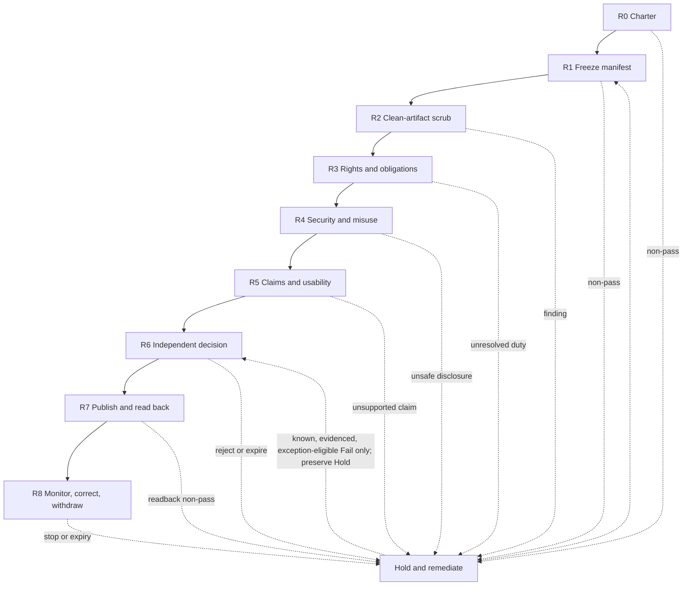

# Public release and external distribution

External distribution moves an artifact beyond an established access
boundary. It includes a public repository or website, an open-source package,
a model or adapter, a dataset or index, a prompt or policy bundle, a skill or
MCP package, an evaluation set, a paper supplement, a public dashboard, and
demo media.

This gate supplements [code deployment and release](code-deployment.md). A
release that is safe for one controlled production environment is not
automatically safe or authorized for unrestricted distribution. Use the
[public-release readiness record](../worksheets/public-release-readiness.md)
for the exact artifact and distribution event.

!!! danger "Fail closed"
    Hold the release while the distribution unit is undefined, a required
    owner is absent, an organization-defined release-blocking or
    highest-severity finding remains open, a secret or prohibited record is
    present, rights or applicable obligations are unresolved, coordinated
    vulnerability disclosure is incomplete, or the required approval or valid
    exception is missing. Automated and AI reviews are advisory; they cannot
    independently approve publication.

## Why this is a separate gate

Public release can make source history, workflow logs, examples, model
behavior, data, and operational assumptions available to unknown recipients.
Copies can persist in clones, forks, caches, archives, package registries, and
mirrors after the publisher removes the canonical copy. Takedown can reduce
continued exposure; it cannot guarantee erasure.

Apply the gate to:

- a new distribution channel;
- a private-to-public visibility change;
- the first public version of an existing internal artifact;
- a materially changed audience, license, dataset, model, capability, or use;
- a new public release after a security, privacy, rights, or trust incident;
- transfer, archival, deprecation, or withdrawal of a public artifact.

Customer, partner, consortium, and broad internal distribution may use the
same gate with controls proportionate to the actual audience and contract.
Calling a channel “controlled” does not remove the need to identify its
recipients, onward-sharing rights, retention, and revocation limits.

## Decision rights

Name the roles before preparing the artifact. The baseline path keeps the
qualified independent decision separate from the person or agent that
produced the material change. If adopted organization policy expressly
permits an exception, record a separate governance exception rather than
mislabeling owner acceptance as independent approval.

| Role | Required decision or duty |
|---|---|
| Content or product owner | Purpose, intended audience, claims, limitations, AI-assistance disclosure, and release value |
| Repository or artifact owner | Exact distribution unit, source history, dependencies, build, retention, versioning, and lifecycle |
| Data and privacy owner | Personal, confidential, licensed, derived, telemetry, deletion, residency, and affected-person treatment |
| Security and vulnerability owner | Threat exposure, secret handling, dual-use review, coordinated disclosure, incident path, and safe examples |
| Legal, intellectual-property, and trade-compliance owner | Applicable law, contract, license, attribution, redistribution, export, sanctions, and record duties |
| Responsible-AI or risk owner | Required input on affected people, misuse, transparency, recourse, and reassessment; link current category-bound residual-risk decision IDs when policy requires them, without assuming blanket acceptance authority |
| Distribution operator | Protected publication, immutable artifact promotion, public readback, rollback, and channel controls |
| Support, incident, and takedown owner | Intake, service expectations, correction, notification, withdrawal, and end-of-life response |
| Qualified independent approver | Go, hold, reject, or condition decision for the exact reviewed artifact |
| Exception authority, if policy permits | Decide whether the documented scope, rationale, compensating controls, owner, and expiry satisfy the adopted exception policy |

The legal and compliance owners determine which jurisdictions, actor roles,
contracts, and organization policies apply. This guide does not make that
determination or confer a right to distribute.

## Define the exact distribution unit

The release manifest must enumerate everything a recipient or the public
channel can access, not only the files intended for a landing page:

- source revision, reachable history, branches, tags, releases and release
  assets, Git LFS pointers and objects, submodules, issues, discussions, pull
  requests, wikis, and repository metadata;
- build workflow, action history, job summaries, logs, artifacts,
  attestations, and environment or package metadata exposed by the channel;
- generated site, documentation, examples, downloadable archives, containers,
  binaries, scripts, install hooks, and dependencies;
- models, adapters, weights, tokenizers, configuration, model cards, and
  evaluation reports;
- datasets, labels, features, embeddings, indexes, benchmarks, and synthetic
  or transformed records;
- prompts, system policies, guardrails, skills, tool or MCP manifests,
  schemas, helper code, and default permissions;
- screenshots, audio, video, diagrams, sample traces, telemetry, and support
  records;
- license or reuse terms, copyright and attribution notices, source offers,
  security policy, support scope, claims, limitations, and end-of-life terms;
- canonical URL, registry coordinates, version, digest, signing or attestation
  identity where used, and the last known-good or withdrawal target.

Assign each item one explicit mode: **public bytes**, **public metadata or
card only**, **controlled access**, or **private and blocked**. An omitted item
does not default to public. Preserve evaluation holdouts, security-sensitive
detail, private source material, and restricted data behind an access boundary
when disclosure would defeat their purpose or authority.

For a repository visibility change, inspect platform-specific consequences
before approval. As checked on 2026-07-28, GitHub's current documentation
states that changing a private repository to public makes its code and
Actions history and logs visible to everyone, allows anyone to fork it, and
disables **all push rulesets**. GitHub also documents activity, star, watcher,
and fork-network effects. Treat the change as a control transition: do not
assume private-state protections survive it. Record the resulting rule state,
then re-establish or replace and test the intended review, required-check,
bypass, and push protections before relying on the public repository as a
governed source. Review the
[current visibility warnings](https://docs.github.com/en/repositories/managing-your-repositorys-settings-and-features/managing-repository-settings/setting-repository-visibility)
for the exact repository and plan rather than relying on a prior checklist.

If private history cannot be cleared safely, publish a clean, separately
owned distribution artifact rather than changing the visibility of the
working repository. Record how that artifact is derived and how corrections
will flow without exposing the private source boundary.

## Release gate

| Gate | Required outcome | Minimum evidence | Hold when |
|---|---|---|---|
| **R0 Charter** | Purpose, audience, channel, reuse intent, owner, support model, and materiality are explicit | Release request and accountable roles | Audience, channel, or decision authority is ambiguous |
| **R1 Freeze manifest** | One candidate enumerates every exposed artifact, surface, history, dependency, and channel configuration | Manifest, source revision, artifact digest, history scope, and inventory diff | The reviewed unit can change without invalidating the decision |
| **R2 Clean-artifact scrub** | The exact candidate and exposed metadata are inspected for secrets, private material, personal data, hidden content, malicious behavior, and unsafe links | Clean-build record, scan results, manual review, findings, and remediation | A prohibited item or organization-defined release-blocking finding remains |
| **R3 Rights and obligations** | Distribution, modification, hosting, data, model, media, attribution, notice, export, sanctions, contract, records, and privacy duties are resolved | Current [regulatory obligation register](../worksheets/regulatory-obligation-register.md) snapshot, exact-artifact rights record, selected terms, notices, and owner decisions | Authority to distribute or satisfy an applicable duty is unresolved |
| **R4 Security and misuse** | Threat disclosure, vulnerable examples, dangerous capability, dual use, supply chain, and recipient abuse are assessed and treated | Threat review, coordinated-disclosure record, safe-example review, and residual-risk decision | Release would expose a live secret, bypass, unremediated vulnerability, prohibited capability, or unsafe default |
| **R5 Claims and usability** | Claims are measured and dated; limitations, AI assistance, provenance, accessibility, support, and reporting paths are usable | Claim-to-evidence map, limitation notice, accessibility result, security and support contacts | A material claim is misleading, evidence is stale, or essential access and reporting paths fail |
| **R6 Decision or governed exception** | Required owners and a qualified independent approver decide on the frozen candidate; if adopted policy expressly permits, a named human governance authority may instead accept a scoped time-bounded exception | Attributable independent approval, or a clearly labeled policy-permitted exception, bound to the digest | The required decision is missing or applies to another revision; an approval is self-issued; or an exception lacks authority, scope, controls, owner, or valid expiry |
| **R7 Publish and read back** | A protected identity publishes the decision-bound candidate and verifies the public result | Publication log, observed URL or registry state, digest, navigation/download checks, and rollback result | The public artifact, metadata, permissions, or behavior differs from the decision-bound candidate |
| **R8 Monitor, correct, withdraw** | Reports, mirrors, source drift, obligations, vulnerabilities, misuse, support, correction, takedown, and retirement have owners and triggers | Monitoring record, intake path, incident/CAPA links, withdrawal exercise, and next review | Ownership lapses, a stop condition fires, or the artifact can no longer be supported safely |

## R0–R5 result semantics

The readiness record is the authoritative result index; its checklists are
review prompts. Record every prescribed R0–R5 control row as **Pass / Fail /
N/A / Unknown / Stale**. All applicable R0–R5 control rows must be **Pass**.
N/A is satisfied only by a dated applicability test, rationale, accountable
owner, and evidence or policy basis proving that the trigger is absent.
Missing evidence, owner, review capacity, or unresolved applicability is not
N/A.

A blank, omitted, conflicting, expired, or unbound result is **Unknown** or
**Stale**, not an implicit Pass. Any **Fail**, **Unknown**, or **Stale** result
forces Hold and forbids a publication-ready candidate status. Summarizing a
gate as complete does not override a non-pass control row.

Only R6 may decide a policy-permitted exception to a known, evidenced,
exception-eligible Fail. The exception cannot change the underlying R0–R5
result, backfill missing evidence, or make the candidate publication-ready.
Unknown, Stale, blank, unjustified N/A, non-exception-eligible, prohibited,
highest-severity, and organization-defined release-blocking results must be
resolved or rerun.

Each organization should convert these outcomes into enforceable policy for
its channels. A completed form is evidence of a decision, not proof that every
control is effective or every legal duty is satisfied.

## R2: Clean-artifact scrub

Build or assemble the candidate from the intended immutable source in a clean
environment. Scan and manually inspect the exact distributable object and all
metadata the channel will expose. A scan of the developer's current directory
is not an equivalent control.

### Content and data

- secrets, tokens, credentials, cookies, private keys, connection strings,
  signing material, and credentials embedded in history or examples;
- customer, employee, contributor, or other personal and confidential data;
- private prompts, system or developer instructions, raw transcripts, hidden
  reasoning, support cases, internal decision records, and unapproved traces;
- internal hostnames, paths, account or tenant identifiers, ticket numbers,
  email addresses, private links, nonpublic source names, and environment
  topology;
- comments, front matter, hidden text, bidirectional or confusable Unicode,
  attachment content, image or media metadata, generated source maps, and
  archived or deleted-but-reachable history;
- training, evaluation, feedback, retrieval, memory, cache, index, and
  telemetry records that were not approved for the public purpose;
- drafts, unrelated files, raw research captures, licensed standards text, or
  third-party material outside the approved distribution unit.

### Executable and supply-chain behavior

- binaries, serialized models, macros, notebooks, install or build scripts,
  hooks, background processes, generated files, and auto-executing examples;
- skills, plugins, MCP servers, tools, startup commands, requested
  permissions, network destinations, bundled helpers, and transitive
  dependencies;
- dynamic download, shell construction, `eval`-like behavior, obfuscation,
  encoded payloads, unexpected upload or telemetry, and repository poisoning;
- workflow permissions, untrusted triggers, artifact paths, publishing tokens,
  mutable dependencies, package names, and registry namespace ownership;
- vulnerability, malware, dependency, license, provenance, and policy
  findings, including limits and false-negative assumptions;
- SBOM, AI component or bill-of-materials, model and data inventory,
  checksums, signatures, and provenance evidence where appropriate to the
  released artifact and recipient verification.

### Presentation and channel

- navigation, download targets, redirects, canonical URLs, robots and indexing
  behavior, custom-domain ownership, analytics, cookies, forms, and embedded
  third-party resources;
- accessibility of structure, keyboard operation, contrast, alternative text,
  captions, documents, tables, diagrams, and error or support paths;
- public-facing owners, contact addresses, issue templates, security reporting,
  version status, deprecation notice, and expected response terms;
- digest or signature verification where appropriate, plus a readback method
  that distinguishes the decision-bound candidate from a stale or substituted
  copy.

Treat tool output as evidence to review. Secret scanners, DLP, license
scanners, malware analysis, static analyzers, and LLM reviewers can miss
contextual or novel problems and cannot grant publication rights.
If a live secret entered any candidate, history, log, or public-channel
artifact, rotate or revoke it before treating content removal as remediation.

## AI-artifact release lenses

Each applicable lens is required gate evidence, not optional background
reading. Complete the artifact-specific section of the
[readiness record](../worksheets/public-release-readiness.md) for every
instance; a blank or unknown result blocks release.

| Artifact | Additional release questions |
|---|---|
| Model, adapter, or tokenizer | Is the origin and exact revision known? Do the license and supplier terms permit redistribution? Are serialization and runtime risks isolated? Do the model card, evaluation limits, intended uses, prohibited uses, and dangerous-capability findings match the released object? |
| Dataset, benchmark, or index | Are source rights, consent or other authority, population, transformations, labels, personal data, deletion duties, contamination, and re-identification risks documented? Does the released sample actually match the approved data rather than a private predecessor? |
| Prompt, policy, skill, tool, or MCP package | Could the instructions manipulate agent priorities, leak protected context, widen authority, execute on install, contact unexpected destinations, or hide executable helpers? Are default permissions deny-by-default and examples non-production? |
| Evaluation or assurance artifact | Does publication leak holdouts, enable gaming, expose defenses, reveal protected incidents, or overstate what the test proves? Are synthetic or minimized examples sufficient? |
| Trace, transcript, or telemetry example | Is raw content necessary? Are identities, prompts, tool arguments, internal URLs, resource names, decision rules, and credentials removed? Was minimization applied before collection, not only before publication? |
| Generated text, image, audio, or video | Are source and media rights, consent, AI disclosure, provenance, impersonation, affected-person, accessibility, and manipulation risks resolved for the intended audience? |
| Security research or vulnerability evidence | Has disclosure been coordinated with affected owners? Are live targets, secrets, working bypasses, weaponization detail, and unpatched dependencies handled through the approved vulnerability process? |

Publishing model weights, a benchmark, a prompt, or a model card does not
prove that training data may be redistributed. Publishing an attestation does
not prove safety, originality, license clearance, or correctness.
“Synthetic,” “de-identified,” or “aggregated” is not an automatic privacy
clearance; evaluate disclosure, linkage, membership, and re-identification
risk in the release context.

## R3: Rights and obligation clearance

The accountable legal, privacy, data, and intellectual-property owners should:

1. bind the current
   [regulatory obligation register](../worksheets/regulatory-obligation-register.md)
   snapshot to the exact release, then record any artifact- and
   channel-specific jurisdictions, roles, audience locations, contracts,
   supplier terms, policies, and review date;
2. establish the right to distribute every first- and third-party component,
   dataset, model, media asset, example, mark, and derivative;
3. select explicit reuse terms or an approved restricted-distribution
   agreement; automation must not select a license on the owner's behalf;
4. provide required attribution, notices, source offers, copyright statements,
   patent or trademark treatment, and redistribution conditions;
5. verify that model, dataset, API, benchmark, and provider terms permit the
   intended hosting, modification, commercial use, and onward distribution;
6. resolve personal-data purpose, notice, consent or other authority,
   minimization, access, correction, deletion, retention, cross-border,
   records, and affected-person duties;
7. determine whether export, sanctions, sector, procurement, accessibility,
   child-safety, content, or vulnerability-disclosure rules apply to the
   artifact, publisher, recipients, locations, or capabilities;
8. record unresolved ambiguity as a blocker rather than treating public
   availability elsewhere as authorization.

An inventory or machine-readable license identifier improves traceability but
does not establish ownership or legal permission. The absence of explicit
reuse terms is a release decision, not a default open-source license.

## R4 and R5: Safe disclosure and supportable claims

Map every material public claim to dated evidence. Separate:

- measured results from design goals and examples;
- the evaluated revision, dataset, population, environment, and operating
  envelope from untested contexts;
- security controls from proof of security;
- standards alignment from conformance or certification;
- build provenance from authorship, rights, safety, and correctness;
- AI assistance disclosure from a claim that AI created the entire artifact.

State known limitations, failure modes, prohibited uses, confidence bounds,
support status, and the date or version to which claims apply. Provide an
accessible reporting path for security, privacy, rights, safety, accuracy, and
support concerns.

Security and dual-use review should ask whether publication:

- reveals a live exploit, credential, target, authorization bypass, detection
  blind spot, or unremediated weakness;
- packages dangerous capability or a permissive default that materially
  lowers the effort required for misuse;
- has unknown material high-consequence capability or removes safeguards that
  cannot be restored once recipients control the artifact;
- exposes red-team cases, safeguards, holdouts, or internal architecture in a
  way that defeats controls;
- creates a foreseeable risk that bounded release, delayed detail,
  coordinated disclosure, recipient controls, or nonpublication would reduce.

Record why public release is proportionate to safer alternatives such as a
metadata-only card, gated or contractual access, a redacted artifact, a
limited recipient pilot, a hosted API, delayed detail, or nonpublication.

Use the organization's vulnerability-disclosure process. NIST
[SP 800-216](https://csrc.nist.gov/pubs/sp/800/216/final) is a federal
guideline for receiving, assessing, managing, and communicating vulnerability
reports; organizations should adapt it to their own roles and applicable
requirements rather than claim it as a universal mandate.

## R6: Decision and exceptions

Bind every independent approval or governed exception to the frozen manifest,
source revision, artifact digest, channel, audience, terms, claims, and
release window. A material change invalidates the decision and returns to the
earliest affected gate.

R6 is append-only governance over the preserved R0–R5 results. It must not
edit, relabel, backfill, or treat an R0–R5 result as Pass or
publication-ready.

**Outcome mapping:** ordinary **Go** requires a decision-bound R0–R5
disposition of **publication-ready public-review candidate**, every prescribed
row to be Pass or justified N/A, every R6 requirement satisfied, current
required owners and approvals, and no exception. **Conditional go under
governed exception** requires a current policy-permitted exception to either a
known, evidenced, exception-eligible R0–R5 Fail or an R6-only governance
requirement. It preserves every underlying Fail and Hold disposition, and a
conditional decision must not be recorded as ordinary Go. Any other Hold
candidate, missing or expired exception, or non-exception-eligible result
requires Hold or Reject.

A permitted exception must identify:

- the unmet control and why it cannot be satisfied now;
- exact artifact, audience, channel, duration, and exposure;
- evidence that distribution authority and any clear legal prohibition are
  resolved;
- compensating controls, stop conditions, monitoring, and takedown authority;
- named exception authority and adopted-policy authority basis, remediation
  owner, expiry, and reassessment trigger.

The exception authority does not inherit residual-risk or publication
authority. Link every current category-bound residual-risk decision that the
frozen candidate requires; a missing decision is not exception-eligible.

Do not waive Unknown, Stale, blank, unjustified N/A, a missing required owner
or unaccepted required duty, missing decision authority, missing distribution
rights, an unresolved applicable obligation or required treatment, a clear
legal, regulatory, contractual, license, or adopted-policy prohibition, any
live or recoverable secret, credential, cookie, connection string, private
key, or signing material, a prohibited record, incomplete required
coordinated disclosure, an open organization-defined release blocker or
highest-severity finding, unknown high-consequence capability, or a missing
publication or withdrawal path.
An AI-generated review, self-review, successful build, or scanner result
cannot serve as the qualified independent approval. If policy permits an
exception to independent review, a named human governance authority must
record it explicitly, narrowly, and temporarily. The record must label the
decision as a non-independent exception, and the change-producing agent,
model, or automated operator cannot accept it.

## R7: Publish and verify

When decision-authorized:

1. publish only the frozen candidate through a protected identity and
   environment with minimum permissions;
2. build once where applicable and promote by digest rather than rebuilding an
   assumed equivalent;
3. record source, workflow, operator, independent-approval or
   governed-exception record, artifact, target, time, and public version;
4. read back the public repository, URL, package, model, or dataset and verify
   digest, history scope, metadata, access, license, notices, downloads,
   navigation, representative content, security and support contacts, and
   channel permissions;
5. test correction, rollback, withdrawal, credential revocation, domain or
   namespace recovery, and public status communication;
6. preserve restricted evidence and the prior known-good artifact according
   to retention policy.

[SLSA verification guidance](https://slsa.dev/spec/v1.2/verifying-artifacts)
explains why provenance must be checked against consumer expectations rather
than merely generated. Apply that distinction to the publishing path:
attestation presence is not verification, and verification is not a safety
decision.

R7 is satisfied only when every prescribed public-state check has an explicit
**Pass** backed by current evidence matching the R6 decision-bound artifact,
manifest, channel, terms, and audience. **Fail**, **Unknown**, **Stale**,
blank, or any identity, digest, permission, claim, terms, or support-path
mismatch means publication is not verified. Stop further promotion
immediately and record an R8 **correct**, **restrict**, or **withdraw**
disposition; do not infer success from publication workflow completion.

## R8: Monitor, correct, withdraw, and retire

Monitor public reports, source and dependency changes, vulnerabilities,
rights or policy changes, misuse, stale claims, broken links, accessibility,
namespace or domain ownership, mirrors, and unsupported versions. Connect
findings to the
[incident, problem, and corrective-action process](../operations/incident-problem-and-corrective-action.md).

R8 **continue** requires a current, unexpired R6 Go or governed-exception
decision, all decision conditions satisfied, no stop trigger, and passing R7
readback. Expiry, invalidation, a stop trigger, or failed or incomplete
readback forbids Continue. R8 cannot extend or relabel R6, cure a failed
readback, or authorize materially changed public bytes. A material correction
returns to the earliest affected gate and requires a new R6 decision before
publication.

For accidental disclosure or an unsafe release:

1. pause further publication and restrict the canonical artifact when
   authorized;
2. preserve limited, access-controlled evidence and determine the exposed
   revisions, channels, logs, forks, caches, registries, and mirrors;
3. revoke credentials, tokens, signing or deployment authority, and unsafe
   routes as needed;
4. notify security, privacy, legal, data, affected-party, supplier, and
   communication owners according to the incident plan;
5. request host, registry, cache, or mirror removal where lawful and useful,
   while recording that independent copies may persist;
6. correct through a new reviewed release or permanent withdrawal, verify the
   public result, and communicate version or risk information;
7. complete root-cause analysis, regression evidence, corrective action, and
   an effectiveness check.

Rollback restores the publisher-controlled state. It does not erase public
copies, undo recipient actions, satisfy notification duties, or complete
remediation.

For a planned transfer, deprecation, withdrawal, or end of life, project this
public-channel state and its persistent-copy limitations into the
[transfer, decommissioning, and retirement record](../worksheets/transfer-decommissioning-and-retirement.md).
That record joins public disposition to successor acceptance, repository and
domain custody, supplier and billing exit, access revocation, residual
ownership, readback, and reopen criteria; it does not override this gate's
rights and channel decisions.

## Minimum evidence record

Retain, with appropriate access controls:

- release ID, purpose, audience, channel, version, and lifecycle status;
- accountable roles, independent approval or governed exception, conditions,
  and expiry;
- complete distribution manifest, source revision, history scope, digest, and
  provenance limitations;
- clean-build and scrub methods, tools, results, manual reviews, findings, and
  closure evidence;
- rights, terms, notices, attribution, privacy, contract, trade, regulatory,
  and records decisions;
- security, dual-use, vulnerability-disclosure, claims, limitations,
  accessibility, and AI-assistance reviews;
- publication log and independent public-state readback;
- support, monitoring, correction, takedown, mirror, transfer, and retirement
  owners, thresholds, and exercises;
- next review date and material-change triggers.

## Source boundary

**Source check:** 2026-07-28. Recheck platform behavior and applicable legal,
security, privacy, and channel requirements for each material release.

This procedure is informed by the
[NIST Secure Software Development Framework](https://csrc.nist.gov/pubs/sp/800/218/final),
[NIST SP 800-218A](https://csrc.nist.gov/pubs/sp/800/218/a/final),
[NIST Privacy Framework 1.0](https://www.nist.gov/publications/nist-privacy-framework-tool-improving-privacy-through-enterprise-risk-management),
[NIST AI 600-1](https://doi.org/10.6028/NIST.AI.600-1),
[NIST SP 800-188](https://www.nist.gov/publications/de-identifying-government-datasets-techniques-and-governance),
[NIST SP 800-216](https://csrc.nist.gov/pubs/sp/800/216/final), and
[SLSA 1.2](https://slsa.dev/spec/v1.2/), plus the
[NTIA 2024 open-model-weights report](https://www.ntia.gov/programs-and-initiatives/artificial-intelligence/open-model-weights-report).
These sources provide secure-development, generative-AI risk, privacy-risk,
de-identification, vulnerability-disclosure, provenance, and open-weight
release inputs. NIST SP 800-188 is scoped to U.S. Government datasets, and
the NTIA report is government policy analysis rather than release authority.
None of these sources by itself authorizes public release or substitutes for
the organization's legal, risk, security, and channel decisions.
