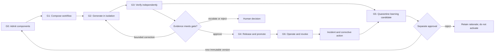

# Security-first AI-assisted development lifecycle

This page is the security control overlay for an AI-assisted engineering
change; it is not the lifecycle of the AI product itself. Use the
[AI system lifecycle](ai-lifecycle.md) for discovery through retirement and
the [skills-first AI-assisted change workflow](skills-first-ai-development.md)
to organize execution and evidence.

The overlay defines a vendor-neutral organizational standard for AI-assisted
development. It applies when a person or agent uses models, skills, tools,
plugins, hooks, MCP servers, or generated artifacts to change software,
infrastructure, data, prompts, policies, evaluations, or operational
documentation.

The standard extends secure software development; it does not create a
parallel path around repository governance, architecture, security, privacy,
change management, or operations. The accountable human and repository owners
retain decision rights. Models propose or produce work, deterministic controls
enforce boundaries, evidence supports review, and authorized people approve
consequential transitions.

## Status and relationship to external approaches

This is a reference organizational standard, not a claim of conformance to an
external standard. Tailor it through the
[risk-tiered control matrix](../governance/control-matrix.md), while preserving
all applicable legal, security, repository, and production controls.

[NIST SP 800-218A](https://csrc.nist.gov/pubs/sp/800/218/a/final) augments the
[Secure Software Development Framework](https://csrc.nist.gov/pubs/sp/800/218/final)
for organizations that produce, adapt, acquire, or integrate generative AI and
dual-use foundation-model components. Use both where applicable. SP 800-218A
does not replace ordinary secure development and does not define the complete
deployment or production-operations lifecycle.

At checked commit
[`9f91454`](https://github.com/awslabs/aidlc-workflows/tree/9f9145442429440ccd93f22e27186aa428007e5a),
the AWS Labs v2 repository describes AI-DLC 2.0 as a generally available,
native multi-harness implementation of the AWS methodology. Its included
[architecture specification](https://github.com/awslabs/aidlc-workflows/blob/9f9145442429440ccd93f22e27186aa428007e5a/assets/AI-DLC-Workflows-2.0-Specification.pdf)
proposes skills as composition units, flexible workflow composition, persona
agents, orchestration, packaging, and Generate–Verify–Learn. The repository
and specification are useful vendor inputs, but neither is a formal standard,
a complete enterprise security baseline, or a conformance framework. If
adopted, pin a known-good commit or release, review the complete package, and
overlay it with the mandatory gates below.

The checked implementation ships a five-phase, 32-stage, 14-agent default with
approval gates and adaptive composition. Those are vendor implementation
defaults, not fixed enterprise requirements or evidence that a selected stage
is secure.

## Normative outcomes

An implementation of this standard must:

- start from human-owned intent, acceptance criteria, scope, and risk;
- use organization-approved component revisions and capability profiles;
  require immutable identifiers where exposed, and for provider-managed
  mutable services record the approved service and configuration, observed
  revision, interface and policy hashes, sentinel evaluation, exception,
  change monitoring, and tested fallback;
- keep identity, authorization, secrets, policy, and final state changes
  outside model discretion;
- isolate generation from trusted verification and privileged release;
- classify evidence as deterministic, inferential, or human judgment;
- bind evidence and approval to the reviewed source and artifact revisions;
- limit iteration, authority, data, network access, time, tokens, spend,
  retries, concurrency, and delegation depth;
- treat learned corrections as untrusted candidates until separately tested
  and approved;
- support suspension, revocation, rollback, incident response, and corrective
  action;
- preserve a privacy-minimized evidence chain without publishing raw agent sessions
  or hidden reasoning.

The words **must**, **should**, and **may** express the organizational baseline,
recommended practice, and optional practice respectively. An organization
should translate them into its own policy language and exception process.

## Lifecycle and control compartments

Generate, Verify, and Learn are separate control compartments even when one
harness presents them in a single interface. Separation can be implemented
with distinct identities, protected configurations, isolated runners,
independent people, or a combination proportionate to risk. The agent that
changes a control must not be able to weaken the verifier and then treat the
weakened result as independent evidence.

## Mandatory gate overlay

| Gate | Lifecycle construct | Required security outcome | Minimum evidence |
|---|---|---|---|
| **G0 Component admission** | Package manager and component libraries | Admit skills, plugins, hooks, MCP servers, models, tools, runners, and dependencies only after risk-based review | Canonical source, owner, license, immutable digest/version where exposed or mutable-service record, SBOM or AI component inventory, provenance, requested authority, scans, isolated test, approval, expiry, and revocation path |
| **G1 Workflow composition** | Orchestrator, intent, and stage plan | Bind approved intent, risk tier, component revisions and mutable-service exceptions, trust boundaries, decision rights, invariants, and no-go rules | Workflow manifest, linked issue or request, acceptance criteria, architecture or ADR, threat/impact assessment, component records, capability profiles, and replacement delta |
| **G2 Controlled generation** | Generate compartment | Execute with ephemeral least privilege, bounded delegation, protected state, and explicit data flows | Workload identity and scopes, runtime-policy digest, sandbox evidence, network/filesystem policy, tool-call audit, budgets, and stop conditions |
| **G3 Independent verification** | Verify compartment | Distinguish executable checks from advisory inference; prevent self-certification of material changes | Protected verifier identity and configuration, deterministic results, calibrated inferential results, independent review, source/artifact binding, iteration limit, and escalation outcome |
| **G4 Release and promotion** | Cross-stage transition | Promote only an approved, provenance-verified release unit through a protected path | Trusted build, SBOM, verified provenance/attestations where applicable, approvals, release manifest, staged rollout, stop criteria, and actual deployed-state readback |
| **G5 Controlled learning** | Learn compartment | Treat feedback, corrections, prompts, tests, and policy changes as quarantined candidates; never mutate active guidance silently | Candidate origin, sanitization, poisoning and regression tests, owner decision, new immutable version, rollout scope, and rollback |
| **G6 Operate and revoke** | Enterprise operations overlay | Detect drift and component change; pause, revoke, rotate, recover, and learn from failure | Inventory reconciliation, supplier and schema change alerts, route telemetry, kill-switch and credential-revocation exercise, fallback test, incident record, and corrective-action effectiveness check |

Passing one gate does not authorize a later gate. In particular, approving a
plan does not approve each tool call, approving a component does not approve
every use, and passing an AI review does not approve merge or deployment.

## G0 — Component admission

The admission boundary covers more than a skill instruction file. Review the
entire executable and control surface:

- instructions, agents, prompts, schemas, policies, templates, and examples;
- helper scripts, hooks, startup commands, binaries, containers, package
  manifests, lockfiles, and install/build steps;
- MCP servers, tool descriptions, dynamic tool-list behavior, authentication,
  transport, network destinations, and transitive services;
- model and provider aliases, requested capability profile, region, retention,
  and safety configuration;
- licenses, maintainer identity, release history, vulnerability response, and
  update mechanism.

Discovery in a marketplace, repository, directory, or model catalog is not
approval. Automated scanning and LLM review inform the admission decision but
do not replace accountable review. See
[agent extension supply-chain security](../security/agent-extension-supply-chain.md)
for the inspection pipeline.

Admitted components receive an immutable identifier and one lifecycle state:
**draft**, **quarantined**, **pilot**, **approved**, **deprecated**, or
**revoked**. Production policy must reject missing, deprecated-for-new-use, and
revoked versions.

## G1 — Workflow composition

Before generation, produce a workflow manifest that names:

- accountable change owner, repository owner, intended user, and affected
  service;
- issue or request, problem, acceptance criteria, scope, non-goals, and
  unchanged behavior;
- risk tier, data class, autonomy, action consequence, and deployment impact;
- selected skill, agent, model-route, tool, MCP, verifier, and runner versions;
- data flows, trust boundaries, credentials, network destinations, and output
  destinations;
- human decisions, prohibited actions, stop conditions, and any separate
  policy-exception decision ID, named exception authority, and adopted-policy
  authority basis;
- exact checks, evaluation thresholds, release path, observation, rollback,
  compensation, and incident ownership.

A later replacement of a model, skill, tool, MCP server, verifier, policy, or
runner requires a recorded delta. Material deltas return to the applicable
earlier gate.

## G2 — Controlled generation

Generation runs in a dedicated branch, worktree, or ephemeral workspace.
Default controls are:

- repository-scoped write access and read-only access elsewhere;
- no production credentials and no ambient cloud or source-control authority;
- deny-by-default network access with destination and protocol allowlists;
- host-held, short-lived credentials that are never placed in model context;
- explicit tool scopes and per-resource authorization;
- bounded subprocess, filesystem, browser, and interpreter execution;
- step, token, time, spend, retry, concurrency, and delegation-depth limits;
- content, secret, malware, and dependency inspection on generated artifacts;
- attributable, privacy-minimized tool and policy decision records.

Higher capability does not confer greater authority. A stronger coordinator and
a smaller worker receive only the permissions required for their assigned
tasks.

## G3 — Independent verification

Classify each postcondition:

| Verification class | Examples | Acceptance rule |
|---|---|---|
| Deterministic executable | compile, unit test, schema validation, policy-as-code, signature or digest verification, exact state readback | Trusted check must pass against the reviewed revision |
| Statistical or behavioral | task success, safety rate, latency distribution, model nondeterminism | Approved evaluation design, sample limits, thresholds, and uncertainty must be recorded |
| Inferential advisory | model code review, semantic consistency review, threat brainstorming | Finding or opinion informs review; it cannot self-certify a material change |
| Human judgment | intent, architecture fit, residual risk, legal interpretation, affected-person impact | Named qualified owners record each judgment within authority reserved by adopted policy; residual risk requires one current category-bound decision for every policy-reserved category, and supporting rows are not votes |

The verifier must be protected from change-producing code and untrusted
content. Evaluation inputs and tool results can carry prompt injection.
Deterministic checks should run from trusted configuration outside the branch
where practical. Model-based reviewers should use bounded tools, independent
context, calibrated tests, and a clear advisory label.

Self-correction is bounded. Define maximum iterations, cumulative tokens,
elapsed time, spend, and repeated-failure thresholds before execution.
Exhaustion, conflicting evidence, an authorization error, or a critical
security finding stops the loop and escalates; it does not relax the check.

## G4 — Release and promotion

Use the canonical [code deployment and release](code-deployment.md) path.
Required properties include:

- focused pull request and human-readable evidence package;
- relevant code-owner and qualified human review;
- trusted required checks that the change cannot silently replace;
- build-once promotion by digest for enterprise-built artifacts;
- explicit records for provider-managed or mutable dependencies;
- tamper-evident release manifest binding all compatible revisions;
- protected deployment identity and environment;
- progressive exposure, comparison baseline, automatic stop conditions, and
  named go/hold/abort authority;
- rollback, forward recovery, or compensation tested for the actual state
  transition;
- readback of the deployed code, configuration, route, policy, model, and
  migration state.

An agent may prepare the branch, evidence, and draft pull request when
authorized. It may not approve its own control changes, merge, publish, deploy,
or change access without the required human authority.

## G5 — Controlled learning

“Learning” means proposing a new version of a skill, prompt, policy, test,
router, runbook, or knowledge artifact. It does not mean allowing production
feedback to rewrite active control instructions.

Every learning candidate must:

1. retain source and incident or feedback provenance;
2. remove secrets, personal data, and malicious embedded instructions;
3. be quarantined from active registries and retrieval;
4. be assessed for poisoning, overfitting, conflicting policy, license, and
   cross-tenant contamination;
5. pass normal, edge, adversarial, and historical regression checks;
6. receive a new immutable version and owner approval;
7. use a bounded rollout with rollback to the prior version.

Rejected candidates retain a concise rationale so the same unsafe correction
is not repeatedly proposed.

## G6 — Operate, revoke, and improve

Continuously reconcile the deployed manifest with:

- repository and artifact state;
- component, model, tool, MCP schema, provider, region, price, and policy
  changes;
- permission and credential state;
- quality, safety, security, reliability, latency, and cost objectives;
- exceptions, expiry dates, owners, and lifecycle states.

Support immediate route disablement, component revocation, credential
rotation, network isolation, workflow pause, and safe fallback. A material
issue enters the
[incident, problem, and corrective-action](../operations/incident-problem-and-corrective-action.md)
loop. Closure requires a verified fix and a later effectiveness check, not only
an agent-authored explanation.

## Risk-based tailoring

Tailoring changes depth, not the control objective.

| Change class | Minimum application |
|---|---|
| Low-consequence documentation or isolated prototype | Named intent and owner, approved components, isolated generation, relevant deterministic checks, human review |
| Normal product change | Complete G0–G4 evidence, independent review, trusted CI, staged deployment where applicable |
| Sensitive, security, policy, or production-critical change | Current threat/impact assessment, separate verifier identity, qualified owner review, enhanced provenance, full adversarial evaluation, canary, and tested recovery |
| Privileged, destructive, secret-bearing, or rights/safety-critical action | Denied by default; explicit per-action authority, deterministic privileged executor, independent environment gate, enhanced monitoring, and documented residual-risk decision |

An exception binds the exact unmet internal control, candidate and scope,
result, exposure, rationale, compensating controls, monitoring, stop trigger,
remediation owner, expiry, invalidation triggers, and supersession to a
separate decision ID and one named policy-designated exception authority under
its adopted-policy authority basis. It cannot waive a clear prohibition, cure
missing rights or a mandatory duty, resolve uncertain applicability, replace a
required owner, discipline decision, approval, independence, or evidence, make
a Tier 4 scope releasable, or authorize an otherwise prohibited use by
reclassifying it. Any residual-risk decision is separate, category-bound, and
current; exception authority does not inherit residual-risk, merge, release,
deployment, publication, or operating authority.

## Required evidence package

Use the
[AI-assisted change evidence](../worksheets/ai-assisted-change-evidence.md)
worksheet. At minimum, the review record binds:

- intent, ownership, risk, accepted components, and workflow manifest;
- skill, plugin, hook, MCP, model-route, tool, runner, and policy versions;
- runtime and sandbox policy;
- deterministic, statistical, inferential, and human verification results;
- bounded-correction history and escalation result;
- reviewed commit and release artifact;
- approvals, limitations, exception expiry, deployment, observation, and
  recovery;
- any learning candidate and its promotion or rejection decision.

Evidence is a concise index, not a raw transcript dump. Do not publish hidden
reasoning, system instructions, credentials, private paths, customer data, or
unrelated session content.

## Adoption sequence

1. Inventory repositories, owners, agent runtimes, skills, tools, plugins,
   hooks, MCP servers, models, and deployment paths.
2. Establish G0 admission and a revocable component registry before expanding
   agent authority.
3. Implement G1 manifests and stable capability profiles.
4. Separate G2 construction identities from G3 trusted verification.
5. Protect merge and deployment, then prove G4 deployed-state readback.
6. Pilot bounded G5 learning on non-production guidance.
7. Exercise G6 revocation, fallback, incident, and corrective-action paths.
8. Expand only when accepted outcome, escaped-defect, control-bypass,
   reviewer-load, recovery, latency, and total-cost measures support it.
