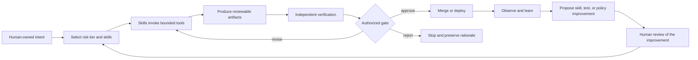

# Skills-first AI-assisted change workflow

This page is the change workflow for people and coding agents producing one
AI-assisted engineering change. It operates within the
[AI system lifecycle](ai-lifecycle.md) and implements the
[security-first AI-assisted development lifecycle](security-first-ai-dlc.md);
it does not replace either.

AI-assisted development should be governed as an engineering system, not as a
choice of chat interface. A versioned **skill** is a preferred reusable
implementation and control surface: it can tell an agent when to act, which
tools it may use, which evidence it must produce, and when it must stop for
human judgment.

Skills operate beneath organizational policy, accountable identity, platform
enforcement, independent checks, and authorized human gates; they do not
replace any of them. Tools provide capability. Skills make an approved workflow
discoverable and repeatable. Artifacts make claims inspectable. Independent
gates decide whether work may proceed.

## Operating model

| Layer | Purpose | Typical contents |
|---|---|---|
| Skills | Encode the approved way of working | triggers, procedure, decision rights, allowed tools, outputs, stop conditions |
| Tools | Perform bounded actions | repository search, issue access, test runners, scanners, browsers, build and deployment APIs |
| Artifacts | Preserve intent and evidence | specification, ADR, test results, screenshots, risk notes, release manifest, sanitized decision trace |
| Gates | Authorize consequential transitions | architecture approval, merge checks, deployment approval, risk acceptance |

The model prevents two common errors:

- a tool is mistaken for a complete development process; and
- an agent-generated description is mistaken for evidence that the change is
  correct.

## Skill contract

Treat a skill as governed executable guidance. Each production skill should
declare:

| Contract field | Required decision |
|---|---|
| Identity | What is the stable name, owner, version, and change history? |
| Trigger | When should the agent use the skill, and when must it not? |
| Preconditions | What repository, issue, environment, identity, and approvals must exist? |
| Inputs | Which sources are authoritative, optional, untrusted, or prohibited? |
| Decision rights | Which decisions may the agent propose, make, or only escalate? |
| Tools | Which tools, scopes, network destinations, and credentials are allowed? |
| Procedure | What sequence, checkpoints, and questions should be followed? |
| Outputs | Which human-readable and machine-readable artifacts must be produced? |
| Validation | Which deterministic checks and independent reviews define success? |
| Stop conditions | What ambiguity, risk, failure, or side effect requires a pause? |
| Data handling | What may be logged, redacted, retained, or published? |
| Tests | How is the skill tested against normal, edge, adversarial, and failure cases? |
| Runtime and dependencies | Which agent or harness, operating environment, packages, services, and compatible versions are required? |
| Model profile | Which approved capability profile, data conditions, quality floor, latency and spend budget, and compatible revisions may execute the skill? |
| Verification and escalation | Which independent check accepts the result, and when must execution escalate to a stronger profile or human? |
| Review | Who approved the skill, when was it last reviewed, and when or after which change must it be reviewed again? |
| Revocation | Which events revoke the skill, who may revoke it, and what replacement or safe fallback applies? |

Skills should bind to stable capability profiles rather than mutable provider
aliases. The platform resolves profiles to approved deployments at runtime. A
skill may narrow the enterprise allowlist but must not broaden it. Skill
selection, model routing, tool authorization, and human approval remain
separate decisions even when one harness exposes all four.

Skill instructions are code-like supply-chain artifacts. Review and pin them,
protect their owning paths, scan any included scripts, and test changes before
making a new version generally available. A skill allowlist helps the agent
choose appropriately, but it is not a security boundary; enforce tool,
filesystem, network, and credential limits in the execution environment.

Treat the entire package as control-bearing: plugins, hooks, helper scripts,
startup commands, binaries, dependencies, MCP servers, tool descriptions,
schemas, annotations, results, update channels, and manifests. Use
[agent extension supply-chain security](../security/agent-extension-supply-chain.md)
for admission, sandbox evaluation, runtime enforcement, change detection, and
revocation. Marketplace or registry discovery is not security approval.

## Skill registry, selection, and lifecycle

Maintain an approved registry rather than relying on whichever skill happens to
be locally discoverable. For each immutable skill version, record:

- canonical identifier, owner, source, version or digest, and change history;
- lifecycle state: **draft**, **quarantined**, **pilot**, **approved**,
  **deprecated**, or **revoked**;
- applicable task types, risk tiers, repositories, data classes, runtimes, and
  excluded uses;
- runtime, package, service, model, tool, and skill dependencies;
- permissions, network destinations, credentials, and data-handling limits;
- approval, last review, next review or material-change trigger;
- revocation conditions, revocation authority, replacement, and fallback.

Selection is a policy decision:

1. classify the task, risk, repository, data, environment, and intended action;
2. select the most specific compatible **approved** skill and bind its version
   to the change evidence;
3. apply documented precedence when several skills match, and stop for the
   registry owner if applicability or conflicting instructions cannot be
   resolved;
4. if no approved skill matches, do not silently install one or improvise
   privileged behavior—follow repository instructions or a human-owned manual
   path and record the no-match decision;
5. use a **draft** or **pilot** skill only inside its approved test scope,
   prevent a **quarantined** skill from ordinary execution, do not select a
   **deprecated** skill for new work, and prevent execution of a **revoked**
   skill.

Installing or updating an external skill requires explicit approval before its
instructions or scripts are made available to the agent. Review its source,
license, bundled code, dependencies, permissions, network behavior, data
handling, and maintainer history; pin the approved version or digest; evaluate
it in an isolated environment; and record the approver and evidence. Discovery
from a registry, marketplace, repository, issue, or retrieved document is not
installation approval.

Use the
[security-first AI-assisted development lifecycle](security-first-ai-dlc.md)
to separate component
admission, workflow composition, isolated generation, trusted verification,
release, controlled learning, and operational revocation. A model review is
inferential evidence; it cannot replace a deterministic check or qualified
human decision.

## Tool classes and authority

Separate tools by consequence rather than exposing one broadly privileged
runtime.

| Tool class | Default authority | Examples |
|---|---|---|
| Discovery | Read-only | source search, documentation, issue and PR reads, dependency inventory |
| Construction | Isolated workspace write | edit files, generate tests, update a branch or worktree |
| Validation | Deterministic and policy-controlled | build, unit and integration tests, lint, SAST, dependency and license scanning |
| Evidence | Append or publish bounded records | test summaries, screenshots, manifests, checksums, sanitized traces |
| Collaboration | Draft or scoped write | issue comment, PR update, review response |
| Release | Approval-gated privileged action | artifact promotion, environment change, production deployment, rollback |

Use separate identities for construction, validation, and deployment where
risk warrants it. The agent that changes code must not be able to weaken a
required check and then use the weakened result as evidence. The same agent
may perform a preliminary review, but that review is not independent
assurance.

## Lifecycle skills

A skills-first AI development lifecycle can be implemented with a small,
composable catalog.

### 1. Intake and risk tier

Produce:

- the user, product, or operational problem;
- accountable product and engineering owners;
- expected outcome and non-AI alternative;
- affected repositories and services;
- scope and non-goals;
- acceptance criteria;
- data, security, compliance, autonomy, and reversibility classification;
- unresolved questions and the person authorized to answer them.

The skill may clarify intent. It must not silently turn an ambiguous request
into a consequential implementation.

### 2. Specification and acceptance

Translate approved intent into observable behavior:

- examples and invariants;
- compatibility and unchanged behavior;
- failure and abstention behavior;
- performance, reliability, security, accessibility, and cost requirements;
- acceptance tests or an executable evaluation plan.

Specifications are proposed evidence, not truth. Domain owners confirm that
they represent the actual need.

### 3. Architecture and risk

Inspect the existing architecture and prior decisions before proposing a
change. Produce a concise design or ADR for material choices, including:

- interfaces and data flows;
- trust and authorization boundaries;
- alternatives considered;
- migration and compatibility;
- dependency and supply-chain impact;
- observability;
- rollout, rollback, compensation, and retirement;
- threat or impact assessment when required by the risk tier.

### 4. Implementation in isolation

Work in a dedicated branch, worktree, or ephemeral environment. Use
least-privileged credentials and deny-by-default or allowlisted network
access. Make small coherent changes and preserve an attributable run
identifier.

For a defect, first produce or identify a test that demonstrates the
pre-change failure. Avoid changing unrelated code merely because an agent can
do so cheaply.

### 5. Verification and evaluation

Run the repository-owned commands for:

- formatting, lint, type, build, and unit tests;
- integration, contract, migration, and end-to-end tests;
- security, secret, dependency, license, and infrastructure checks;
- behavioral, safety, adversarial, and regression evaluations;
- performance and cost checks;
- visual or interactive inspection where behavior is rendered to a user.

Machine-generated tests require review. A passing test only supports the
behavior it actually exercises.

### 6. PR evidence packaging

Create a concise evidence package using the
[AI-assisted change evidence](../worksheets/ai-assisted-change-evidence.md)
worksheet. Bind results to the reviewed commit. Include the exact commands,
result status, relevant artifact links, limitations, and human confirmation.

The PR body is the durable reviewer brief. Large logs and generated artifacts
may live elsewhere, but the brief must explain why each item is relevant.

### 7. Independent review

Use automation for mechanical inspection and people for contextual judgment.
Review:

- whether the change solves an approved problem;
- architecture fit and duplicated capability;
- authorization and trust-boundary changes;
- critical control flow and boundary cases;
- any change to CI, tests, policy, instructions, or ownership;
- evidence freshness and correspondence to the head commit;
- rollout, rollback, and operational ownership.

AI review is an additional lens. It must not be the only required approval for
a material change.

### 8. Deployment, observation, and learning

Follow the
[code deployment and release](code-deployment.md)
process. Observe the actual released version and outcome. After merge or
deployment, ask what friction, missing context, recurring defect, or unsafe
assumption should be converted into:

- a regression test or evaluation case;
- a clearer skill;
- a deterministic check;
- an architectural rule;
- a runbook update;
- or a platform capability.

An agent may draft a skill improvement. A named owner reviews, tests, and
approves it before it replaces the active version.

## Evidence, not transcript theater

Development traces can reveal intent, corrections, rejected approaches, and
validation effort. They can also contain secrets, private paths, copied
material, stale conclusions, prompt injection, and large amounts of irrelevant
work.

Do not publish raw agent logs by default. Prefer a human-confirmed decision
trace containing:

- the initiating request and linked issue;
- material clarifications and human corrections;
- decisions and alternatives;
- concise tool summaries;
- tests and proof outcomes;
- open questions and known gaps.

Remove hidden reasoning, system and developer instructions, raw credentials,
cookies, environment dumps, unrelated work, and unnecessary personal or
confidential data. Obtain explicit approval before publishing a sanitized
trace.

The OpenClaw project provides a concrete, project-specific example through its
[`agent-transcript` skill](https://github.com/openclaw/agent-skills/blob/main/skills/agent-transcript/SKILL.md)
and its
[AI-assisted contribution policy](https://github.com/openclaw/openclaw/blob/main/CONTRIBUTING.md).
The useful enterprise principle is selective, consented provenance—not prompt
length as a quality metric. A short request that invokes a well-tested skill
may be more trustworthy than a long improvised conversation.

Skill, session, commit, and artifact provenance can show which sources,
workflow, and identities were involved. It does not by itself establish
line-by-line authorship, originality, intellectual-property ownership, license
clearance, correctness, or safety; those claims require their own review and
evidence.

## Minimum PR evidence package

Every non-trivial AI-assisted change should identify:

1. **Intent:** problem, user impact, issue, scope, non-goals, and acceptance
   criteria.
2. **Ownership:** accountable human, repository owner, code owners, reviewers,
   and deployment owner.
3. **Approach:** design, alternatives, affected components, compatibility, and
   migrations.
4. **AI involvement:** assistance type, skill versions, material tools, and a
   sanitized decision trace when safe and useful.
5. **Verification:** exact checks, results, before-and-after evidence, and the
   commit or artifact digest they cover.
6. **Risk:** security, privacy, reliability, operational, and supply-chain
   impact; limitations and exceptions.
7. **Operations:** rollout, stop conditions, rollback or forward recovery,
   dashboards, and on-call ownership.
8. **Human confirmation:** an accountable contributor states that they
   reviewed, understand, and can explain the change.

Evidence does not self-certify. Required checks should rerun in a trusted
environment, and reviewers should inspect the highest-consequence paths.

## Risk-proportionate depth

| Change class | Minimum treatment |
|---|---|
| Small and low consequence | intent, owner, focused diff, relevant check, human review |
| Normal product change | complete concise evidence package, independent review, CI, staged deployment |
| Sensitive or production-critical | approved design, threat or impact assessment, two-person separation where required, full evidence, signed provenance, canary and tested recovery |
| Destructive, secret-bearing, or autonomous production action | prohibited by default; explicit authorization, deterministic privileged executor, independent environment gate, enhanced monitoring |

Do not impose a large document set on every change. Scale the evidence to the
cost of misunderstanding, the trust boundary, and the consequence of failure.
For a high-context external contribution, a structured knowledge package can
be reviewed before implementation authority is granted. The emerging
[Knowledge-Based Pull Requests](https://arxiv.org/html/2606.26721) proposal
explores this pattern, but its project-side regeneration model remains a
research hypothesis rather than an established standard.

## Adoption sequence

1. Document canonical repository commands and ownership.
2. Protect instruction, workflow, policy, evaluation, and deployment files.
3. Start with intake, verification, and PR-evidence skills.
4. Give agents read access first, then isolated branch write access.
5. Add independent required checks and deployment gates.
6. Pilot on low-consequence work and measure accepted outcomes.
7. Expand only after review time, defect escape, recovery, and evidence quality
   improve.

AI-DLC approaches can provide useful workflow and artifact patterns, while a
local skill-and-tool contract is one reusable control surface inside the larger
engineering system. At checked commit
[`9f91454`](https://github.com/awslabs/aidlc-workflows/tree/9f9145442429440ccd93f22e27186aa428007e5a),
the AWS Labs v2 repository describes AI-DLC 2.0 as a generally available,
native multi-harness implementation. Its
[architecture specification](https://github.com/awslabs/aidlc-workflows/blob/9f9145442429440ccd93f22e27186aa428007e5a/assets/AI-DLC-Workflows-2.0-Specification.pdf)
provides a flexible skills-based Generate–Verify–Learn design. Treat both as
vendor-authored methodology and implementation input, not a formal standard or
complete enterprise security baseline. Pin the adopted commit or release and
apply the
[security-first enterprise gate overlay](security-first-ai-dlc.md) rather than
treating its examples as sufficient controls.

The official
[DORA 2025 report](https://dora.dev/research/2025/dora-report/) and
[errata](https://dora.dev/research/2025/errata/) reinforce the systems view:
the reported relationships were positive for delivery throughput and product
performance but remained negative for delivery stability. Treat these as
research associations, not proof that a tool causes an outcome; the surrounding
platform, workflow clarity, tests, feedback loops, and team alignment remain
material.

Measure lead time, review time, accepted-change cost, rework, escaped defects,
change failure, rollback success, incident recurrence, and human attention.
Do not optimize for generated lines, prompt count, or transcript length.
