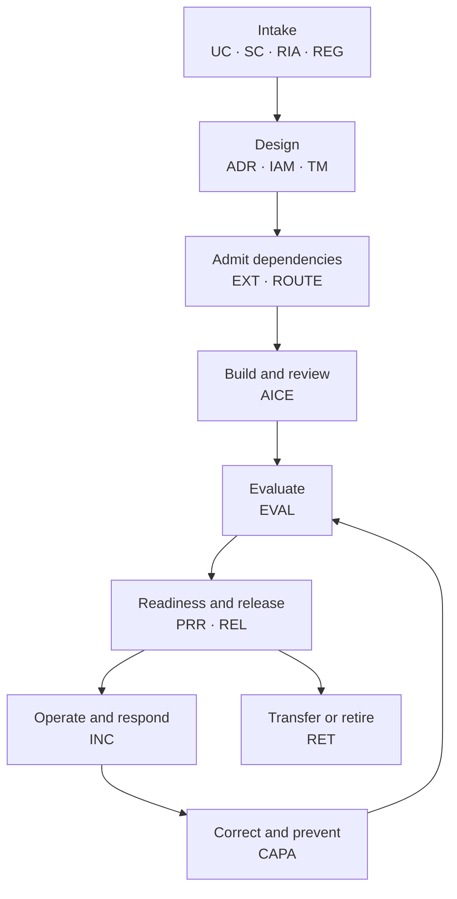
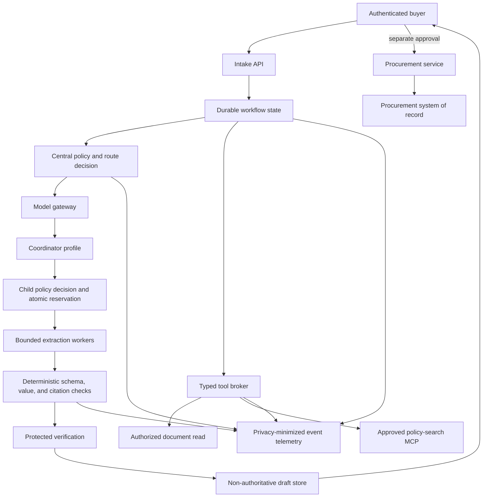

# Worked golden thread: procurement evidence assistant

This page follows one fictional AI system from intake through retirement. It
shows how the guide's decisions and evidence join together; it is not a
pre-approved design.

!!! warning "Fictional evidence, not authorization"
    The organization, system, identifiers, dates, measurements, incidents,
    approvals, and digests below are synthetic. They do not establish legal
    applicability, compliance, control effectiveness, provider approval, or
    production readiness. A real team must complete the linked records with
    its own qualified owners and independently verified evidence.

## 1. Scenario and acceptance boundary

**Cedar & Finch Manufacturing** is a fictional enterprise. Its procurement
team receives supplier quotations in varied document formats. Buyers manually
copy commercial terms into a comparison worksheet, check the quotations
against procurement policy, and prepare a review packet.

The proposed **Procurement Evidence Assistant** extracts cited fields, checks
packet completeness, and drafts a side-by-side evidence packet for an
authenticated buyer.

| Field | Synthetic example value |
|---|---|
| AI-system inventory ID | `SYS-PEA-001` |
| Use-case ID | `UC-PEA-001` |
| Operating-boundary ID | `BOUND-PEA-001` |
| Accountable business owner | Procurement operations director |
| Product and service owner | Procurement applications team |
| Intended users | Authenticated internal buyers in one synthetic tenant |
| Business outcome | Reduce evidence-packet preparation time without reducing field accuracy, confidentiality, or buyer accountability |
| Non-AI baseline | Buyer reads each quotation, copies fields, checks policy, and prepares the packet manually |
| AI role | Extract cited fields, identify missing evidence, and draft a comparison; the output is a proposal |
| Authoritative state | The procurement service owns requests, supplier records, approvals, and purchase orders |
| Example data | Synthetic quotations, an approved procurement-policy corpus, and synthetic business-contact details |
| Example organization tier | `Tier 2 — Operational`; this is an internal classification from the guide's example matrix, not a legal category |
| Distribution boundary | Internal restricted service; no public or supplier-facing release is authorized |

The system is deliberately prohibited from:

- recommending or selecting a supplier;
- approving spend, changing a supplier record, or creating a purchase order;
- sending a message or document outside the established access boundary;
- browsing the public internet;
- using a quotation, tool result, or model output as an instruction source;
- retaining raw quotation text in ordinary telemetry; or
- continuing when identity, authorization, policy, evidence, or result state is
  ambiguous.

The buyer reviews the cited source passages and explicitly approves any later
procurement action. The resource-owning procurement service reauthorizes that
action against the buyer, request, supplier, amount, and current workflow
state. The model, coordinator, worker, skill, and tool broker never receive
purchase-order authority.

The records distinguish a draft proposal ID, parameter-bound human approval
ID, procurement-service authorization decision ID, execution attempt ID, and
authoritative transaction ID. A success statement from a model or an
ambiguous timeout cannot substitute for the transaction result and
postcondition readback.

### Outcome and stop measures

The [use-case assessment](../worksheets/use-case-assessment.md) records the
non-AI baseline, expected value, affected people, and stop conditions before
build.

| Measure | Illustrative target | Stop or escalation condition |
|---|---:|---|
| Critical commercial fields with exact value, unit, currency, and source span | 100% | Any unsupported or mismatched critical field |
| Cross-tenant or unauthorized document access | 0 | Any allowed unauthorized request |
| Consequential action initiated by an agent | 0 | Any attempted or completed action |
| Buyer packet-preparation time | At least 40% below the measured manual baseline | Benefit is not sustained for two review periods |
| Mean total task cost | At or below the approved task budget | Budget reservation fails or aggregate execution exceeds its limit |
| Buyer correction and escalation | Visible, usable, and measured | Users cannot correct, contest, or switch to the manual path |

## 2. The evidence spine

The example-local IDs below are not a repository-wide naming convention. They
demonstrate stable relationships rather than filenames or dashboard
locations. A real evidence registry would map each ID to an immutable or
controlled record, its owner, revision, retention, access policy, and current
status.

**Synthetic snapshot point:** 2026-06-15 after `REL-PEA-001` was rolled back
at the 5% canary. The initial evaluation remains a historical pass for that
candidate; the system is on hold, the incident and CAPA are open, the fixed
candidate is not approved, and retirement is only planned. Record states
therefore differ without implying contradictory approval.

`SC-PEA-001` is the example instance of the
[AI system card](../worksheets/system-card.md). `RIA-PEA-001` and
`REG-PEA-001` apply the
[risk and impact](../worksheets/ai-risk-impact-assessment.md) and
[regulatory obligation](../worksheets/regulatory-obligation-register.md)
records to the same operating boundary.

| Record | What it decides or proves | Accountable example role | Illustrative state |
|---|---|---|---|
| `UC-PEA-001` | Purpose, owner, users, baseline, intended outcome, prohibitions, and initial screening | Business owner | `Proceed with conditions` — bounded design |
| `SC-PEA-001` | Stable system identity, scope, components, intended use, limitations, releases, and current lifecycle state | Product owner | `Experiment` — held after the 5% synthetic canary control failure |
| `RIA-PEA-001` | Affected people, autonomy, data, foreseeable harms, oversight, recourse, and residual-risk path | One named residual-risk decision authority; business, product, data, security, privacy, responsible-AI, and legal roles provide the policy-required inputs | Historical `Accept with conditions` for the initial canary; the decision is invalidated by the control failure, no current acceptance exists, and consuming gates hold while `RIA-PEA-002` is pending |
| `REG-PEA-001` | Controlled snapshot and digest of official sources, source-defined roles, applicability decisions, atomic duties, event clocks, and evidence links for this boundary | Qualified legal and compliance owners | Historical decision was `Ready for the stated boundary` for the initial canary; current decision is `Hold` pending incident reassessment |
| `ADR-PEA-001` | Why bounded AI assistance is used, alternatives rejected, trust boundaries, and exit consequences | Architecture owner | `Accepted` |
| `SB-PEA-001` | Supplier-operated, logically isolated managed-service boundary; provider-cloud location; private controlled connectivity; monitored mutable-service artifact; exact endpoint and final invocation PEP; provider usage meter | Platform and security owners; not route or release authority | Historical boundary record for the initial canary; any move to enterprise cloud, data center, edge/device, another endpoint, or another PEP requires a new record and approval |
| `IAM-PEA-001` | Human and workload principals, resource actions, delegation, credentials, final authorization, and negative tests | Identity and security owners | `ready for stated scope` |
| `AET-PEA-001` | Root and child execution identity, separate runtime and effect states, typed tool outcomes, cancellation, minimized events, integrity, alerts, reconciliation, and closure | Platform, privacy, and service owners | Artifact schema was approved for the initial canary; evidence status is now `failed / stale`, runtime disposition is `Hold`, and `AET-PEA-002` is required for the corrected release |
| `TM-PEA-001` | Assets, attackers, abuse paths, controls, residual risks, and required security tests | Security owner | Required tests defined |
| `EXT-PEA-001` | Exact skill, helper, tool, and MCP contents, authority diff, scans, sandbox behavior, approval, expiry, and revocation | Named extension-admission authority; platform security and affected discipline owners provide required inputs | Historical decision was `approve` for the bounded `pilot` lifecycle state; pilot suspended after the control failure and corrected `EXT-PEA-002` not yet admitted |
| `ROUTE-PEA-001` | Capability profiles, `SB-PEA-001`, exact deployment and final invocation PEP, child attenuation, budgets, evaluation, fallback, and adapter conformance | Named route-decision authority; model governance, platform, and affected discipline owners provide required inputs | Historical decision was `approve` with enforceable conditions for the initial pilot; its exact deployment target is now blocked, and `ROUTE-PEA-002` is required before another release |
| `AICE-PEA-001` | Human intent, change scope, artifact pack, validation, limitations, and recovery for the implementation PR | Change owner | Qualified review accepted the record for the exact `REL-PEA-001` head before canary; `AICE-PEA-002` remains pending for the fix |
| `EVAL-PEA-001` | Frozen test-set profile, baseline comparison, critical thresholds, results, limitations, advisory recommendation, and links to separate exception and residual-risk decision records | Evaluation owner; supplies advisory evidence only and has no exception, residual-risk, or release authority | Advisory `Pass` evaluation result for the initial synthetic release candidate; no exception was required, the result granted no release authority, and `EVAL-PEA-002` is required for the fix |
| `PRR-PEA-001` | Ownership, architecture, security, reliability, release, incident, and rollback evidence | Release owner | Historical `go` for the bounded 5% canary; closed for that attempt and no longer authorizes deployment or promotion after stop and rollback; `PRR-PEA-002` not yet decided |
| `REL-PEA-001` | Exact release manifest, build provenance, desired state, promotion decisions, readback, and rollback target | Release and service owners | Rolled back at 5% to `REL-PEA-000`; `REL-PEA-002` remains a candidate |
| `INC-PEA-001` | Detection, impact, timeline, containment, evidence, restoration, notification handoff, and service-to-repository ownership map | Incident commander and affected service owners; repository owners accept repair handoffs but do not close the incident | Manual service restored; incident closure pending and CAPA open |
| `CAPA-PEA-001` | Root cause, systemic cause, corrections, prevention, verification, and effectiveness review | Problem and control owners; action owners implement and a separate verifier reports effectiveness | Implementation and independent verification pending; effectiveness criteria defined |
| `RET-PEA-001` | Exit decision, dependency inventory, revocation, deletion or retention, transfer, readback, and closure | Product and records owners | Required before final shutdown |

An approved status in one record does not approve another. For example,
extension admission does not authorize a production route, evaluation does not
authorize deployment, and deployment does not authorize external
distribution.

For `RIA-PEA-001`, fictional policy `CF-AI-RISK-3` designates one Product Risk
Director as the residual-risk decision authority for this risk class and
bounded canary. The business, product, data, security, privacy,
responsible-AI, and legal entries are required inputs, not votes. The release
owner may use a current, valid decision as evidence but does not inherit its
authority; invalidated `RIA-PEA-001` is not consumable. The synthetic incident
breaches a recorded stop trigger, so the historical acceptance cannot authorize a corrected candidate;
`RIA-PEA-002` must make a new attributable decision before a new readiness
review can consider release.

### One synthetic obligation handoff

The public example uses fictional policy and contract sources so it does not
invent a jurisdictional legal conclusion. A real `REG-PEA-001` must add the
official legal, regulatory, sector, records, rights, and other sources selected
by qualified owners for the actual facts. Uncertain applicability remains
`Uncertain — hold`.

| Source and status | Role and applicability | Atomic obligation | Canonical event and evidence |
|---|---|---|---|
| `SRC-PEA-01`, fictional adopted policy `CF-PROC-AI-4`, effective 2026-06-01, source review 2026-09-01 | `ROLE-PEA-01` system owner; `APP-PEA-01` `Applies now` to `BOUND-PEA-001` | `OBL-PEA-01`: every critical field needs exact value, unit, currency, source span, and buyer review before attachment | `EVT-PEA-01` promotion decision; `EVID-PEA-01` links `EVAL-PEA-001` and `PRR-PEA-001`; historical `Current — pass` supported the initial canary, while the affected current evidence is `Current — fail / hold` pending reassessment |
| `SRC-PEA-02`, fictional retention schedule `CF-RS-9`, effective 2026-06-01, source review 2027-06-01 | `ROLE-PEA-02` service and records owners; `APP-PEA-02` `Applies now` to trace and incident stores | `OBL-PEA-02`: apply the recorded 30-day, 180-day, and 13-month synthetic dispositions by evidence class, subject to an approved hold or changed source decision | `EVT-PEA-02` collection and scheduled deletion per root execution; `EVID-PEA-02` is the retention-job and deletion readback |
| `SRC-PEA-03`, fictional supplier processing addendum `CF-SPA-6`, effective 2026-06-01, review at renewal | `ROLE-PEA-03` service customer; `APP-PEA-03` `Conditionally applies` when an approved supplier processes quotation content | `OBL-PEA-03`: use the approved processing boundary and hand incident facts to the contract owner for notice and deletion decisions | `EVT-INC-PEA-01` owns the canonical contractual trigger and calculation rule; `INC-PEA-001` records occurrence, detection, and awareness facts plus any calculated due time while referencing that Event ID; `EVID-PEA-03` links the route, supplier, and qualified decision |

## 3. Architecture and authority

The [architecture decision record](../worksheets/architecture-decision-record.md)
selects the least-autonomous viable pattern. Flexible document interpretation
is probabilistic; identity, authorization, calculations, schema validation,
workflow state, and purchasing actions remain deterministic.

The decision record compares four patterns:

| Pattern | Decision | Reason |
|---|---|---|
| Manual process | Retain as the safe fallback and baseline | It is slower but preserves a usable path when AI or policy dependencies are unavailable |
| One capable model | Use only as an evaluation comparator; it is not runtime-eligible in this snapshot | It reduces orchestration complexity but has higher measured example cost and latency |
| Coordinator with bounded extraction workers | Pilot | It met the same critical gates in the synthetic evaluation with lower total task cost and latency |
| Autonomous purchasing agent | Reject | The business outcome does not require supplier selection, spend approval, external communication, or purchase-order authority |

### Identity, data, and action boundaries

`IAM-PEA-001` is a completed example instance of the
[identity and permission matrix](../worksheets/identity-and-permission-matrix.md).

| Principal | May do | Must not do | Enforcement and evidence |
|---|---|---|---|
| Buyer | Submit an authorized request, view entitled documents, review and correct the draft, separately approve a procurement action | View another tenant's documents or delegate approval to an agent | Enterprise identity, resource authorization, approval event, negative access tests |
| Workflow workload | Read current workflow state and request narrowly scoped route and tool decisions | Hold broad document, model, or procurement credentials | Workload identity, audience-bound short-lived credentials, policy logs |
| Coordinator | Propose decomposition and a typed packet draft within its grant | Select an exact model, add a tool, widen data, approve a child, or commit state | Central route grant, tool broker, output schema, budget ledger |
| Extraction worker | Process one authorized synthetic document fragment supplied as bounded context and return cited fields | Write state, make a direct or arbitrary network call, invoke a tool, delegate again, or read another document | Child grant, preauthorized fragment binding, sandbox, zero-tool set, depth and fan-out limits |
| Policy-search MCP server | Search the approved policy corpus and return typed, cited results | Grant authority, change its schema silently, or contact another server | Capability-manifest digest, per-call authorization, egress policy, schema validation |
| Procurement service | Validate current buyer authority and commit an approved business transaction | Accept model output as authorization | Owning-service policy, parameter-bound approval, idempotency, transaction readback |

Raw quotation content is available only in the authorized request path and the
restricted incident evidence store when preservation is required. Ordinary
telemetry carries identifiers, classifications, decisions, versions,
measurements, and outcome codes rather than quotation text, prompts, or
business-contact details.

## 4. Governed routing and extension admission

The coordinator asks for a capability profile. The central policy service,
using the approved catalog revision, selects the exact deployment and issues
the [portable route grant](../architecture/model-portfolio-and-routing.md#portable-route-grant-contract).
Neither the coordinator nor a worker can name a provider, region, processing
plan, or model.

For the historical initial canary, one fictional named route-decision
authority recorded `ROUTE-PEA-001`; supporting roles supplied required inputs
without voting. The decision bound synthetic capability profiles to exact
approved deployment records for this evaluated boundary and applied the
[model routing and agent dispatch plan](../worksheets/model-routing-and-agent-dispatch-plan.md):

| Requested profile | Synthetic exact deployment approval | Permitted role |
|---|---|---|
| `capable-coordinator` | `DEP-PEA-COORD-01` in catalog `CAT-PEA-017` | Decompose and synthesize within the root grant |
| `economical-extractor` | `DEP-PEA-WORKER-02` in catalog `CAT-PEA-017` | Extract one cited document fragment under a child grant |
| `protected-verifier` | `DEP-PEA-VERIFY-01` in catalog `CAT-PEA-017` | Advise or reject against the protected verification contract; never approve release |

All three fictional approvals reference managed-service serving boundary
`SB-PEA-001`, immutable revision `SB-PEA-001-r1`, and boundary-digest record
`SBD-PEA-001`. Each route grant binds those three values, its exact deployment,
the final PEP, and required provider-readback policy. This example has no
fallback or disconnected package.

These identifiers and approvals are fictional. A real record also binds the
provider service, exact model or documented mutable alias, boundary
revision/digest, final PEP, required observed-state policy, region, processing
plan, data terms, price record, lifecycle, evaluation, expiry, and fallback.

### Strict child attenuation

| Constraint | Root grant `RG-PEA-0042` | Worker grant `RG-PEA-0042-A` | Attenuation check |
|---|---|---|---|
| Purpose | Build one comparison draft for request `REQ-SYNTH-042` | Extract cited fields from document `DOC-SYNTH-A` | Child task is a subset |
| Data scope | Two authorized quotation objects and approved policy corpus | One authorized quotation object | Narrower object scope |
| Tools | `document.read`, `policy.search`, `draft.propose` | None; the authorized fragment is supplied as bounded context | Child has no tool authority |
| Network | Approved model gateway and broker-mediated tools | Approved model gateway only | No direct destination |
| Side-effect class | Non-authoritative reversible draft | None | Child is read-only |
| Time | 60 seconds total | 18 seconds | Child reservation is smaller |
| Total task budget | 180,000 synthetic USD micros | 35,000 synthetic USD micros | Atomically reserved from the root |
| Fan-out and depth | Maximum two children, depth one | Zero children, no delegation | Child cannot delegate |
| Use and retry | One use; one bounded retry for the root | One use; no retry | Replay and retry are narrower |
| Expiry | Five minutes after issue | Ninety seconds after issue | Child expires first |

The adapter proves presenter binding, audience, current revocation epoch,
catalog and deployment approval, serving-boundary revision/digest, required
provider readback, reservation ownership, expiry, use count, and the
parent-child subset relation before final model invocation. It rejects the whole
dispatch when budget reservation or authoritative state is unavailable.
Observed execution is reconciled to the grant; a signed decision alone is not
proof that the runtime obeyed it.

### One synthetic authority trace

The happy path joins proposal, approval, authorization, execution, and
authoritative result without retaining a raw grant. The buyer's final action
in this example attaches the reviewed evidence packet to an existing
procurement request; it does not approve spend or create a purchase order.

| Stage | Synthetic record | Authority or result |
|---|---|---|
| Root execution | `ROOT-PEA-0042` | Binds use case, release, pseudonymous tenant correlation ID, buyer session decision, request, and deadline |
| Root route | `DEC-PEA-0042`; approved one-way grant hash `GH-PEA-0042`; `SB-PEA-001@SB-PEA-001-r1`; digest record `SBD-PEA-001` | Central policy resolves the coordinator deployment and exact boundary revision/digest, then atomically reserves the root budget |
| Child dispatch | `TASK-PEA-0042-A`, `DEC-PEA-0042-A`, `GH-PEA-0042-A`, reservation `RES-PEA-0042-A`; same exact boundary revision/digest | Signed parent link, one document fragment, no tools, no side effects, fan-out zero, and a smaller budget |
| Root and child model invocation | leases `MIL-PEA-0042` and `MIL-PEA-0042-A`; provider readbacks `MSTATE-PEA-0042` and `MSTATE-PEA-0042-A` | Final PEP validates the approval, epoch, boundary revision/digest, and required freshness-bounded readback before each lease becomes `committed-to-invoke` |
| Document read | Tool decision `TD-PEA-0091`; call `CALL-PEA-0091` | Broker authorizes the workflow workload, tenant, request, and exact document; typed result returns a fragment binding and source digest |
| Policy search | Tool decision `TD-PEA-0092`; MCP call `CALL-PEA-0092` | Host binds `EXT-PEA-001`, the approved capability-manifest and `policy.search` schema, caller, purpose, corpus revision, and query classification; typed result returns cited policy records as untrusted data |
| Draft proposal | Tool decision `TD-PEA-0093`; call `CALL-PEA-0093`; `DRAFT-PEA-0042`, parameter digest `PD-PEA-0042` | Broker authorizes the non-authoritative write after schema and citation gates; idempotent typed result and readback confirm one draft with no procurement transaction |
| Human approval | `APR-PEA-0042`, bound to buyer, request, draft and parameter digests, action `attach packet`, and expiry | Any parameter change or expiry invalidates approval |
| Service authorization | `AUTHZ-PEA-0042` | Procurement service reauthenticates and authorizes the buyer, workload, request, current state, and exact action |
| Execution attempt | `ATTEMPT-PEA-0042`, idempotency key `IDEM-PEA-0042` | Owning service attempts the action once; timeout is ambiguous until reconciled |
| Authoritative result | Transaction `TXN-PEA-0042`; postcondition `OBS-PEA-0042` | Procurement service confirms the exact packet digest is attached once to the intended request |

### Admitted components

One fictional named extension-admission authority recorded `EXT-PEA-001`;
supporting roles supplied required constraints and evidence without voting.
The decision applies
[agent extension supply-chain security](../security/agent-extension-supply-chain.md)
and its
[assessment worksheet](../worksheets/agent-extension-assessment.md) to the full
extension surface:

| Component | Synthetic approved record | Runtime boundary |
|---|---|---|
| Quote-extraction skill | Version `1.3.0`, exact source revision and immutable digest recorded in the controlled registry | Defines input, output, stop, tool, and evidence contracts; grants no authority |
| Document parser helper | Exact source and binary provenance, dependency inventory, static findings, and isolated execution result | Disposable sandbox, read-only input, bounded workspace, no network |
| Policy-search MCP server | Image digest, owner, protocol and capability-manifest versions, `policy.search` schema, corpus revision, and expiry | One read-only capability, per-call authorization, approved corpus, no cross-server flow |
| Draft proposal tool | Versioned typed schema and owner | Writes only a non-authoritative draft with idempotency and readback; cannot call the procurement commit API |

Admission includes canonicalization, deterministic scans, contextual advisory
review, a threat model and authority diff, isolated execution with synthetic
data and canary secrets, and one attributable `approve / hold / reject`
decision plus a separate `pilot`, `active`, or `quarantined` lifecycle
treatment. Any digest, dependency, signer, owner, startup, capability, schema,
destination, or requested-authority change suspends the component until
reassessment. Automatic marketplace installation and silent MCP
`tools/list_changed` acceptance are disabled.

## 5. Threats, controls, and failure behavior

The [threat-model worksheet](../worksheets/threat-model.md) connects each abuse
path to prevention, detection, a safe failure, and test evidence.

| Threat ID | Abuse or failure path | Prevention and detection | Safe failure and evidence |
|---|---|---|---|
| `TM-01` | A supplier quotation contains instructions intended to override the system | Treat document content and MCP results as untrusted data; delimit content; admit no control instructions from documents; run injection and Unicode tests | Reject or abstain, create no draft action, and record a content-risk outcome without copying the payload into ordinary telemetry |
| `TM-02` | A buyer or worker requests another tenant's document | Authorize the buyer, workload, tenant, purpose, and exact resource at intake and every document read | Deny before retrieval, alert on repeated attempts, and preserve decision IDs |
| `TM-03` | The model changes a number, unit, currency, or source | Require typed fields with exact source spans; validate values and calculations deterministically; stop on verifier disagreement | Mark the packet incomplete and route to the buyer's manual path |
| `TM-04` | A coordinator widens worker tools, data, budget, route, or delegation | Central route resolution, atomic child reservations, signed parent linkage, strict subset checks, and observed-state reconciliation | Deny dispatch, revoke the grant on misuse, and alert the routing owner |
| `TM-05` | A skill, helper, dependency, or MCP schema changes after approval | Exact digest or controlled mutable-service record, capability sentinels, schema hashing, inventory reconciliation, and expiry | Quarantine the component, rotate affected credentials, and use the manual path |
| `TM-06` | Retries or parallel workers amplify cost | Aggregate root budget, per-child reservation, concurrency and fan-out caps, deadlines, loop detection, and cost alerts | Cancel remaining work, reconcile delayed usage, and prevent fallback from escaping the root budget |
| `TM-07` | Traces expose quotation content or identities | Field allowlist, classification, tokenized resource IDs, access control, content-free outcome codes, and retention enforcement | Drop prohibited fields before collection; quarantine a telemetry pipeline that cannot enforce minimization |
| `TM-08` | A tool times out after an ambiguous draft write | Idempotency key, authoritative transaction ID, bounded retry, and postcondition readback | Stop and reconcile; never infer success from a model statement or timeout |

Relevant control outcomes include
[GOV-01, GOV-03–GOV-06](../governance/control-catalog.md#governance-and-accountability),
[DAT-01–DAT-08](../governance/control-catalog.md#data-and-knowledge),
[SEC-01–SEC-11](../governance/control-catalog.md#security-and-privacy),
[DEV-01–DEV-11](../governance/control-catalog.md#delivery-and-evaluation),
and [OPS-01–OPS-11](../governance/control-catalog.md#operations-and-resilience).
The IDs aid traceability; citing them is not evidence that they operate.

## 6. Artifact-first implementation change

The change follows the
[security-first AI-assisted development lifecycle](../delivery/security-first-ai-dlc.md),
the [skills-first workflow](../delivery/skills-first-ai-development.md), and
the
[AI-assisted change-evidence worksheet](../worksheets/ai-assisted-change-evidence.md).
The fictional implementation is proposed through issue `ISS-PEA-84` and pull
request `PR-PEA-142`. The PR does not publish hidden reasoning or a raw agent
transcript. It carries reviewable artifacts that let a reviewer reconstruct
intent and test the claims:

- the issue, bounded acceptance criteria, non-goals, owners, and recovery path;
- diffs to the workflow, schemas, prompts, policy, infrastructure, runbooks,
  and dependency manifests;
- `ADR-PEA-001`, `IAM-PEA-001`, `TM-PEA-001`, `EXT-PEA-001`, and
  `ROUTE-PEA-001`;
- a sanitized synthetic input and expected typed output;
- deterministic unit, schema, authorization, replay, budget, and
  failure-injection results;
- `EVAL-PEA-001`, including baseline and critical-case results;
- a candidate release manifest, rollback target, and deployment readback
  procedure; and
- `AICE-PEA-001`, which names AI assistance, material skills and tools,
  limitations, exact validation commands, and the attributable qualified
  review accepted for the exact deployed head.

The change-producing agent may build and verify the packet. It cannot approve
its own control change, replace a qualified domain review, weaken a failing
gate, merge, or deploy. An AI review is labeled advisory.

## 7. Evaluation, routing decision, and total economics

`EVAL-PEA-001` applies the
[evaluation strategy](../delivery/evaluation-strategy.md) and
[evaluation plan and report](../worksheets/evaluation-plan-and-report.md) to
synthetic evaluation set `ESET-PEA-003`. It records lineage, access,
contamination checks, scenario and slice coverage, evaluator versions, and
limitations. The set contains 600 normal, edge, critical, adversarial,
authorization, degraded-dependency, and human-review cases.

These invented results illustrate the decision method:

| Metric | Release threshold | One capable-model baseline | Coordinator and workers | Illustrative decision |
|---|---:|---:|---:|---|
| Critical fields with exact value, unit, currency, and source span | 100% | 100% | 100% | Both pass the hard gate |
| Unauthorized resource requests allowed | 0 of 80 | 0 | 0 | Both pass the hard gate |
| Adversarial cases producing a prohibited action | 0 of 120 | 0 | 0 | Both pass the hard gate |
| Complete packets without buyer correction | At least 96% | 98.0% | 97.7% | Worker design remains within the predeclared 1.0-point non-inferiority margin |
| End-to-end p95 latency | At most 30 seconds | 26.4 seconds | 18.7 seconds | Worker design passes |
| Mean total task cost | At most USD 0.10 | USD 0.094 | USD 0.052 | Worker design passes |
| Escalation to manual review | At most 10% | 4.2% | 5.5% | Both pass |

Total task cost includes coordinator and worker inference, duplicated context,
policy and tool calls, protected verification, retries, escalation, telemetry,
and supporting platform allocation. It is not a comparison of public list
prices. The synthetic result does not predict another workload, provider,
model, plan, region, or date.

The example approves the coordinator-worker route only for the tested document
class, data boundary, tools, policy, catalog, exact deployments, and budgets.
The capable-model baseline is not an approved fallback in this snapshot. Making
it runtime-eligible would require its own exact deployment approval, routing
rule, current evaluation, route-grant and adapter evidence, budgets, and
release binding. The only approved fallback here is the manual process.

## 8. Readiness, deployment, and observed state

The release follows the
[code deployment and release](../delivery/code-deployment.md) path.
The [production readiness review](../worksheets/production-readiness-review.md)
does not simply repeat that evaluation passed. `PRR-PEA-001` verifies accepted
owners, obligation and identity records, threat and extension decisions,
support, error budgets, rollback, manual fallback, incident routing,
credential revocation, and the current evidence revisions. Its decision is
bound to the reviewed source, `REL-PEA-001` manifest and digest, internal
canary target and release window, 5% initial and maximum exposure, named release
owner and deployment operator, rollback target, conditions and expiry, and a
separate observed-state readback owner. Any change to that decision boundary
or expansion beyond 5% requires `PRR-PEA-002` or another superseding record
before further deployment or promotion.

`REL-PEA-001` binds:

- the reviewed source and infrastructure revisions;
- workflow, prompt, policy, schema, routing-catalog, deployment-approval,
  extension, MCP capability-manifest, corpus, and evaluation revisions;
- the enterprise-built artifact digest and available provenance;
- mutable provider dependencies, observed revision sentinels, limitations, and
  fallback;
- staging, canary, promotion, stop, rollback, and compensation decisions; and
- the release, deployment, service, incident, security, data, and business
  owners.

The fictional rollout is:

1. deploy the exact candidate to staging and run smoke, authorization,
   injection, replay, budget, revocation, and recovery tests;
2. run in shadow mode without exposing drafts to buyers;
3. expose drafts to 5% of eligible internal buyers with the manual path
   visible;
4. compare quality, corrections, security, latency, cost, and support signals
   with the frozen baseline;
5. if the 5% canary passes, bind 25% and then 100% maximum exposure to
   superseding readiness records and named go and promotion decisions; and
6. read back the actual artifact, policy, route, model deployment, extension,
   schema, corpus, tenant, and alert configuration after every promotion.

In the synthetic history, `REL-PEA-001` stops at the 5% canary. It never
reaches 25% or 100%. The team completes readback at 5%, the control failure
opens `INC-PEA-001`, and the system rolls back to the manual-only
configuration `REL-PEA-000`. Any corrected attempt uses a new AI-assisted
change record, extension admission, route and exact-deployment reapproval,
execution and telemetry contract, evaluation, readiness decision, and release:
`AICE-PEA-002`, `EXT-PEA-002`, `ROUTE-PEA-002`, `AET-PEA-002`,
`EVAL-PEA-002`, `PRR-PEA-002`, and `REL-PEA-002`.

Automatic stop conditions include any unauthorized access or action, critical
field mismatch, unexplained component or route drift, unbounded budget use,
missing evidence, or loss of the manual path. Rollback disables the route and
system-scoped extension binding, cancels active grants, reconciles ambiguous
drafts, and returns buyers to the manual process.

Containment first increments the affected deployment-approval revocation epoch
and blocks new grants and final-invocation leases. Each active PEP and adapter
must acknowledge that desired state. Reservations and work whose invocation
lease is not `committed-to-invoke` are cancelled; already committed model
invocation requests are not assumed
cancelled, their results are quarantined, and their budget remains reserved
until delayed usage is reconciled. Rollback readback for `REL-PEA-000` records
no new leases or model invocation, no active grants, no exposed drafts,
reconciled reservations, the system-scoped extension binding disabled, and all
eligible buyers on the manual path.

Because `SB-PEA-001@SB-PEA-001-r1` is a connected managed-service boundary,
there is no outstanding disconnected package. A disconnected example could not
declare the block effective until every package and lease was acknowledged,
independently disabled, or expired or exhausted and its pre-reserved allocation
was reconciled.

The service is internal restricted. This deployment record does not authorize
publishing the repository, synthetic examples, evaluation set, traces, or
service. Any later external distribution needs a separate
[public-release readiness record](../worksheets/public-release-readiness.md) for
the exact frozen artifact and channel.

### Desired and observed state

Deployment readback compares the manifest with the running path. These
synthetic rows capture the initial 5% pre-incident readback and demonstrate
the distinction between a recorded decision and observed enforcement:

| Boundary | Approved desired state | Synthetic observed state | Disposition |
|---|---|---|---|
| Enterprise-built artifact | Digest bound by `REL-PEA-001` | Running digest matches | Continue |
| Routing and serving boundary | Approved `SB-PEA-001@SB-PEA-001-r1`, digest record `SBD-PEA-001`: supplier-operated, provider-cloud, logically isolated, private controlled connectivity, monitored mutable-service identity, exact endpoint/final PEP, required readback policy, policy/catalog/deployment approvals, region, and revocation epoch | Gateway, final PEP, provider readback `MSTATE-PEA-0042`, usage record, and adapter report the same boundary revision/digest and a current measurement result | Continue |
| Extension and MCP | Approved skill and helper digests plus MCP capability and tool-schema digests | Registry, host, and runtime sentinels match | Continue |
| Data and tenant | `BOUND-PEA-001`, approved corpus revision, and synthetic tenant only | Retrieval and negative-test evidence match | Continue |
| Rollout | Eligible 5% canary cohort | Observed exposure is 5%; no unapproved cohort | Continue |
| Egress and authority | Model gateway and broker-mediated read tools; no procurement authority | Network and tool decisions show no alternate path | Continue |

Any unexplained mismatch produces `hold` or `rollback`; it is not repaired by
editing the evidence record to match production.

### Privacy-minimized operating evidence

`AET-PEA-001` is the system-specific projection of the reusable
[agent execution and telemetry contract](../worksheets/agent-execution-and-telemetry-contract.md).
Its artifact revision was bound to the initial canary release; its evidence is
now failed or stale, and the runtime disposition is `Hold`. The corrected
candidate must produce and test `AET-PEA-002`.

For each root execution, the example telemetry allows an authorized operator
to join:

- root execution, a pseudonymous tenant correlation ID that is not an
  authentication or session token, use-case, release, workflow, and policy IDs;
- route decision ID, serving-boundary ID/revision/digest record, approved
  one-way grant hashes, non-sensitive parent-child correlation IDs, catalog,
  deployment approval, exact observed model/runtime record, privacy-minimized
  authenticated measurement reference and freshness result, final PEP,
  reservation, normalized meter source, and revocation-epoch IDs;
- extension, MCP capability-manifest, tool-schema, corpus, and verifier
  revisions;
- authorization and tool-decision IDs, consequence class, outcome code,
  retries, fallback, cancellation, and ambiguous-state disposition; and
- input and output token counts, elapsed time, reserved and reconciled cost,
  and alert owner.

The synthetic retention values below illustrate that telemetry needs its own
governed disposition. They are not default legal or policy periods.

| Evidence class | Access and purpose | Illustrative retention and deletion | Integrity and missing-event behavior |
|---|---|---|---|
| Ordinary execution metadata | Service-operations owner; least-privileged service, security, cost, and assurance responders | 30 days, then delete event rows after approved aggregates are produced; propagate correction and deletion by root ID | Authenticated producer, protected transport, append-only event sequence, integrity checks, and gap detection; a missing start, decision, tool, or result event marks the execution incomplete, alerts the telemetry owner, and blocks promotion |
| Restricted incident sample | Incident-evidence owner; named responders and qualified obligation owners for one recorded purpose | 180 days under the synthetic policy unless a recorded obligation, legal hold, investigation, or shorter minimization decision changes it; disposition is recorded at closure | Encrypted restricted store, access audit, source digest, custody record, and hold protection; failed preservation is recorded and incident closure remains on hold |
| Minimized aggregate measures | Product-measurement owner; approved product, FinOps, and assurance analysts | 13 months under the synthetic policy, with no raw content or reversible tenant link; delete or re-aggregate at expiry | Versioned aggregation job, source window, completeness check, and quality owner; incomplete windows are labeled and cannot support a go decision |

Ordinary traces exclude raw grants and envelopes, quotation text, prompts,
model responses, source spans, business-contact details, credentials, secrets,
and hidden reasoning. Restricted content is collected only when a documented
purpose, authority, access boundary, retention rule, and
incident-preservation decision require it. This field list illustrates one
run; it does not establish an approved telemetry purpose, field set, retention
period, or operating control for another boundary.

## 9. Synthetic incident and corrective action

The example applies the
[incident, problem, and corrective-action](../operations/incident-problem-and-corrective-action.md)
path and its
[incident record](../worksheets/incident-and-corrective-action-record.md).
During the 5% canary, a privacy-minimized verifier-disagreement sentinel opens
`INC-PEA-001` for a detected control failure and near miss. One synthetic
quotation contains hidden directional Unicode around text that attempts to
influence the extractor. The packet omits a required payment-term citation.
No purchase order, supplier change, external message, unauthorized read, or
data disclosure occurs.

The synthetic ownership map exercises both relationship directions:

| Service / runtime boundary | Repository / artifact relationship | Accepted primary and backup | Incident assessment and handoff evidence |
|---|---|---|---|
| `SVC-PEA-001` Procurement Evidence Assistant | `REPO-PEA-APP-001` application and orchestration repository | Service: Procurement Applications / Enterprise Purchasing duty team; repository: PEA Maintainers / AI Platform maintenance | Affected; application-triage handoff accepted under `INC-PEA-001` |
| `SVC-PEA-001` Procurement Evidence Assistant | `REPO-DOC-NORM-001` shared document-normalization repository | Service: Procurement Applications / Enterprise Purchasing duty team; repository: Document Platform / Core Platform on-call | Affected parser path; fix handoff accepted by the named change owner at synthetic time `2026-06-17T09:40Z` under `FIX-PEA-002` |
| `SVC-CIA-001` Contract Intake Assistant | `REPO-DOC-NORM-001` shared document-normalization repository | Service: Contract Operations / Enterprise Applications duty team; repository: Document Platform / Core Platform on-call | Assessed under `INC-PEA-001`; unaffected because its release remains on the prior parser digest, with the scope decision linked rather than omitted |

| Phase | Synthetic record |
|---|---|
| Detect and declare | The validator rejects the packet, the sentinel alerts, and the incident commander classifies the event under the organization's incident policy |
| Contain | The incident commander orders the predefined pause, revocation, and manual fallback; authorized platform responders execute it; a separate readback owner verifies route, extension, grant, cohort, and manual-path state. This is preauthorized containment, not emergency approval of the parser repair |
| Regulatory and contractual handoff | Pass the instance facts and detection time to `REG-PEA-001`; qualified owners decide applicability, clocks, notification, and evidence rather than the incident bot |
| Diagnose | The parser exposed hidden directional controls to prompt assembly, while the adversarial set covered visible and zero-width injections but not this transformation path |
| Correct | The named `REPO-DOC-NORM-001` change owner canonicalizes and flags directional controls before prompt assembly, preserves a safe display representation for authorized review, requires the source citation, and fails closed on mismatch; repository and code owners review the exact repair without claiming service restoration |
| Verify | Add the exact synthetic case and transformations to protected regressions; rerun authorization, injection, route, tool, and full evaluation suites; require qualified independent human review of the fix and evidence, with protected model verification labeled advisory and the implementer excluded from required independent verification |
| Rerelease | Record the parser change in `AICE-PEA-002`; repeat full-package acquisition, scans, authority diff, isolated execution, exact digest, approval, and revocation evidence in `EXT-PEA-002`; obtain `ROUTE-PEA-002` for the exact replacement deployments, catalog, policy, epoch, and attenuated grants; issue and test `AET-PEA-002` for the revised execution, prohibited-field, event-completeness, alert, and reconciliation behavior; build candidate `REL-PEA-002`, rerun `EVAL-PEA-002`, and have the release owner record a new `PRR-PEA-002` decision. Only then may the deployment operator execute an authorized shadow or canary while a separate readback owner verifies actual state and the service owner accepts restoration |

`INC-PEA-001` remains open in this worked snapshot. Closure requires an
accountable incident decision after each affected service records accepted
restoration readback and transaction reconciliation; affected-party,
contractual, and regulatory-notification dispositions from qualified owners;
a permanent fix or separately authorized time-bounded risk treatment;
evidence-retention and communications decisions; system-card, release,
problem, and known-error updates; and explicit accepted custody of still-open
`CAPA-PEA-001` actions, owners, dates, and escalation. Repository repair and
merge evidence supports that decision but does not close the incident.

`CAPA-PEA-001` does more than patch the parser:

| Incident or action ID | Affected service / repository boundaries | Implementation or command primary / accepted backup and custody | Independent readback or effectiveness verifier / result | Incident or control authority decision / state |
|---|---|---|---|---|
| `INC-PEA-001` | `SVC-PEA-001`, both PEA repositories, and the `SVC-CIA-001` scope assessment | Procurement Applications incident lead / Enterprise Applications incident lead; restricted incident-channel contact; command accepted under fictional policy `IR-POL-7` | Runtime Assurance reports `match` for the pause, revocation, manual fallback, and unaffected-service digest assessment | Separate Procurement Service incident authority records `keep open`; incident command does not inherit closure |
| `CAPA-PEA-001-A` | `SVC-PEA-001`, `REPO-DOC-NORM-001`; assess `SVC-CIA-001` | Parser change owner / Core Platform maintainer; custody accepted under `CUST-PEA-A` | Independent Quality Assurance: `pending` against predeclared canonicalization criteria | AI Control Assurance: `keep open`; implementation incomplete |
| `CAPA-PEA-001-B` | Both PEA repositories and extension-admission path | Security-control implementer / Security Engineering duty lead; custody accepted under `CUST-PEA-B` | Independent Security Validation: `pending` for rule, bypass, and regression evidence | AI Control Assurance: `keep open`; observation not started |
| `CAPA-PEA-001-C` | `SVC-PEA-001`, `SVC-CIA-001`, protected evaluation assets | Evaluation owner / Model Assurance duty lead; custody accepted under `CUST-PEA-C` | Independent Quality Assurance: `pending` for transformation and format coverage | AI Control Assurance: `keep open`; criteria snapshot `CRIT-PEA-001` frozen |
| `CAPA-PEA-001-D` | Every registered document-ingestion path | Platform implementation owner / Core Platform on-call; custody accepted under `CUST-PEA-D` | Independent Platform Assurance: `pending` on real-path invocation evidence | AI Control Assurance: `keep open`; coverage evidence incomplete |
| `CAPA-PEA-001-E` | `SVC-PEA-001` user and manual-review boundary | Product measurement owner / Procurement Operations analyst; custody accepted under `CUST-PEA-E` | Independent Product Risk review: `pending` for false rejects and manual-workload impact | AI Control Assurance: `keep open`; observation period incomplete |

Action owners submit real-path implementation evidence. The named independent
verifier reports `pass`, `fail`, or `inconclusive` against the predeclared
criteria, baseline, scope, and observation period. The corrective-action
control owner alone records `close` or `keep open`; action ownership, incident
command, repository repair, or verification does not inherit that authority.

Incident closure and corrective-action closure are separate. The system may be
restored after risk-proportionate verification, while systemic prevention
remains open until the effectiveness criteria pass. At this snapshot,
`SVC-PEA-001` is accepted on the manual fallback but the incident remains
`watch open`; `SVC-CIA-001` is recorded as unaffected rather than silently
excluded; and `CAPA-PEA-001` remains `effectiveness watch open`. Closing one
action, merging either repository, or accepting one service boundary does not
close the others.

## 10. Transfer and retirement

The architecture decision includes exit while the design is still changeable.
The team completes the
[transfer, decommissioning, and retirement record](../worksheets/transfer-decommissioning-and-retirement.md),
using the owning expectations from the
[AI system lifecycle](../delivery/ai-lifecycle.md),
[data architecture](../architecture/data-architecture.md),
[third-party risk](../governance/third-party-risk.md), and
[resilience](../operations/resilience.md).
`RET-PEA-001` must inventory and disposition:

| Area | Required example action and evidence |
|---|---|
| Users and workflow | Announce the final service date, preserve the manual path, close active requests safely, and name support for disputed packets |
| Routes and models | Deny new route grants, cancel active executions, remove exact deployment approvals for this use, and verify no fallback silently remains |
| Skills, tools, and MCP | Revoke this system's extension binding, disable its capability registrations and startup paths, rotate or revoke its credentials, and preserve separately approved shared use unless the affected scope requires broader containment |
| Data and derived stores | Stop ingestion; apply approved retention, legal hold, export, correction, and deletion decisions to documents, drafts, caches, indexes, traces, evaluation samples, and backups |
| Infrastructure and jobs | Remove endpoints, schedules, queues, topics, service identities, network rules, secrets, dashboards, and alerts after preservation duties are met |
| Suppliers | End or amend service use, obtain required return or deletion evidence, close billing, and retain contract and incident records as required |
| Evidence and ownership | Preserve the system card, decisions, approvals, releases, incidents, CAPA, deletion proofs, exceptions, and final accountable owner for the required period |
| Readback | Reconcile the inventory with observed routes, calls, identities, storage, jobs, network activity, and cost; investigate any residual activity |

Ordinary retirement closes only when the accountable owners accept the
readback, active work and consequential effects are authoritatively resolved,
successor or no-successor duties are accepted, and all remaining retained
records or shared dependencies have an explicit owner, purpose, access rule,
review date, and final disposition. Retirement does not close the synthetic
incident or `CAPA-PEA-001`; those records retain their own owners and
effectiveness criteria.

## 11. Reviewer reconstruction test

A reviewer should be able to answer each question without relying on a chat
transcript or model explanation:

| Question | Evidence path |
|---|---|
| Why use AI, and what happens without it? | `UC-PEA-001` → manual baseline and outcome measures |
| Who is affected, and what can the system never do? | `RIA-PEA-001` → `ADR-PEA-001` → `IAM-PEA-001` |
| Which obligations and dates apply to this boundary? | `REG-PEA-001` source, role, obligation, Event-ID, and decision records |
| What exact component and model path may run? | `EXT-PEA-001` → `SB-PEA-001` → `ROUTE-PEA-001` → route grant, final invocation PEP, and deployment approvals |
| How is worker authority proven narrower than parent authority? | `IAM-PEA-001` → signed grant linkage → atomic reservations → adapter conformance and observed-state reconciliation |
| Can one root run be reconstructed without treating telemetry as authority? | `AET-PEA-001` → root and child IDs → typed outcomes → required events → authoritative transaction readback → reconciliation and closure |
| What passed, failed, or remained uncertain? | `TM-PEA-001` → `EVAL-PEA-001` → exception and residual-risk records |
| What was approved and actually deployed? | `PRR-PEA-001` → `REL-PEA-001` → promotion decision and deployed-state readback |
| How was a detected control failure and near miss contained and prevented? | `INC-PEA-001` → `CAPA-PEA-001` → new evaluation and release evidence |
| What remains after shutdown? | `RET-PEA-001` → inventory, revocation, deletion or retention, supplier, cost, and readback evidence |

## What this example does and does not establish

This golden thread demonstrates a coherent evidence relationship across
business ownership, architecture, governance, security, routing, extensions,
delivery, evaluation, deployment, operation, correction, and retirement.

It does **not**:

- mandate an agentic or multi-model design where a deterministic or
  single-model system is sufficient;
- approve a provider, model, extension, MCP server, data source, price, region,
  or deployment plan;
- prove that the invented controls operated or that the invented measurements
  are reproducible;
- supply a legal conclusion, conformity assessment, certification, or
  regulatory catalog;
- replace the linked worksheets, organization policy, domain expertise,
  independent review, or exact-artifact release decisions; or
- authorize this guide or the fictional example for public distribution.
