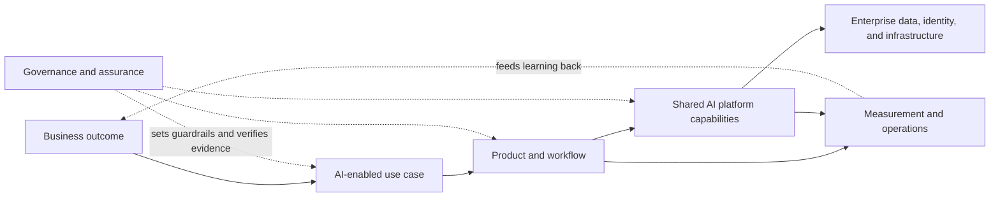

# Enterprise AI Architecture Guide

Enterprise AI succeeds when a useful model is embedded in a trustworthy system. That system must connect business outcomes, governed data, secure access, measurable quality, human accountability, and reliable operations.

This guide provides a shared architecture and decision framework for doing that repeatedly.

## The core model

The model makes three boundaries explicit:

1. **The use case owns the outcome.** A platform team cannot own whether a capability is appropriate or valuable.
2. **The platform provides paved roads.** Common controls and components should be reusable, observable, and hard to bypass accidentally.
3. **Governance is continuous.** Approval at launch is insufficient; material changes, drift, incidents, and retirement need defined treatment.

## Decisions this guide helps make

- Should this use case use AI at all?
- What risk tier and human oversight are appropriate?
- Which capabilities belong in a shared platform?
- Which model, retrieval, agent, or classical ML pattern fits?
- What evidence is required before production?
- How will the system be observed, changed, and retired?

## A practical reading path

Before choosing a role-specific path, scan the
[guide map and coverage review](guide-map.md). It provides the high-level table
of contents, an end-to-end lifecycle view, cross-cutting coverage questions,
and the remaining decisions that need explicit scope.

### Cross-cutting operating paths

These paths join existing guidance and evidence records; they do not create a
second lifecycle or change the accountable owner of a decision.

| Outcome to own | Follow this path | Close the loop with |
|---|---|---|
| **Adopt AI and govern effects on people** | [Strategy and value](executive/strategy-and-value.md) → [adoption roadmap](adoption/adoption-roadmap.md) → [responsible AI and human factors](governance/responsible-ai-and-human-factors.md), including [contestability and recourse](governance/responsible-ai-and-human-factors.md#contestability-and-recourse) | [Use-case assessment](worksheets/use-case-assessment.md) → [risk and impact assessment](worksheets/ai-risk-impact-assessment.md) |
| **Deliver and demonstrate predictive value** | [Predictive machine learning](delivery/predictive-ml.md) → [evaluation strategy](delivery/evaluation-strategy.md) | [Evaluation plan and report](worksheets/evaluation-plan-and-report.md) → [FinOps and value realization](operations/finops-and-value.md) |
| **Own, deploy, correct, and prevent recurrence** | [Repository ownership and deployment plan](worksheets/repository-ownership-and-deployment-plan.md) → [code deployment and release](delivery/code-deployment.md) → [incident, problem, and corrective action](operations/incident-problem-and-corrective-action.md) | [Incident and corrective-action record](worksheets/incident-and-corrective-action-record.md) with effectiveness evidence |

FinOps and value realization apply to every AI pattern; the predictive path is
one joined example, not a scope limit.

### Detailed role paths

For a new enterprise program, begin with [principles](foundations/principles.md), the [reference architecture](architecture/reference-architecture.md), and the [operating model](governance/operating-model.md).

For executives and portfolio leaders, start with [strategy, value, and risk appetite](executive/strategy-and-value.md) and the [adoption roadmap](adoption/adoption-roadmap.md).

For a product team, complete the
[use-case assessment](worksheets/use-case-assessment.md) for every proposal.
Escalate to the
[AI risk and impact assessment](worksheets/ai-risk-impact-assessment.md) before
build or production, or sooner when screening identifies material people,
data, autonomy, or regulatory risk. Record source-specific applicability,
duties, dates, controls, and evidence in the
[regulatory obligation register](worksheets/regulatory-obligation-register.md).
Then follow the
[AI system lifecycle](delivery/ai-lifecycle.md) and close release gates with the
[production readiness review](worksheets/production-readiness-review.md).
The
[fictional procurement-evidence golden thread](examples/worked-golden-thread.md)
shows how those records connect through routing, extension admission,
deployment, incident response, corrective action, and retirement without
claiming a real approval.

For engineering teams using coding agents, start with
the [AI system lifecycle delivery map](delivery/ai-lifecycle.md), apply the
[security-first AI-assisted development lifecycle](delivery/security-first-ai-dlc.md),
execute the
[skills-first AI-assisted change workflow](delivery/skills-first-ai-development.md),
capture the change with the
[AI-assisted change evidence](worksheets/ai-assisted-change-evidence.md)
worksheet, and follow [code deployment and release](delivery/code-deployment.md).

For platform and security teams admitting skills, plugins, hooks, or MCP
servers, use
[agent extension supply-chain security](security/agent-extension-supply-chain.md)
and its [assessment worksheet](worksheets/agent-extension-assessment.md).

For teams designing multi-agent systems or an enterprise model allowlist, use
[governed model routing and agent dispatch](architecture/model-portfolio-and-routing.md).
Refresh discovery inputs from the
[dated model and provider candidate catalog](architecture/model-and-provider-candidate-catalog.md).
Then complete the
[model routing and agent dispatch plan](worksheets/model-routing-and-agent-dispatch-plan.md).
Bind human, workload, agent-runtime, tool, credential, tenant, and delegated
authority in the
[identity and permission matrix](worksheets/identity-and-permission-matrix.md).
Then define the canonical root execution, typed runtime outcomes,
cancellation and ambiguity handling, privacy-minimized event fields, alerts,
reconciliation, and closure in the
[agent execution and telemetry contract](worksheets/agent-execution-and-telemetry-contract.md).

For repository owners, establish duties with the
[repository ownership and deployment plan](worksheets/repository-ownership-and-deployment-plan.md)
and follow [code deployment and release](delivery/code-deployment.md).

For operators and service owners, begin with
[production operations](operations/production-operations.md) and
[resilience](operations/resilience.md). Use the
[agent execution and telemetry contract](worksheets/agent-execution-and-telemetry-contract.md)
when agentic execution is in scope, route escaped issues through the
[incident, problem, and corrective-action](operations/incident-problem-and-corrective-action.md)
loop, and reconcile capacity, cost, and realized outcomes through
[FinOps and value realization](operations/finops-and-value.md).

For teams releasing a repository, model, dataset, prompt or extension package,
evaluation artifact, public site, or other material beyond an established
access boundary, apply the
[public release and external distribution](delivery/public-release-and-external-distribution.md)
gate and complete its
[readiness record](worksheets/public-release-readiness.md) for the exact
candidate.

For owners transferring, decommissioning, withdrawing, archiving, or retiring
a system, supplier boundary, repository, or public artifact, complete the
[transfer, decommissioning, and retirement record](worksheets/transfer-decommissioning-and-retirement.md).
It joins successor acceptance, continuity, in-flight work, data and records
disposition, access removal, supplier exit, readback, residual ownership, and
reopen criteria without authorizing a destructive action.

For platform and architecture teams, use the [reference architecture](architecture/reference-architecture.md), [data architecture](architecture/data-architecture.md), [security architecture](security/security-architecture.md), and [platform engineering](platform/platform-engineering.md).

For assurance teams, use the [risk-tiered control matrix](governance/control-matrix.md),
[framework alignment](governance/framework-alignment.md), the
[regulatory obligation register](worksheets/regulatory-obligation-register.md),
[responsible AI and human factors](governance/responsible-ai-and-human-factors.md),
and [evaluation strategy](delivery/evaluation-strategy.md).

## What “enterprise-ready” means here

An enterprise-ready AI system is:

- tied to a named business owner and measurable outcome;
- classified by impact, data sensitivity, and autonomy;
- secure by default and least-privileged;
- evaluated against task-specific quality and harm thresholds;
- observable across data, model, orchestration, and user experience;
- recoverable through fallback, rollback, and incident procedures;
- governed throughout its lifecycle;
- portable enough to avoid accidental concentration risk.

## Status, provenance, and reporting

This guide was initiated by the repository owner and developed with AI
assistance. This repository is a review and reference artifact. Its
availability does not by itself indicate independent approval, organizational
adoption, certification, legal or security assurance, or fitness for a
particular system. Accountable owners must determine applicability, tailor the
controls, verify their operation, and approve each consequential system and
release. AI review is advisory and cannot provide independent approval.

The repository is a source-only public reference distribution licensed under
the
[MIT License](https://github.com/madtank/enterprise-ai-architecture-guide/blob/main/LICENSE).
Its clean public history excludes the private working history and operational
evidence. No public site deployment is configured, and generated artifacts
retain their own applicable terms. The
[publication and provenance record](https://github.com/madtank/enterprise-ai-architecture-guide/blob/main/PUBLICATION.md)
defines the public boundary and validation. Verify that the following
repository paths are reachable and that the private security-intake path
works; a listed link is not evidence that its destination is usable:

- [project status, provenance, and limitations](https://github.com/madtank/enterprise-ai-architecture-guide/blob/main/PUBLICATION.md);
- [support and correction routes](https://github.com/madtank/enterprise-ai-architecture-guide/blob/main/SUPPORT.md);
- [private security reporting policy](https://github.com/madtank/enterprise-ai-architecture-guide/blob/main/SECURITY.md); and
- [contribution and review model](https://github.com/madtank/enterprise-ai-architecture-guide/blob/main/CONTRIBUTING.md).

Do not put a suspected vulnerability, leaked secret, customer data,
confidential prompt, or internal system detail in a public issue.
