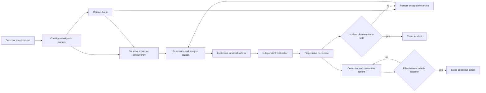

# Incident, problem, and corrective action

Issue handling is a closed loop:

- an **incident** contains harm and restores an acceptable service;
- a **problem investigation** identifies contributing and systemic causes;
- a **defect or vulnerability fix** corrects behavior;
- a **corrective action** removes or controls a cause of an observed failure;
- a **preventive improvement** reduces the likelihood or impact of related
  failures;
- an **effectiveness check** demonstrates whether the action worked against
  defined criteria over an appropriate scope and period.

Restoration is not remediation, and merging a fix is not closure.

This workflow uses
[NIST SP 800-61r3](https://csrc.nist.gov/pubs/sp/800/61/r3/final) as a
cybersecurity incident-response foundation. Its extension here to AI quality,
safety, fairness, operational defects, complaints, nonconformities, and
corrective and preventive action is organization-defined. Do not represent
those broader processes as requirements of NIST SP 800-61r3. As checked
2026-07-28, NIST lists revision 3 as final, published April 2025, and
superseding revision 2. The role and handoff contract below is also an
organization-defined operating control, not a claim that NIST prescribes these
job titles.

Use the
[incident and corrective-action record](../worksheets/incident-and-corrective-action-record.md)
to bind the issue, response, root cause, fix, preventive action, independent
verification, effectiveness review, and separate closure decisions.

## Route the issue

| Issue type | Primary path | Special handling |
|---|---|---|
| Active production degradation or harm | Incident response | restore or contain first |
| Reproducible software defect | Defect workflow | failing regression test before fix where practical |
| Suspected vulnerability | Private vulnerability process | restrict disclosure and preserve evidence |
| AI quality, safety, fairness, or autonomy regression | AI incident plus evaluation workflow | assess affected slices, actions, and recourse |
| Data, feature, retrieval, or index defect | Data incident and correction workflow | identify every derived asset and dependent release |
| Failed or bypassed control | Nonconformity and corrective action | assess broader exposure and similar controls |
| Complaint, appeal, or contested decision | Product and human-review process | preserve access to explanation, correction, and remedy |
| Supplier or mutable-model change | Supplier and release reassessment | constrain, reroute, or suspend if needed |
| Skill, plugin, hook, MCP, tool-schema, or route change | Extension or route incident plus supply-chain reassessment | revoke component or route, rotate credentials, quarantine affected releases |
| Near miss | Problem and preventive-action review | do not wait for customer impact |

Security reports follow the repository or enterprise security policy. Do not
ask a reporter to place exploit details, secrets, or sensitive data in a public
issue.

## Severity and ownership

Severity should consider:

- actual and potential harm;
- affected people, tenants, records, actions, and transactions;
- data sensitivity and exposure;
- autonomy, privilege, and irreversibility;
- propagation across services or customers;
- duration and detectability;
- service, financial, regulatory, contractual, and public impact;
- availability of a safe fallback or remedy.

A single high-consequence action may outrank a widespread low-quality result.

For every material issue, name:

- stable IDs for every affected service or runtime boundary, repository,
  artifact, and release;
- incident commander and accepted backup;
- service or runtime owner, on-call route, and accepted backup for each
  affected service;
- accountable repository owner, maintainer or triage owner, fix or change
  owner, and applicable code owners and reviewers for each affected repository;
- release owner, deployment operator, and observed-state readback owner for
  containment, restoration, and any fix release;
- technical investigation owner;
- product or business impact owner;
- security, privacy, data, responsible-AI, legal, communications, and supplier
  owners as applicable;
- problem and corrective-action control owner, closure authority, and required
  independent effectiveness verifier; and
- decision authority for shutdown, rollback, recovery, notification, and
  closure.

Assignments need a primary, accepted backup, contact method, authority source,
and handoff expectation.

### Authority does not flow between roles

| Role | Accountable decision or action | This role alone does not authorize |
|---|---|---|
| Service or runtime owner | Operating objectives, support, dependency coordination, impact, fallback, and acceptance of restored service | Repository repair or merge, release, deployment execution, incident closure, or corrective-action closure |
| Incident commander | Severity, coordination, and predefined containment and restoration coordination | Incident closure, ordinary repository merge, general release or promotion, self-verification of execution, or corrective-action closure |
| Named incident-closure authority | Record `close` or `keep open` after required service restoration, notification, remedy, evidence, and custody conditions | Response execution, repair, merge, release, or corrective-action closure merely by closing the incident |
| Repository owner, maintainer, and code owners | Repository custody, repair triage, path review, merge, and continuity under policy | Runtime containment, release, deployment, service-restoration acceptance, incident closure, or corrective-action closure |
| Fix or change owner | Correction intent, implementation, evidence, and follow-through for one change | Approval, deployment, independent verification, risk acceptance, or closure of their own work |
| Release owner | Exact-release `go`, `hold`, `abort`, and promotion decisions after required evidence and approval | Deployment execution or proof that the target reached the approved state |
| Deployment operator or authorized responder | Execute only the recorded deployment or containment action | Create missing approval, widen scope, or provide independent readback where separation is required |
| Observed-state readback owner | Compare actual runtime state with the authorized target and record match, gap, and disposition | Release, incident, or corrective-action closure merely by reporting state |
| Corrective-action or control owner | Freeze criteria and record `close` or `keep open` after required effectiveness evidence | Replace required independent verification or close the incident |
| Independent verifier | Report `pass`, `fail`, or `inconclusive` against predeclared criteria | Close an incident or corrective action unless separately assigned a compatible human authority |

One person may hold compatible roles when adopted policy permits it, but every
decision remains separately attributable and required independence must be
preserved. A service can depend on several repositories, and a repository can
affect several services. Record both directions with stable IDs rather than
assuming one owner or one-to-one scope.

A handoff is not an authority transfer unless the receiving primary or backup
accepts the exact scope, duty, limits, time, and evidence. Keep the prior owner
and escalation active until acceptance. An unaccepted, expired, or ambiguous
handoff remains open and cannot be used to declare restoration or closure.

## Regulatory and contractual clock handoff

At triage, link the system's current
[regulatory obligation register](../worksheets/regulatory-obligation-register.md)
snapshot and preserve occurrence, detection, awareness, confirmation,
containment, and materiality-decision timestamps. Record potentially
applicable obligation IDs and canonical Event IDs. For each incident instance,
record the clock-start fact and time, calculated due time and timezone under
the canonical Event rule, recipients, required initial and supplemental
content, supplier notice dependencies, and evidence of delivery.

The incident commander supplies facts and protects the response; the
qualified legal, privacy, compliance, contract, or other obligation owner
decides applicability and notification within their authority. When the
decision is uncertain, escalate against the earliest plausible clock and
retain a hold rather than waiting for root-cause analysis or treating silence
as permission not to notify.

## Closed-loop workflow

Evidence preservation begins during intake and triage and continues through
containment and restoration. When delay creates imminent risk of harm,
authorized containment takes precedence over complete capture. Record what
could not be preserved and why; do not postpone safe evidence collection that
does not impede containment.

The
[synthetic incident and corrective-action thread](../examples/worked-golden-thread.md#9-synthetic-incident-and-corrective-action)
illustrates containment, regulatory-clock handoff, verified repair,
progressive rerelease, and a corrective action that remains open after service
restoration.

### 1. Detect and acknowledge

Capture:

- reporter and safe contact method;
- time, environment, affected version or route, and observation;
- expected and actual behavior;
- business, user, data, security, and operational impact;
- reproduction or occurrence rate;
- immediate workaround;
- sensitivity and disclosure restrictions.

Create a stable issue or incident identifier. Acknowledge ownership rather than
leaving an alert, complaint, or scanner result unassigned.

### 2. Triage and declare

Confirm the issue type, severity, scope, and required responders. Separate
verified facts, working hypotheses, and unknowns. Establish update frequency
and the authority to pause service, revoke credentials, disable tools, block a
release, or communicate externally.

Freeze the initial service-to-repository impact map, role and decision-rights
register, accepted backups, and handoff state. Update that map append-only as
scope changes; do not overwrite the fact that a boundary or owner was unknown
at an earlier decision point.

### 3. Contain

Select the least harmful effective action:

- disable a feature, model route, tool, connector, prompt, policy, dataset, or
  index;
- revoke credentials or delegated authority;
- restrict tenants, cohorts, actions, or traffic;
- stop a rollout;
- switch to a tested deterministic or human path;
- roll back to a known-good compatible release;
- quarantine compromised artifacts or sources;
- preserve affected state for investigation.

Containment must maintain authorization and data obligations. A fallback that
violates residency or exposes more data is not safe.

Preserve evidence concurrently where safe. If collection would delay action
needed to prevent imminent harm, contain first and document the resulting
evidence gap.

A predefined pause, revocation, isolation, rollback, or manual fallback is a
containment action only within its recorded authority. If the urgent response
requires a production code, configuration, data, route, model, extension, or
infrastructure change outside that boundary, use the
[emergency-change process](../delivery/code-deployment.md#emergency-changes).
Record the incident ID, exact action and target, emergency authority and
executor, why ordinary gates cannot meet the response time, before-state
evidence, time-bounded identity and expiry, stop and recovery path,
observed-state readback, evidence gaps, and the owner and deadline for normal
tests, protected review, documentation, merge or revert, and corrective
action. Incident authority does not automatically approve an ordinary repair,
merge, release, or later promotion.

By the retrospective deadline, any emergency change still present must either
be reverted or packaged as an exact reviewed release candidate and receive the
ordinary release-owner decision, deployment and readback reconciliation, and
operating-envelope record. Merge or completed review alone does not normalize
production state.

### 4. Preserve evidence concurrently

At an appropriate privacy level, retain:

- initiating identity and request or event identifier;
- source, build, release, deployment, and configuration identifiers;
- agent execution and telemetry contract ID, schema, and deployed producer and
  consumer revisions;
- model provider, route, alias, and revision when available;
- prompt, policy, retrieval, data, index, skill, plugin, hook, MCP server,
  tool-schema, and workflow revisions;
- authorization, approval, state transition, retry, and side-effect results;
- sanitized relevant inputs, outputs, traces, logs, and screenshots;
- required-event gaps, integrity failures, unknown outcomes, quarantines, and
  reconciliation state;
- alerts, operator actions, communications, and timestamps;
- artifact signatures, checksums, and custody.

Collect the minimum content needed. Apply redaction, access control, retention,
legal hold, and integrity protection. Do not create an uncontrolled sensitive
data lake for debugging.

### 5. Restore acceptable service

Restore through rollback, forward recovery, compensation, data correction, a
safer fallback, or controlled reduced functionality. Verify the actual running
state and the critical outcome, not only process completion.

Document what remains impaired and, for each identified risk, whether it is
demonstrably remediated or retained under adopted policy. Every retained risk
must link all applicable current category-bound decision IDs, exact scope,
named authorities and authority bases, results, conditions, validity states,
expiries, invalidation triggers, and supersession; also record the owner and
expiry of every workaround.

For every containment, rollback, restoration, and rerelease checkpoint, bind
the expected release manifest plus critical configuration, route or model,
extension, data or migration, identity or authority, cohort, and fallback to
the observed value, observation time, authoritative source, verifier, result,
and disposition. An unknown, stale, mismatched, or ambiguously committed side
effect forces hold and reconciliation. Each affected service owner accepts its
restored operating state only after the named readback; that acceptance is
evidence for, but not itself, the incident-closure decision.

### 6. Reproduce and diagnose

Create the smallest safe reproducer or statistical replay that represents the
failure. Diagnose across the full system:

- requirement and product assumptions;
- source code, dependencies, and infrastructure;
- data, labels, features, retrieval, and index;
- model and provider behavior;
- prompt, policy, orchestration, memory, and agent topology;
- identity, authorization, tools, and systems of record;
- user experience and human review;
- test, evaluation, monitoring, and release gaps;
- supplier change and organizational incentives.

Do not stop at labels such as “hallucination,” “human error,” or “the agent did
it.” Identify the conditions that allowed the failure to reach or remain in
production.

### 7. Define the fix

Assign a fix or change owner for every affected repository or governed
artifact. The accountable repository owner or maintainer accepts repair
triage, applicable code owners and required independent reviewers decide
technical acceptance, and an authorized maintainer merges under policy. Those
actions do not declare the service restored or authorize production release.

For a code defect:

1. link the incident or issue;
2. add a regression test that fails on the affected revision where practical;
3. state the expected behavior and unaffected behavior;
4. choose the smallest safe correction;
5. assess similar paths and prior releases;
6. update migration, rollback, monitoring, and communication plans;
7. follow the ordinary protected PR and review process.

For probabilistic behavior, use a representative protected evaluation case,
multiple trials where required, severity-weighted thresholds, and slice
analysis. A single successful rerun is weak evidence.

Vulnerability remediation also assesses exploitability, exposure window,
credential or data compromise, affected versions, notification, and coordinated
disclosure.

### 8. Verify independently

Verification should include:

- the original reproducer or evaluation now passes;
- the check failed against the pre-fix revision;
- relevant regression, negative, adversarial, integration, and security tests;
- migration and recovery validation;
- review by someone other than the change-producing person or agent;
- confirmation that no required check or threshold was weakened;
- staging or replay evidence against the release candidate.

The change-producing agent's summary is not independent verification.

### 9. Release progressively

Deploy through the
[code deployment and release](../delivery/code-deployment.md) process. Observe
the affected path and related signals. Define an explicit rollback or abort
threshold for the fix itself; remediation can introduce a new failure.

The release owner records `go`, `hold`, `abort`, and promotion decisions for
the exact candidate. The deployment operator executes only that decision, and
the observed-state readback owner independently records the actual target
state and discrepancies required by adopted policy. Merge, release approval,
execution, readback, restoration acceptance, and incident closure remain
distinct states.

### 10. Analyze systemic causes

After stability, conduct a learning review proportional to severity. Examine:

- technical trigger and contributing conditions;
- why prevention did not block it;
- why detection did or did not find it;
- why containment and recovery took the observed time;
- whether ownership, documentation, tools, skills, or decision rights were
  unclear;
- which similar systems may share the condition;
- whether earlier warnings or near misses existed.

Use blameless analysis to improve systems while retaining explicit
accountability for actions and follow-through.

### 11. Correct and prevent

Potential actions include:

- regression tests and protected evaluation cases;
- stronger invariants, schemas, types, or authorization;
- narrower agent and tool authority;
- deterministic policy or CI checks;
- updated skills and repository instructions;
- stronger extension-admission rules, route policy, revocation, and
  credential-rotation controls;
- architecture or dependency changes;
- improved alerts, dashboards, or sampling;
- safer defaults, feature flags, fallbacks, or compensation;
- updated runbooks, ownership, staffing, training, or supplier terms;
- review of sibling repositories and services.

Each action needs a stable ID and affected service and repository scope;
implementation primary and backup; corrective-action or control owner and
closure authority; priority, due date, dependency, and accepted custody;
criteria and baseline frozen before results; real-path evidence; observation
scope and period; required independent verifier; and reopen trigger. Do not
close an action because a document was written or a fix was merged; verify that
the new control operates on the real path.

### 12. Close the incident and communicate

Authorized incident closure requires:

- acceptable service restored;
- affected data, transactions, or people addressed;
- required notification and recourse completed;
- every identified risk demonstrably remediated by the released permanent fix
  or, where adopted policy permits retention, covered by every applicable
  current category-bound residual-risk decision;
- accepted restoration readback for every affected service boundary;
- evidence retained under policy;
- open corrective actions recorded with owners, due dates, evidence criteria,
  accepted custody, independent-verification requirement, and closure
  authority;
- system card, inventory, runbook, tests, skills, and architecture records
  updated where needed.

Closing the incident does not close its corrective or preventive actions.
Those actions remain open until their effectiveness criteria pass.
If the affected system is transferred or retired, use the
[transfer, decommissioning, and retirement record](../worksheets/transfer-decommissioning-and-retirement.md)
to assign incident, CAPA, complaint, appeal, notification, evidence, and
known-error custody. Exit closure cannot silently close those workflows.

Communicate what happened, impact, current state, customer action, and
prevention at the level appropriate to the audience and disclosure constraints.

### 13. Verify and close corrective actions

For each corrective or preventive action:

1. verify that the action was implemented on the real operating path;
2. confirm that the criteria, baseline, scope, and observation period were
   approved before results were known;
3. execute the defined effectiveness test over the required scope and period;
4. have the named verifier record `pass`, `fail`, or `inconclusive` and their
   independence or permitted role relationship;
5. retain the result and required review;
6. have the named corrective-action or control owner record `close` or
   `keep open`;
7. keep failed, inconclusive, stale, incomplete-period, overdue, or regressed
   actions open and revise or escalate them.

Scheduling an effectiveness review is not evidence that an action worked.
Closing one action does not close sibling actions or the incident.

## Fix ownership matrix

| Decision or action | Accountable role |
|---|---|
| Accept issue, set severity, and coordinate response | incident commander under predefined authority |
| Stop, isolate, or degrade service | incident commander under predefined authority |
| Accept restored operating state for each service boundary | service owner after observed-state readback |
| Revoke access or contain compromise | security owner |
| Correct data or transactions | data and business-process owners |
| Own repair scope, intent, evidence, and follow-through | fix or change owner with the accountable repository owner |
| Technically accept code or configuration repair | applicable code owners and required independent reviewers |
| Merge an accepted repair | authorized maintainer under repository policy |
| Decide whether a defined residual risk may be retained | one named, category-bound residual-risk decision authority designated under adopted policy and bound to the exact risk record |
| Decide a security, privacy, compliance, or other internal-policy exception | one named exception authority separately designated under adopted policy and bound to the exact exception record |
| Authorize release or promotion of the fix | release owner after required approvals |
| Execute the authorized deployment or containment action | deployment operator or authorized responder within recorded authority |
| Read back containment, restoration, and deployed state | named observed-state readback owner |
| Notify affected parties | legal, privacy, communications, and product owners as applicable |
| Close incident | incident authority after restoration evidence |
| Verify corrective-action effectiveness | named independent verifier where required |
| Close or keep open a corrective action | control owner after effectiveness evidence |

Incident command, service restoration, repository repair, and release consume
required current residual-risk and exception decisions; none inherits or
recreates those authorities. Supporting discipline rows are not votes.

## Measures

Track:

- time to acknowledge, own, contain, restore, remediate, and verify;
- customer or stakeholder harm and recourse completion;
- detection source and coverage;
- rollback and recovery success;
- defect escape and reopen rate;
- recurrence of the same or related cause;
- corrective actions overdue and verified effective;
- percentage of fixes with pre-change reproduction evidence;
- emergency changes and retrospective completion;
- near-miss reporting and prevention;
- owner and backup coverage.

Avoid rewarding fast closure if it creates shallow cause labels, suppresses
reports, or leaves preventive work unfinished.
