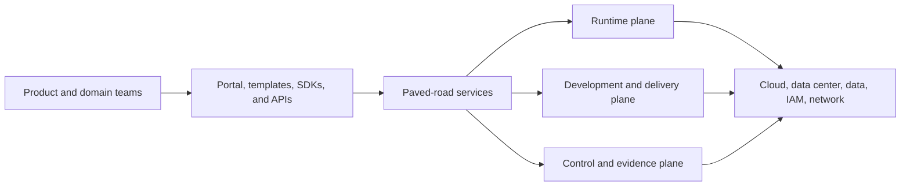
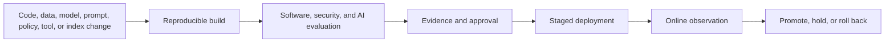

# AI platform engineering

An enterprise AI platform is a product that gives delivery teams safe, observable, and economical ways to build AI systems. It is not a single model endpoint, a notebook environment, or a collection of vendor consoles.

The platform should centralize capabilities with enterprise-wide economies of scale while leaving use-case outcomes and domain decisions with product teams.

## Platform boundaries

The platform owns reusable capability and service reliability. It does not own:

- whether a use case is legitimate;
- the source data’s meaning or permitted purpose;
- the user workflow and human oversight;
- domain-specific evaluation thresholds;
- category-bound residual-risk decisions reserved to named authorities under
  adopted policy.

## Service catalog

A mature platform may provide:

### Access and runtime

- AI gateway, model catalog, routing, rate limits, quotas, and cost attribution;
- online, batch, streaming, and asynchronous inference patterns;
- agent or workflow runtime with durable state, budgets, and checkpoints;
- approved tool registry and connector gateway;
- entitlement-aware retrieval and context assembly;
- guardrail, policy, schema-validation, and content-handling services;
- managed feature, vector, cache, and session-memory services.

### Development and delivery

- isolated workspaces and approved data-access paths;
- reusable project templates, reference implementations, SDKs, and test doubles;
- experiment tracking and reproducible training or fine-tuning;
- registries for models, datasets, prompts, policies, tools, and evaluations;
- evaluation harnesses, red-team suites, and representative test data;
- artifact stores, build pipelines, infrastructure as code, and GitOps promotion;
- deployment strategies including shadow, canary, champion/challenger, and rollback.

### Management and assurance

- inventory, ownership, classification, approval, exception, and lineage records;
- dashboards for outcome, quality, fairness, safety, security, reliability, and cost;
- privacy-minimized traces and audit-event export;
- policy-as-code distribution and control-evidence collection;
- vendor inventory, entitlement management, and deprecation notices;
- capacity, sustainability, showback, and chargeback data.

Not every organization needs to build every service. The architectural requirement is a coherent contract and ownership model, whether capabilities are built, bought, or shared.

## Golden paths

Provide opinionated paths for common patterns:

- predictive batch and online inference;
- grounded enterprise assistant;
- human-approved content generation;
- human-approved transaction preparation;
- bounded tool-using agent;
- fine-tuned model or adapter;
- sensitive or regulated deployment.

Each path should ship with:

- reference architecture and threat model;
- infrastructure and pipeline templates;
- default identity, network, data, and logging controls;
- evaluation starter set and release thresholds;
- service objectives, dashboards, alerts, and runbooks;
- cost model and quota defaults;
- required evidence and approval route.

A golden path is successful when teams can extend it without forking its control foundations.

## Environment and tenant model

Define:

- enterprise, domain, product, environment, and tenant isolation boundaries;
- separate identities and data for development, test, evaluation, and production;
- approved paths for masked, synthetic, sampled, and production data;
- whether models, caches, indexes, and GPUs are shared or dedicated;
- noisy-neighbor, data-residue, and side-channel controls;
- regional deployment and data-sovereignty rules;
- promotion and rollback across environments.

Production should not depend on mutable notebooks, personal API keys, ad hoc tunnels, or development-only vendor projects.

## Model access and routing

The model catalog should record approved purposes, data classes, regions, context limits, safety characteristics, quality evidence, cost, quotas, support status, and deprecation dates.

The gateway or routing layer may:

- enforce workload identity and use-case authorization;
- block disallowed data/provider combinations;
- select models by quality, risk, availability, latency, and cost policy;
- apply rate and spend controls;
- record model revision and routing rationale;
- fail safely when no approved route is available.

Routing must not silently move sensitive traffic to an unapproved provider, region, model, or retention policy.

### Agent and model route profiles

Use stable capability profiles rather than allowing applications, agents, or
skills to name arbitrary provider aliases.

| Field | Required decision |
|---|---|
| Task and risk class | Which work and consequence level may use the route? |
| Coordinator profile | Is decomposition required, and at what evaluated capability? |
| Worker profile | What reasoning, context, modality, structure, and tool-use capability is required? |
| Serving boundary | Which operating responsibility, location, tenancy, connectivity, artifact control, exact model/runtime target, and final invocation enforcement point are allowed? |
| Supplier and artifact constraints | Which services, immutable revisions or weight/runtime digests, approved mutable-service records, regions/sites, data terms, patch states, and lifecycle states are allowed? |
| Authority | Which data, tools, side effects, and delegation depth are permitted? |
| Objectives | Which quality, critical-case, latency, availability, and total-cost thresholds apply? |
| Verification | Which protected deterministic gate validates machine-checkable postconditions, which model reviewer may advise or reject, and which qualified human approves consequential judgment? |
| Escalation and fallback | When does the route retry, escalate, abstain, or fail safely? |
| Operations | Who owns the route, budget, monitoring, reassessment, emergency block, and revocation? |

The coordinator may request only compatible approved profiles. The gateway
resolves the profile to an allowed exact deployment, enforces data and
authority constraints, and records the decision. See
[governed model routing and agent dispatch](../architecture/model-portfolio-and-routing.md).

The policy service must express that decision as the same versioned,
tamper-evident enterprise route grant for every harness. Codex, Claude Code,
Google ADK, AgentCore, and application-specific adapters may expose different
configuration APIs, but each adapter must validate the grant before model
access, map only its permitted fields, reject unsupported or widened
authority, and return observed-route telemetry for reconciliation. A
product-specific model override is an implementation mechanism, not a second
policy authority.

The adapter path must also be exclusive and live-authorized for every
decision-bound serving-boundary ID, revision, and digest. A supplier-operated
or jointly managed path
puts provider credentials and provider-bound egress only at the approved
gateway. An enterprise-operated path puts invocation-admission authority only
at the approved serving gateway, scheduler, or runtime policy enforcement point
and gives a separate decision-bound serving-runtime identity only the approved
artifact-read and accelerator access. Applications, models, workers, skills,
and unapproved workloads hold neither identity.

Immediately before model access, the final invocation enforcement point
transactionally validates the selected serving-boundary ID/revision/digest,
exact target, artifact/runtime identity, deployment approval, current
per-approval revocation epoch, and an authenticated freshness-bounded
deployment/load measurement while changing a single-use lease from `issued` to
`committed-to-invoke`; only then may it send, queue, or execute the request.
Runtime self-report alone is not an integrity source; missing, stale, or
tampered measurement makes exact-runtime enforcement unsupported.
This durable transition is the race boundary: a block committed first denies
the invocation, and an invocation committed first is in flight. The catalog
revision remains immutable decision provenance. An emergency block stops new
leases and becomes effective only after every connected managed or local
enforcement point acknowledges the new epoch or is independently verified
drained or disabled and every outstanding disconnected package and lease is
acknowledged, independently disabled, or expired or exhausted;
unavailable or stale control state fails closed, while in-flight results are
cancelled or quarantined. A disconnected path needs a separately approved,
signed, bounded-validity policy package bound to one PEP/device proof key and
measured runtime, a pre-reserved non-overlapping allocation, and durable
rollback-resistant local package/epoch/consume/lease state. Clone, snapshot
restore, local-state corruption, expiry, exhaustion, missed refresh, clock
uncertainty, or block uncertainty fails closed. Central policy does not refresh
or reuse its allocation before reconciliation, and a block is not effective
merely because an administrative record says the PEP is disabled. The policy
service atomically reserves each child grant from a shared root-execution
budget so individually valid parallel children cannot collectively exceed
fan-out, concurrency, token, retry, deadline, or cost limits.

Switching between managed and enterprise-operated serving, or changing
location, connectivity, weights, serving image, runtime/configuration, safety
policy, target, or final enforcement point, is a material deployment change.
Cross-boundary fallback is never implicit and requires separate approval,
evaluation, conformance, cost, data, rollback, drain, and readback evidence.

Role-specific model configuration is technically possible but not
automatically governed. Keep changing product examples and their source dates
in the
[dated model and provider candidate catalog](../architecture/model-and-provider-candidate-catalog.md#product-specific-harness-capabilities).
The portable route-grant and adapter controls above remain required regardless
of product configuration precedence or override features.

## Delivery architecture

Treat all AI artifacts as versioned dependencies:

Prefer immutable revisions. When a provider exposes only a mutable alias, record the limitation, detect behavioral drift continuously, and keep a tested fallback.

## Platform product management

Manage the platform with:

- named product and service owners;
- user research with delivery and assurance teams;
- published APIs, service levels, support model, and roadmap;
- adoption, lead-time, reuse, reliability, satisfaction, and control-effectiveness metrics;
- transparent unit economics and funding model;
- deprecation policy with migration assistance;
- exceptions that feed the platform backlog.

Avoid measuring success only by model calls, registered users, or number of pilots. Measure how quickly teams deliver governed outcomes and how much duplicated or unsafe work the platform removes.

## Build, buy, and portability

For each capability, compare:

- strategic differentiation;
- control and customization requirements;
- internal operating skill;
- integration and migration effort;
- scale and performance;
- contract, data, IP, and concentration risk;
- total cost across build, run, assurance, and exit.

Wrap external services with stable enterprise contracts where that improves policy consistency and exit options. Do not create abstraction layers that erase valuable provider capabilities without a credible portability requirement.
