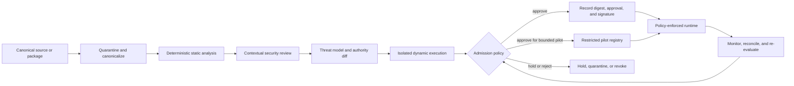

# Agent extension supply-chain security

Agent extensions combine instructions with capability. A skill, plugin, hook,
MCP server, agent package, tool schema, startup command, or helper script can
change what an agent believes, what it can read, where it can send data, and
which actions it can take. Treat these components as untrusted software and
control-plane inputs, not as harmless prompt text.

This page defines an admission, execution, monitoring, and revocation pattern
that can support Codex skills, Claude Code plugins and skills, Gemini CLI
extensions, OpenHands integrations, MCP clients and servers, and similar
frameworks. Product-specific parsers normalize each format into a common
security record; enterprise policy remains outside any one harness.

## Security boundary

Skill metadata, tool annotations, marketplace inclusion, registry discovery,
automated screening, and a requested or pre-approved tool list are not
authorization boundaries. Enforce deny-by-default tool, filesystem, network,
credential, data, and resource policy outside the model.

Treat all of the following as executable or control-bearing:

- instructions, prompts, examples, templates, memory seeds, and retrieved
  documentation;
- agent definitions, tool descriptions, schemas, annotations, and results;
- plugins, hooks, helper scripts, install/build steps, local startup commands,
  binaries, containers, and package dependencies;
- MCP servers, manifests, transports, authentication configuration, dynamic
  tool lists, and transitive downstream services;
- model and provider configuration, marketplace update channels, and runtime
  policies.

Approval applies to an exact component digest or version where exposed, its
declared authority, and an approved use context. For a provider-managed mutable
service, approve the service identity and configuration, record its observed
revision and interface/capability hashes, run sentinel evaluations, monitor
change, and keep an exception and tested fallback. Approval is not blanket
trust for later versions or every task.

## Threat model

### Prompt and control manipulation

- direct or indirect instructions to ignore higher-priority rules;
- Unicode confusables, bidirectional controls, hidden text, or misleading
  rendered-versus-source content;
- fake policy, approval, tool, or system messages;
- instructions that redefine priorities, evidence, completion, or escalation;
- poisoned examples or tool descriptions that steer future calls.

### Data exfiltration

- reads of SSH keys, cloud credentials, environment files, browser data,
  source-control tokens, or unrelated workspaces;
- unexpected upload, HTTP, DNS, webhook, email, or collaboration requests;
- encoded, compressed, encrypted, fragmented, or image-based payloads;
- cross-server flows that combine a private-data reader with a public sink;
- model, telemetry, support, or evaluation retention outside the approved
  data boundary.

### Shell and runtime abuse

- download-and-execute patterns such as `curl | bash`;
- `eval`, interpreter injection, unsafe deserialization, or dynamic command
  construction;
- obfuscated commands, background processes, persistence, or sandbox escape;
- access to instance metadata, management networks, Docker sockets, or
  privileged host APIs;
- unbounded subprocesses, forks, retries, token use, or denial of wallet.

### Repository and build poisoning

- suspicious install scripts, auto-executing build steps, Git hooks, workflow
  changes, or runner manipulation;
- hidden binaries, Unicode filenames, symlink traversal, generated artifacts,
  submodules, or release assets that differ from reviewed source;
- mutable dependencies, namespace confusion, typosquatting, compromised
  maintainers, or unsigned updates;
- disabling tests, scanners, approval rules, or evidence collection before
  self-verification.

### Skill, plugin, and MCP-specific abuse

- overly broad allowed tools or automatic shell execution;
- unsafe helper scripts and dynamic command interpolation;
- plugins that silently bundle hooks or local MCP startup commands;
- an admitted MCP server later changing tool names, descriptions, schemas, or
  annotations;
- token passthrough, confused-deputy OAuth, weak redirect validation, session
  hijacking, or cross-tenant resource access;
- poisoned corrections promoted into shared skills, policies, or guardrail
  libraries.

## Inspection and admission pipeline

### 1. Acquire and canonicalize

- obtain the package from its canonical source and record the exact commit,
  release, digest, signer, retrieval time, and license;
- archive or hash the full package, including dotfiles, submodules, release
  assets, symlinks, generated files, and transitive manifests;
- render and inspect Unicode, bidirectional controls, archive paths, file
  types, executable bits, and source-to-binary differences;
- disable install hooks, network access, and execution during inspection;
- compare requested authority and contents with the prior approved version.

### 2. Deterministic static analysis

Use several techniques because no one rule set covers the threat surface:

- secret, credential, malware, binary, dependency, license, and vulnerability
  scanning;
- Semgrep or equivalent code rules, CodeQL or equivalent semantic analysis,
  YARA rules, shell linting, and targeted text searches;
- policy checks for forbidden paths, destinations, commands, permissions,
  interpreters, hooks, and mutable dependencies;
- manifest-to-content validation for declared tools, scripts, MCP servers,
  dependencies, and model profiles;
- SBOM and AI component inventory generation plus provenance verification.

High-confidence violations such as credential theft, unapproved egress,
privilege escalation, disabling controls, or hidden executable content are
vetoes. Do not average them away with a favorable aggregate score.

### 3. Contextual security review

A separate model or qualified reviewer can identify intent that signatures
miss, but its output is advisory. Review the package as a system:

- do instructions match helper code and manifests;
- is each permission necessary for the stated behavior;
- can untrusted content become control instructions or command arguments;
- can two individually acceptable tools compose into exfiltration or privilege
  escalation;
- can the component alter its verifier, registry, update channel, or evidence;
- do examples, tests, and documentation hide a different runtime path;
- what happens on ambiguity, partial failure, or malicious tool output.

Prompt injection in the package can target the reviewing model. Give the
reviewer no release authority, restrict its tools, and compare its findings
with deterministic evidence.

### 4. Threat model and authority diff

Map assets, identities, trust boundaries, attacker capabilities, abuse paths,
and mitigations using the
[AI threat-model worksheet](../worksheets/threat-model.md). Use
[MITRE ATLAS](https://atlas.mitre.org/),
[OWASP LLM and agentic guidance](https://genai.owasp.org/),
[NIST SP 800-218 and 800-218A](https://csrc.nist.gov/pubs/sp/800/218/a/final),
and [SLSA](https://slsa.dev/spec/v1.2/) as inputs appropriate to the component.

Produce a machine-readable authority diff covering filesystem, network,
credentials, tools, data, models, resources, side effects, persistence, update
behavior, and delegation. Any expansion requires explicit review.

### 5. Isolated dynamic execution

Execute only after static triage, in a disposable environment with:

- synthetic data and canary secrets;
- no ambient credentials or production network;
- allowlisted DNS, IP, protocol, and HTTP destinations;
- read-only base image and tightly scoped writable workspace;
- syscall, process, file, network, and tool-call observation;
- quotas for time, memory, CPU/GPU, files, output, tokens, calls, and spend;
- forced failure, malformed input, poisoned content, and permission-denial
  scenarios;
- comparison of observed behavior with the declared manifest.

A sandbox is one layer. Verify that it fails closed when unavailable and that
all relevant built-in tools, subprocesses, browsers, and external services are
covered.

### 6. Decision and registry

The admission record contains:

| Field | Required value |
|---|---|
| Identity | canonical name, source, version, commit, digest, signer, owner |
| Mutable service, if unavoidable | approved service/configuration, observed revision, interface and capability hashes, sentinels, exception, change monitoring, and fallback |
| Contents | skills, agents, prompts, tools, hooks, scripts, MCP servers, binaries, dependencies |
| Authority | data, filesystem, network, credential, tool, resource, side-effect, and delegation limits |
| Compatibility | approved harnesses, models, operating systems, repositories, and data classes |
| Evidence | scans, threat model, sandbox results, exceptions, and reviewer |
| Decision governance | decision ID and time; one named admission authority and basis; authoritative disposition; required advice, constraints, and duty acknowledgements |
| Decision binding | assessment revision and digest; exact package or mutable-service record; approved scope and runtime-policy digest; evidence, condition, finding, and exception IDs; effective date, expiry, invalidation triggers, and superseding record |
| Lifecycle | draft, quarantined, pilot, active, deprecated, or revoked |
| Operations | update policy, last/next review, expiry, monitoring, revocation, replacement, and fallback |

The organization must designate one named extension-admission authority for
the assessed boundary. Supporting component, platform, security, privacy,
data, repository, and release roles provide required constraints, advice, or
duty acknowledgements; their rows do not create approval by vote or majority.
An unresolved required-role blocker or conflict with controlling policy
defaults the disposition to **Hold** unless the separately authorized
exception path resolves it. The admission authority cannot waive a requirement
outside its authority, and a critical veto finding cannot be excepted.
AI-generated review remains advisory.

Sign or otherwise protect the decision-bound record. The runtime admits only
a matching digest or approved mutable-service record with an active,
attributable **Approve** decision and an authorizing `pilot` or `active`
lifecycle state. Conditions must be enforceable, monitored, and unexpired.
**Hold**, **Reject**, `quarantined`, `deprecated` for new use, `revoked`,
`expired`, and `superseded` records deny admission. The runtime applies the
narrower of component-requested and enterprise authority.

A material change to a decision-bound package, revision, digest, signer,
dependency, manifest, capability or schema, authority, scope, runtime policy,
or evidence; a mutable-service observation outside its approved envelope; a
failed sentinel or veto assertion; expiry; loss of ownership; or loss of
enforcement invalidates admission. Deny new execution and apply the recorded
containment or revocation path until a new attributable superseding decision
is issued. Preserve the prior record rather than editing it to manufacture
continued approval.

## MCP-specific controls

MCP introduces a live protocol boundary and dynamic server behavior. Apply the
current [MCP specification](https://modelcontextprotocol.io/specification/2025-11-25),
[HTTP authorization](https://modelcontextprotocol.io/specification/2025-11-25/basic/authorization),
[tools specification](https://modelcontextprotocol.io/specification/2025-11-25/server/tools),
[security best practices](https://modelcontextprotocol.io/docs/tutorials/security/security_best_practices),
and [client security guidance](https://modelcontextprotocol.io/docs/develop/clients/client-best-practices).

For every server:

- record owner, canonical source, transport, command or image digest, hosting
  environment, service identity, data classification, and lifecycle state;
- negotiate an approved protocol version and capability manifest covering
  tools, resources and subscriptions, prompts, roots, sampling, elicitation,
  logging, completion, and any experimental surface;
- for each enabled capability, record allowed data, direction, consent,
  authority, owner, schema, output treatment, and revocation behavior;
- freeze or hash approved tool names, descriptions, schemas, annotations,
  resource and prompt identifiers, and expected output contracts;
- reject or quarantine dynamic capability, tool-list, resource, prompt, or
  schema changes—including `notifications/tools/list_changed`—until policy and
  review accept them;
- when a local startup command exists, display and explicitly approve its
  executable and arguments;
- use cryptographically secure session identifiers and prevent sessions from
  becoming authentication;
- protect fetchers from SSRF, redirects to disallowed networks, DNS rebinding,
  metadata access, and oversized or hostile content;
- keep credentials in the host or broker rather than model-visible context;
- authorize every capability request and tool call against user, workload,
  tenant, purpose, resource, current policy, consent, and exact parameters;
- validate output type, schema, size, classification, and safe rendering;
- prevent unauthorized cross-server data flows and log the server, tool,
  capability, identity, parameter or content classification, consent,
  decision, and result;
- provide immediate server disablement, token revocation, and safe workflow
  failure.

For local `stdio` servers, do not apply the HTTP authorization flow. Supply
credentials from the host environment or an approved secret broker, keep them
out of model context and command output, bind them to the narrowest downstream
audience, and fail closed when the approved startup command or sandbox is
unavailable.

For HTTP authorization:

- perform protected-resource and authorization-server metadata discovery and
  validate the expected issuer and endpoints;
- use audience-bound, least-privileged tokens and the RFC 8707 resource
  parameter; never pass the client's upstream token through to a downstream
  service;
- require exact redirect-URI validation, `state`, and PKCE with `S256` for
  authorization code flows; verify advertised support and refuse the
  authorization flow when required support is absent;
- require `nonce` only when OpenID Connect or ID tokens are in use;
- bind authorization and sessions to the initiating client, user, resource,
  tenant, and current workflow.

Tool annotations and descriptions are hints from an untrusted server. They
must not grant authority.

## Runtime enforcement

Admission does not remove runtime risk. The execution environment must enforce:

- approved component, model, server, tool, and capability-manifest digests or
  explicit mutable-service records;
- user, workload, tenant, resource, and delegated-purpose authorization;
- filesystem roots, data classes, network destinations, and credential scopes;
- per-action confirmation for consequential changes;
- command argument construction without unsafe string interpolation;
- step, time, token, spend, retry, concurrency, and delegation budgets;
- output validation and separation of content from control;
- route, tool, data, and policy decision telemetry;
- pause, cancel, kill switch, quarantine, and revocation.

Skills may narrow an enterprise allowlist but cannot broaden it. A model cannot
approve a newly discovered component or elevate its own runtime policy.

## Admission decision and lifecycle treatment

Use both veto rules and a transparent risk rating:

| Admission decision | Lifecycle state / treatment | Typical condition |
|---|---|---|
| Reject | `quarantined` or `revoked` | known malicious behavior, credential theft, hidden persistence, control disabling, unexplained binary, or unapproved privileged egress |
| Hold | `quarantined` | incomplete provenance, unresolved finding, mutable behavior, unverifiable build, or ownership uncertainty |
| Approve | `pilot` | bounded value, isolated low-consequence scope, enhanced observation, expiry, and current category-bound residual-risk decisions where policy requires acceptance |
| Approve | `active` | necessary authority, complete evidence, named owner, enforceable runtime policy, revocation path, and current category-bound residual-risk decisions where policy requires acceptance |

Document findings by severity, exploit preconditions, affected assets,
confidence, evidence, mitigation, residual risk, owner, and due date. A numeric
score helps triage; it never overrides a critical veto or mandatory control.
Lifecycle treatment does not create another decision outcome.

The extension-admission authority consumes required current residual-risk
records but does not inherit or repeat their authority. Extension reviewers
are supporting inputs, not votes; admission itself does not accept residual
risk or authorize release.

## Continuous assurance and revocation

Re-evaluate on:

- new version, commit, dependency, signer, maintainer, or marketplace update;
- tool-list, schema, annotation, model, permission, destination, or runtime
  change;
- vulnerability, malicious-package report, incident, anomalous behavior, or
  provider notice;
- review expiry or material change in intended use, data, authority, or
  consequence.

Continuously compare observed files, processes, destinations, tool calls, data
flows, model routes, and costs with the approved profile. Support immediate
denylist distribution, credential rotation, process termination, artifact
quarantine, rollback, affected-release inventory, and incident notification.

Feed confirmed failures into deterministic rules and regression tests. A model
may propose a detection rule, but a named security owner reviews and versions
it before activation.

## Portable scanner architecture

An open implementation—working name **Agent Extension Security Scanner** or
**SkillGuard**—should separate:

1. format adapters for each skill, plugin, hook, MCP, and agent framework;
2. a normalized component and authority intermediate representation;
3. deterministic analyzers and provenance checks;
4. optional bounded semantic reviewers;
5. sandbox drivers and behavioral assertions;
6. policy-as-code with vetoes, risk decisions, and exceptions;
7. signed results in the component registry;
8. runtime drift and revocation integration.

Keep provider-specific rules modular. The durable product is the normalized
authority and evidence contract, not a growing list of suspicious strings.
