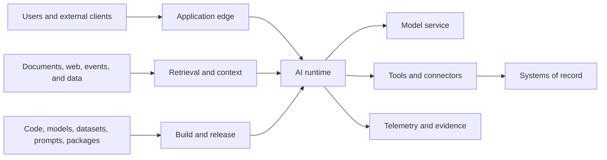
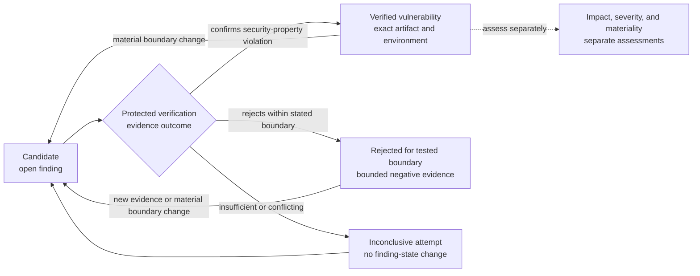

# Security architecture

AI security extends established application, cloud, data, and supply-chain security. It does not replace them. The distinctive challenge is that probabilistic components consume untrusted natural-language content, may retrieve privileged context, and may propose or initiate actions.

The security objective is therefore broader than preventing harmful text: preserve the confidentiality, integrity, availability, authorization boundaries, and accountability of the entire AI system.

## Security principles

1. **Assume model-facing content is adversarial.** User input, retrieved documents, tool output, memory, and model output may all contain instructions or payloads.
2. **Keep authority outside the model.** Deterministic services decide identity, authorization, policy, validation, and transaction commit.
3. **Delegate narrowly.** Use short-lived workload or on-behalf-of credentials scoped to one user, tenant, purpose, tool, and action.
4. **Separate content from control.** Delimit data and instructions, but do not rely on prompting alone as a security boundary.
5. **Contain failure.** Sandboxes, budgets, allowlists, network policy, approvals, and systems-of-record validation limit blast radius.
6. **Make the path reconstructable.** Preserve privacy-minimized lineage, security decisions, action records, and release provenance.
7. **Secure every lifecycle stage.** Design, development, deployment, operation, maintenance, and retirement all introduce risk.

These principles align with the international [Guidelines for Secure AI System Development](https://www.ncsc.gov.uk/collection/guidelines-secure-ai-system-development/introduction), which organize secure AI practices across design, development, deployment, and operation.

## Threat surfaces

Threat modeling should cover at least:

- user and indirect prompt injection;
- jailbreak and policy evasion;
- retrieval, memory, training-data, and tool-description poisoning;
- sensitive-data disclosure, cross-tenant leakage, and model extraction;
- excessive agency, confused-deputy behavior, and unauthorized actions;
- insecure output handling, including code, markup, URLs, and commands;
- server-side request forgery, unsafe browsing, and uncontrolled egress;
- denial of service and denial of wallet;
- compromised models, datasets, containers, packages, plugins, and connectors;
- malicious insiders and over-privileged support or evaluation access;
- evasion, poisoning, privacy, and misuse attacks against predictive and generative models;
- trace tampering, repudiation, and inadequate forensic evidence.

Use [MITRE ATLAS](https://atlas.mitre.org/) for adversary-oriented coverage, [NIST’s adversarial machine-learning taxonomy](https://www.nist.gov/publications/adversarial-machine-learning-taxonomy-and-terminology-attacks-and-mitigations), and the [OWASP Top 10 for Agentic Applications](https://genai.owasp.org/resource/owasp-top-10-for-agentic-applications-for-2026/) as inputs—not as substitutes for a system-specific threat model.

## Identity and authorization

### Identity chain

Carry these identities separately:

- the human or originating client;
- the application workload;
- the orchestration runtime;
- the decision-bound model serving target and final invocation policy
  enforcement point;
- each tool or connector workload;
- the affected tenant and resource.

Do not convert an authenticated chat session into a general-purpose service credential. For delegated action, bind a short-lived token to the initiating identity, approved scopes, tenant, audience, and transaction context. Record both the delegating and executing identities.

### Authorization

Authorization must occur:

1. when the use case is entered;
2. when data is retrieved;
3. when a model or capability is selected;
4. when a tool is invoked;
5. when a system of record commits a change.

The final resource-owning service reauthorizes the exact action. Prior approval by an agent, gateway, or orchestration layer does not replace that decision.

Use the
[identity and permission matrix](../worksheets/identity-and-permission-matrix.md)
to bind human, workload, agent-runtime, tool, tenant, credential, delegation,
approval, and final-action decisions to configured and observed evidence.

## Isolation and network controls

Choose boundaries based on data sensitivity and blast radius:

- separate development, evaluation, staging, and production accounts or projects;
- isolate tenants logically, and physically where required;
- use private endpoints and explicit egress policy for sensitive workloads;
- restrict model endpoints, vector stores, artifact stores, and tool services by workload identity;
- prevent production runtimes from reaching training or build systems unless explicitly required;
- sandbox generated code, browser sessions, interpreters, and untrusted file processing;
- block instance metadata, management networks, and arbitrary internal address ranges from agent-accessible fetchers;
- inspect and constrain DNS, HTTP destinations, redirect chains, file types, size, and content.

Apply the same exclusive final model-invocation boundary across hosting modes:

- for supplier-operated or jointly managed services, only the approved gateway
  holds the provider credential and provider-bound egress;
- for enterprise-operated serving, only the approved serving gateway,
  scheduler, or runtime enforcement point holds invocation-admission
  authority; a separate decision-bound serving-runtime identity has only the
  approved artifact-read and accelerator access;
- bind the approval and route grant to the serving-boundary ID, revision and
  digest, operating responsibility, location, tenancy, connectivity, exact
  artifact/runtime identity, target, PEP, and revocation epoch;
- require an authenticated, freshness-bounded deployment/load measurement from
  a protected platform control plane, attestation service, or integrity monitor
  before enterprise-operated admission; runtime self-report alone is
  insufficient;
- deny every alternate path and treat an embedded runtime that cannot enforce
  the grant, atomic consume/budget, single-use `committed-to-invoke` lease, and
  live or bounded-fresh revocation state as unsupported;
- require every connected managed or local PEP to acknowledge a new epoch or be
  independently verified drained or disabled before a block is effective for
  new work; and
- permit a disconnected path only with exact PEP/device key and measured-runtime
  binding, a monotonic package version, non-overlapping pre-reserved allocation,
  rollback-resistant local package/epoch/consume/lease state, and maximum
  validity within the approved revocation-exposure objective. Clone, snapshot
  restore, corruption, expiry, exhaustion, missed refresh, or uncertain clock,
  measurement, or block state fails closed. A block remains pending until every
  outstanding package and lease is acknowledged, independently disabled, or
  expired or exhausted.

Changing operating responsibility, location, connectivity, artifact/runtime,
target, or PEP is a new security and deployment boundary. It cannot be hidden
inside fallback or migration.

## Data protection

- classify prompts, retrieved context, embeddings, outputs, feedback, and traces;
- minimize data before model invocation;
- tokenize, redact, or pseudonymize sensitive fields where task quality permits;
- encrypt data in transit and at rest with enterprise-controlled key policy;
- prevent provider training or secondary use unless explicitly approved;
- apply DLP at ingress, retrieval, model egress, tool invocation, and export boundaries;
- keep secrets out of prompts, tool descriptions, model-visible environment variables, and traces;
- isolate support and evaluation access, and use privacy-preserving samples;
- propagate deletion through source, cache, index, memory, trace, and evaluation stores.

Embeddings and derived features are not automatically anonymous. Classify them according to the information they can reveal and the access they enable.

## Tool and agent security

Every tool should have:

- a narrow semantic purpose and typed schema;
- an owning team and security classification;
- explicit read and write scopes;
- per-resource authorization;
- input validation and output encoding;
- idempotency and replay protection for side effects;
- timeout, rate, concurrency, and cost limits;
- human approval rules by action class;
- a revocation and kill-switch path;
- audit events that distinguish proposal, approval, execution, and result.

Tools should return data, not new authority. Treat tool descriptions and responses as untrusted content because compromised tools can steer later model behavior.

## AI supply-chain security

Maintain provenance for:

- source code, containers, packages, and build systems;
- base and fine-tuned model weights;
- datasets, labels, transformations, and licenses;
- prompts, policies, guardrails, and evaluation sets;
- embeddings, indexes, plugins, tools, and connectors.

Use trusted registries, dependency pinning, artifact signing, vulnerability and malware scanning, protected build identities, review gates, and tamper-evident release metadata. Record an AI bill of materials that complements the software bill of materials.

For open-weight models, verify origin, license, checksums, model behavior, serialization format, loader safety, and serving isolation. Treat community fine-tunes and adapters as executable supply-chain artifacts.

Skills, plugins, hooks, helper code, MCP servers, startup commands, tool
descriptions, schemas, annotations, and results are also executable or
control-plane inputs. Marketplace listing, automated screening, or an
allowed-tools field is not authorization. Apply the full
[agent extension supply-chain](agent-extension-supply-chain.md) admission,
sandbox, runtime, monitoring, and revocation pattern.

## Security validation

Security testing should include:

- abuse-case and trust-boundary review;
- ordinary application and API security testing;
- identity, authorization, and tenant-isolation tests;
- prompt-injection and poisoned-retrieval scenarios;
- exfiltration, secret discovery, and DLP tests;
- tool misuse, replay, confused-deputy, and approval-bypass tests;
- unsafe output rendering and generated-code execution tests;
- model, dataset, and dependency integrity tests;
- load, quota-exhaustion, and denial-of-wallet exercises;
- red-team activity proportional to exposure and consequence;
- incident reconstruction from retained evidence.

No prompt, filter, or model-level defense is complete. Validate layered controls and residual risk.

### Security-analysis views and finding states

Security-analysis depth and enterprise adoption maturity are separate axes.
The following guide-defined working terms connect analysis results to evidence;
they are not another lifecycle, maturity model, or release gate.

| Analysis view | Result | Evidence boundary |
|---|---|---|
| Threat modeling | Scoped attacker hypotheses, abuse cases, and required security properties | A hypothesis directs testing; it is not a vulnerability finding |
| Context-aware review | Vulnerability candidate | A scanner, model, agent, or analyst report remains unverified until a security-property violation is supported by reproducible or equivalent deterministic evidence |
| Exploitability validation | Verified vulnerability, rejected-for-tested-boundary candidate, or inconclusive attempt | Record the exact artifact and environment, attacker prerequisites, reachability, reproduction, and security property violated or attacker capability gained; record impact, severity, and business materiality as separate triage outputs |
| Vulnerability correlation | Relationship among findings, components, assets, causes, or risk context | Correlation does not prove order, reachability, exploitability, material impact, or a weakness chain |
| Weakness-chain analysis | Evidenced causal sequence of two or more implementation weaknesses | Reproducible or equivalent deterministic evidence must show the causation, propagation, and composition of each link and the composed sequence |
| Environment-aware attack-path analysis | Attack-path hypothesis or validated path from a defined attacker position to an asset or impact | The path may combine vulnerabilities, exposure, identities, credentials, permissions, configuration, and trust; record evidence, confidence, and uncertainty for each material link, and do not treat approved read-only inventory analysis as authority to exploit production |
| Remediation validation | Evidence bound to the corrected artifact or control revision | Show that the original reproduction no longer succeeds, required behavior still passes, and material bypasses and regressions were assessed; bind a corrected revision into a release candidate only when promotion is required |

The finding-state contract is `candidate → verified` or
`candidate → rejected for the tested boundary`. An inconclusive attempt leaves
the candidate open and dependent decisions on Hold. Rejection is bounded
negative evidence, not proof that the weakness is absent. A material change to
the artifact, environment, threat model, or tested prerequisites invalidates
the applicable result and returns the issue to candidate review. Verification,
severity, and business materiality remain separate determinations.

**Figure — Finding evidence states (not an AI-DLC or maturity sequence)**

The diagram follows one scoped finding rather than ordering the analysis views.
An inconclusive attempt adds evidence but does not close the candidate. Prior
results remain historical evidence when new evidence or a material boundary
change creates or supersedes the current-scope record.

Agentic or autonomous vulnerability research may automate hypothesis and
candidate generation, isolated execution, validation, and patch proposals. It
requires explicit target authorization, an isolated non-production and
network-restricted environment, minimal test data and credentials,
privacy-minimized protected evidence, bounded resources, stop conditions,
access and retention rules, and a coordinated-disclosure path. Prefer
non-weaponized reproducers or failing tests. Analytical autonomy does not
authorize testing external or production targets, public disclosure, merge,
release, risk acceptance, or automatic mutation of active controls. Learning
from results remains quarantined, versioned, tested, and separately approved
under
[G5 controlled learning](../delivery/security-first-ai-dlc.md#g5-controlled-learning).

Use authoritative sources as orthogonal lenses rather than combining them into
one implied score or lifecycle:

| Question | Primary input | Boundary |
|---|---|---|
| Which review, target-identification and analysis, or target-vulnerability-validation technique fits the authorized assessment? | [NIST SP 800-115](https://csrc.nist.gov/pubs/sp/800/115/final) | Its 2008 process structure is useful; its tool examples are not a complete current testing program |
| What causal sequence of weaknesses produced a vulnerability? | [NIST SP 800-231](https://csrc.nist.gov/pubs/sp/800/231/final) | The formal Bugs Framework does not by itself prove an environment-specific attack path |
| Which attack classes and adversary behaviors against AI systems should the threat model cover? | [NIST AI 100-2e2025](https://csrc.nist.gov/pubs/ai/100/2/e2025/final) and [MITRE ATLAS](https://atlas.mitre.org/) | Taxonomy or technique coverage generates hypotheses; it is not finding verification |
| Has CISA recorded exploitation in the wild? | [CISA Known Exploited Vulnerabilities Catalog](https://www.cisa.gov/known-exploited-vulnerabilities-catalog) | Catalog status is a prioritization signal, not environment-bound validation or an accountable risk decision; absence does not prove non-exploitation |
| How should received vulnerability reports be assessed, managed, and communicated? | [NIST SP 800-216](https://csrc.nist.gov/pubs/sp/800/216/final) | Adapt the federal guidance to organizational scope; it does not grant public-disclosure authority |

## Security evidence

The production readiness record should link to:

- current threat model and data-flow diagram;
- completed
  [identity and permission matrix](../worksheets/identity-and-permission-matrix.md);
- tool and egress inventory;
- supply-chain and dependency attestations;
- security, privacy, abuse, and red-team results;
- unresolved findings and linked category-bound residual-risk decision IDs,
  results, authorities and authority bases, exact scopes, validity states,
  expiries, invalidation triggers, and supersession;
- incident, vulnerability disclosure, and patch procedures;
- logging, retention, and forensic-readiness decisions;
- last rollback, credential-revocation, and kill-switch exercise.
