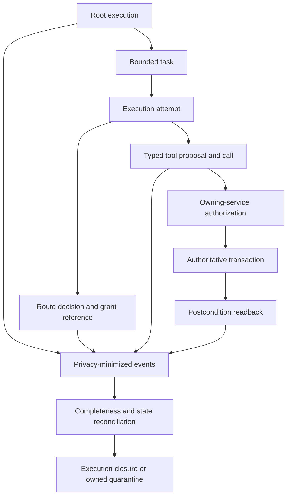

# Agent execution and privacy-minimized telemetry contract

Complete one versioned contract per product, environment, and tenant or data
isolation boundary. A platform may provide the stable core schema; each system
must supply a profile that is at least as restrictive.

!!! warning "A contract is not authorization or permission to collect"
    Completing this record does not authorize a system, route, tool, release,
    data collection, or retention period. It does not prove control operation,
    privacy, compliance, or independent assurance. Qualified owners must
    approve the actual purpose, fields, access, retention, and operating
    boundary. AI-generated review remains advisory.

This worksheet joins runtime evidence that is otherwise distributed across:

- the [identity and permission matrix](identity-and-permission-matrix.md),
  which owns who or what may do which action;
- the
  [model routing and agent dispatch plan](model-routing-and-agent-dispatch-plan.md),
  which owns exact deployments, route grants, budgets, and dispatch policy;
- the
  [agent extension assessment](agent-extension-assessment.md), which owns
  admitted skills, tools, helpers, plugins, and MCP capabilities;
- the [regulatory obligation register](regulatory-obligation-register.md),
  which owns source-specific applicability, duties, event clocks, and evidence
  requirements; and
- the [incident and corrective-action record](incident-and-corrective-action-record.md),
  which owns incident facts, containment, restoration, correction, and
  closure.

This contract owns the common root-execution identity, state relationships,
typed runtime outcomes, privacy-minimized event profile, completeness and
integrity checks, reconciliation, and execution closure. A system of record
remains authoritative for its business transactions. Telemetry is never a
credential, authorization decision, or substitute for transaction readback.

## 1. Contract control and operating boundary

| Field | Value |
|---|---|
| Contract ID and schema version | |
| Contract artifact lifecycle | draft / approved schema / superseded / retired |
| Assurance and evidence status | untested / design-tested / staging-tested / operating evidence current / stale / failed |
| Runtime authorization / disposition | not authorized / evaluation / pilot / production / hold / revoked / retired |
| System, use-case, and operating-boundary IDs | |
| Product and business owner | |
| Service and workflow owner | |
| Platform, harness, and adapter owner | |
| Security and privacy owners | |
| Reliability, incident, and evidence owners | |
| Records, legal, and compliance decision owners | |
| FinOps and budget-reconciliation owner | |
| Environment, tenants, and isolation boundary | |
| Regions, suppliers, and storage boundaries | |
| Data and consequence classifications | |
| Autonomy and maximum permitted consequence | |
| Included execution classes | root / coordinator / worker / verifier / tool / MCP / approval / owning-service transaction |
| Explicit exclusions and prohibited telemetry purposes | |
| Release manifest and deployed revision | |
| Identity and permission matrix ID / revision | |
| Route and dispatch plan ID / revision | |
| Extension assessment IDs / revisions | |
| Threat model and risk assessment IDs / revisions | |
| Obligation snapshot and retention decision IDs | |
| Evaluation and readiness record IDs / revisions | |
| Incident, exception, and known-error links | |
| Opened, effective, expiry, and mandatory review dates | |
| Superseded contract and migration state | |

### Decision requested

Record the exact decision: design review, test authorization, bounded pilot,
production use, continuation, suspension, or retirement. Keep contract state
separate from approval state.

| Role | Name | Decision | Date | Scope, conditions, expiry, and evidence |
|---|---|---|---|---|
| Product / service owner | | | | |
| Platform / engineering owner | | | | |
| Security / privacy | | | | |
| Reliability / incident owner | | | | |
| Records / legal / compliance | | | | |
| Qualified independent reviewer, when required | | | | |

## 2. Core execution invariants

- One canonical `root_execution_id` identifies one bounded end-to-end run. It
  is never reused for another run.
- Every execution-scoped child, retry, fallback, model call, tool call,
  approval, transaction, cost reservation, event, and alert resolves to
  exactly one root execution and an attributable causal parent.
- Platform and control events that can affect zero, one, or many roots—such as
  deployment drift, pipeline loss, supplier change, or a retention-job
  failure—record component, boundary, time window, and query or snapshot
  evidence. They link the known affected roots without fabricating a root or
  causal parent. A multi-execution alert or incident owns its affected-root
  set.
- A correlation identifier is not an identity, credential, permission,
  approval, route grant, idempotency key, or transaction identifier.
- Durable workflow state, the resource-owning policy service, and the
  applicable system of record own authoritative state. Conversation history,
  model memory, a model statement, a trace, and a dashboard do not.
- Every child receives separately authorized, strictly narrower authority and
  atomically reserved headroom. A coordinator-produced task is not an
  authorization artifact.
- Tool descriptions, retrieved content, MCP results, and model outputs are
  untrusted data. They cannot create authority or report an authoritative
  business effect.
- Proposal, approval, owning-service authorization, dispatch, acknowledgement,
  transaction commit, postcondition readback, cancellation, compensation, and
  reconciliation remain distinguishable.
- Timeout, disconnect, missing telemetry, or a cancellation request is not
  proof that work failed, stopped, or caused no effect.
- Raw grants, credentials, hidden reasoning, and unnecessary prompts, context,
  outputs, or tool payloads are prohibited from routine telemetry.
- Required control evidence is defined before release. A missing required event
  is incomplete state, not evidence that nothing happened.
- The deployed contract, producers, consumers, storage, alerts, and
  reconciliation jobs are read back and compared with approved state.



## 3. Execution identity and correlation

### Identifier register

| Identifier | Authoritative issuer | Scope and uniqueness | Propagation and integrity | Ordinary telemetry treatment | Retention / deletion owner |
|---|---|---|---|---|---|
| `root_execution_id` | | one bounded end-to-end run | | permitted; not a credential | |
| `execution_id` and `parent_execution_id` | | one root or child execution | | permitted | |
| `task_id`, `attempt_id`, and `call_id` | | one task, attempt, or external call | | permitted | |
| `event_id` and causal-parent event ID | | one immutable event occurrence; causal parent is absent for a root or standalone control event | | permitted | |
| approved distributed trace context | | diagnostic correlation only | | no identity or sensitive values | |
| initiating human or client reference | | purpose-scoped identity reference | | tokenized or otherwise minimized | |
| workload and delegated identity references | | authenticated executing principal | | minimized identity and decision IDs | |
| tenant, purpose, and use-case references | | one approved isolation and purpose boundary | | scoped token or approved stable ID | |
| route decision ID and approved one-way grant hash | policy service | one route decision | raw grant never logged | permitted under approved access | |
| serving-boundary ID, revision, and digest | deployment registry | one decision-bound operating responsibility, location, tenancy, connectivity, artifact, target, serving-TCB, and final-PEP boundary | bound by the route grant and deployment approval | permitted; no credential, internal address, weights path, or raw grant | |
| authenticated deployment/load measurement ID and freshness result | protected platform control plane, attestation service, or integrity monitor | one observed model/artifact, runtime/configuration, infrastructure, and safety-policy state | bind the measurement policy and result to the serving-boundary revision/digest and invocation lease | record only the approved measurement reference, result, and age; no raw attestation evidence or internal topology in routine telemetry | |
| budget reservation and settlement IDs | budget ledger | one allocation and disposition | | permitted | |
| proposal, approval, and authorization IDs | owning workflow and services | one parameter-bound decision | | permitted | |
| idempotency key | owning service | one retry-safe operation scope | sensitive; never reused across scopes | hash or reference only when approved | |
| transaction and postcondition IDs | system of record | one authoritative business effect | | reference under approved purpose | |
| incident, problem, and CAPA IDs | response process | one governed response record | | permitted under incident policy | |

Pseudonymization reduces direct identifiability; it does not establish
anonymity. Record linkability, re-identification, dictionary-attack, and
cross-purpose risks. Keep any re-identification map in a separately authorized
store. Do not derive routine tokens from low-entropy personal or business
identifiers with an unkeyed hash.

### Root execution manifest

The immutable or tamper-evident manifest binds:

- initiating identity or client reference, executing workload, tenant,
  purpose, use case, environment, and data classes;
- release, workflow, policy, catalog, route, serving-boundary ID/revision/digest,
  deployment approval, model/artifact, runtime/configuration, serving-TCB
  identity and measurement-policy, extension, tool, schema, corpus, verifier,
  adapter, and final invocation PEP revisions;
- start, deadline, permitted regions, allowed consequence classes, and final
  outcome owner;
- aggregate fan-out, depth, concurrency, step, call, token, time, retry,
  output, action, and cost limits;
- approval and human-oversight requirements;
- expected event profile and required reconciliation checks; and
- contract ID, schema version, retention class, and applicable obligation
  snapshot.

The manifest references sensitive artifacts by controlled ID and digest. It
does not copy raw grants, credentials, prompts, results, or protected evidence.

## 4. Separate state machines

Do not overload one `completed` field. Record the authoritative owner, legal
transitions, timeout behavior, and evidence for each state machine.

| State machine | Minimum states | Authoritative owner | Invalid or ambiguous transition behavior | Required evidence |
|---|---|---|---|---|
| Root or child execution | requested → denied (terminal before reservation), or requested → authorized → reserved → running or waiting → terminal; uncertain state enters non-terminal quarantine pending disposition | durable workflow | denial cannot transition to reservation; reject invalid transition; quarantine uncertain state | workflow revision and transition event |
| Execution or invocation result | succeeded / failed / denied / abstained / cancelled-confirmed / timed-out / disconnected | workflow, adapter, or tool broker for its own attempt | a result describes execution, not business effect; timeout or disconnect can be terminal for an attempt while its possible effect remains unknown | result code, acknowledgement, and attempt state |
| Route invocation lease | issued → `committed-to-invoke` / blocked / expired | final model-invocation policy enforcement point | fail closed on unavailable approval, epoch, lease, boundary revision/digest, authenticated measurement, or required disconnected-policy freshness and anti-rollback state | lease decision ID, serving-boundary ID/revision/digest, exact artifact/runtime, authenticated measurement reference and freshness result, final PEP, and observed route |
| Budget | reserved → released only while unclaimed, or reserved → claimed → settling → settled / quarantined | aggregate budget ledger | claimed or unknown work keeps its upper bound | reservation, usage, and settlement IDs |
| Tool attempt | proposed → denied (terminal before send), or proposed → authorized → `committed-to-send` → sent → acknowledged / acknowledgement-unknown → returned / attempt-failed / timed-out / disconnected; a confirmed pre-send cancellation is terminal | tool broker and owning service | denial cannot commit or send; a missing acknowledgement becomes acknowledgement-unknown, not inferred failure; the attempt result remains separate from possible business effect and the orthogonal cancellation state | call, authorization, commit, send, acknowledgement, cancellation, and result IDs |
| Human approval | requested → rejected / expired, or requested → approved → consumed / invalidated / expired | approval service | changed parameters invalidate approval; rejected or expired request cannot be consumed | approver, parameter digest, expiry |
| Business effect | none / proposed / authorized / committed / compensated / rejected / unknown | system of record | model or tool self-report is advisory only | transaction ID and postcondition |
| Cancellation | requested → propagated → acknowledgement-received / unsupported / partial → confirmed-stopped or reconciliation-required → closed | durable workflow and each dependency | request or acknowledgement is not proof of termination | acknowledgements, terminal readback, and outstanding-work inventory |
| Reconciliation / disposition | not required / pending / confirmed-no-effect / confirmed-effect / compensated / residual-unknown-pending-governance | owning workflow and system of record; recovery owner may contain or compensate but cannot accept risk | never copy a telemetry guess into authoritative disposition or treat a pending residual as authorized | queried state, exact residual boundary, and links to every required current category-bound residual-risk decision plus the separate loss / administrative-closure decision |
| Root closure | open / ordinary-closed / administratively-closed-with-owned-residual | durable workflow and accountable service owner | ordinary closure rejects unknown effects or unresolved quarantine; administrative closure does not erase the residual | closure decision, current category-bound residual-risk decision IDs, separate loss / administrative-closure authority, and linked incident, cost, and retention records |

A root execution reaches ordinary closure only after every child, claimed
reservation, tool attempt, approval, consequential outcome, late result,
quarantine, and required event is authoritatively resolved.

Quarantine is not ordinary terminal success or failure. It remains owned,
visible, and non-terminal until authoritative disposition records either an
effect or no effect and assigns any continuing incident, compensation, cost,
or retention work. A permanently unknown outcome may be administratively
closed only when every retained risk links each applicable current
category-bound residual-risk decision and a separately named loss or
administrative-closure authority records the closure under adopted policy.
Neither authority inherits the other, and the unknown remains visible; it
does not qualify for ordinary closure.

## 5. Context, memory, and durable state

This section is the runtime projection of the owning
[data architecture](../architecture/data-architecture.md),
[system card](system-card.md), identity matrix, and approved data or memory
records. It does not create a new data purpose, source authority, retention
period, or permission.

| Store or context class | Authority and purpose | Allowed content and provenance | Read / write principals | Tenant and isolation key | Retention, correction, deletion, and restore | Poisoning and promotion control |
|---|---|---|---|---|---|---|
| Turn context | non-authoritative inference input | | | | | |
| Session memory | bounded interaction continuity | | | | | |
| Workflow state | authoritative progress and action results | | | | | |
| User memory | approved retained preferences or facts | | | | | |
| Shared knowledge or retrieval | governed enterprise sources | | | | | |
| Agent learning candidate | proposed future behavior change | | | | | |
| Restricted incident or evaluation sample | case-specific evidence | | | | | |

- Separate instructions from untrusted user, retrieved, memory, and tool
  content.
- Minimize context before model or tool access and record controlled source
  references rather than copying content into telemetry.
- Do not allow a model to promote content into durable, user, shared, or
  learning state without deterministic policy and any required owner or user
  decision.
- Conversation history cannot replace durable workflow state.
- Restore tests must preserve tenant, purpose, deletion, hold, and revocation
  state rather than resurrecting expired authority or deleted content.

## 6. Child authority and aggregate budget

For each child, attach the corresponding rows from the
[identity and permission matrix](identity-and-permission-matrix.md#delegation-and-child-authority-attenuation)
and route plan. This table records the execution projection; it does not mint a
grant or replace those records.

| Child execution | Parent execution / decision | Authenticated workload and presenter binding | Bounded task and output schema | Context, memory, data, resource, tool, route, network, and action scope | Explicit prohibitions | Aggregate reservation and deadline | Subset proof | Observed use / reconciliation |
|---|---|---|---|---|---|---|---|---|
| | | | | | | | | |

The effective child envelope is the intersection of the request, parent
authority, and current policy. The child must not:

- select an exact serving boundary, operating responsibility, location,
  provider, region/site, model/artifact, runtime/configuration, preview, or
  processing/capacity plan;
- self-authorize or widen a tool or MCP capability. It may propose an action
  from its allowed capability set, but the broker resolves and validates the
  exact approved capability and the resource-owning service or its
  authoritative policy decision point reauthorizes any business action;
- mint, renew, copy, reinterpret, or widen a grant;
- acquire managed-provider, enterprise invocation-admission, serving-runtime,
  artifact-registry, or broad business credentials;
- exceed the parent's remaining time, tokens, retries, cost, concurrency,
  fan-out, depth, data, or consequence limits; or
- bypass the final model-invocation PEP, tool broker, or resource-owning
  service.

Retries and fallbacks consume the original total allocation. Claimed,
in-flight, delayed-billing, or unknown work keeps its reservation until
authoritative settlement or an explicitly approved loss disposition.

## 7. Typed tool and MCP outcome contract

Only a row explicitly marked **conditional** may use `not-applicable`, and it
must give the reason. Mandatory capability, identity, authorization,
classification, retry, outcome, and reconciliation fields cannot be omitted.
A denied proposal still records the denial; a request that was never sent
records `not-sent` rather than inventing an acknowledgement.

| Field | Required treatment |
|---|---|
| Tool / MCP capability ID, owner, version, schema, and digest or mutable-service record | Always required |
| Extension admission record and current lifecycle state | Always required; use the approved admission record or controlled built-in capability record |
| Consequence class and system of record | Always required, including an explicit no-business-effect class |
| Caller, delegated identity, tenant, purpose, and environment | Always required |
| Typed parameter object or approved parameter digest | Always required for the proposal |
| Data and output classification | Always required |
| Per-call authorization decision and enforcement point | Always required, including deny |
| Human approval ID, parameter binding, and expiry | Conditional when policy requires human approval; otherwise record `not-applicable` and the policy reason |
| Deadline, idempotency scope, replay rule, and retry budget | Always required; a non-effecting operation still declares its retry semantics |
| Invocation acknowledgement and serving-target or tool request ID | Required when dispatched; record `not-sent` when denied before dispatch |
| Typed outcome and normalized error category | Always required |
| Authoritative transaction ID and postcondition for an effect, or explicit `business_effect: none` | Always required; a confirmed read-only operation uses `business_effect: none`, not an omitted transaction field |
| Retry safety, residual ambiguity, and reconciliation owner | Always required |
| Compensation or forward-recovery reference | Conditional when an effect can require recovery; otherwise record `not-applicable` and the consequence-class reason |

The result schema must keep these questions separate:

1. Was the invocation rejected before send, sent, acknowledged, or unknown?
2. Did the tool return a syntactically valid result?
3. Did the resource-owning service or its authoritative policy decision point
   authorize the business action?
4. Did the system of record commit an effect?
5. Did postcondition readback verify the intended effect?
6. Is retry proven safe, or does ambiguity require reconciliation?

Tool and MCP descriptions and results remain untrusted content. Dynamic tool,
capability, schema, extension, or server changes invalidate affected
admission, evaluation, and execution-contract evidence.

An unknown possible effect cannot use `not-applicable`; it must record
`business_effect: unknown`, remain quarantined, and carry a reconciliation
owner and response objective.

## 8. Cancellation, timeout, retry, and ambiguous outcomes

Cancellation means stop issuing new child work, grants, leases, tool calls,
and retries; propagate a bounded cancellation request; inventory outstanding
work; and collect acknowledgements. It does not mean every already-committed
request stopped.

| Situation | Required state and action | Retry rule | Reservation / cost treatment | Owner and evidence |
|---|---|---|---|---|
| Before authorization or reservation | deny or cancel with no dispatch | new intent requires a new decision | release only confirmed unclaimed reservation | |
| Authorized model route but not `committed-to-invoke`, or authorized tool request but not `committed-to-send` | block dispatch and cancel unclaimed work | require a new decision | release after authoritative unclaimed proof | |
| Model invocation or tool request committed | mark in flight; request cancellation where supported | no duplicate unless durable idempotency or tested retry safety exists | retain full bound until settled | |
| Tool returns authoritative transaction ID | read back the postcondition | retry only within the owning service's idempotency contract | settle against observed effect | |
| Timeout, disconnect, or missing acknowledgement | mark `unknown`; do not infer failure | stop unless safe retry is proven and remains within root limits | quarantine the reservation | |
| Late result after cancellation or revocation | quarantine result and prevent integration | no automatic retry | reconcile delayed usage and any effect | |
| Partial multi-step effect | stop new steps; reconcile committed steps; compensate or forward-recover as authorized | follow the recorded recovery plan | preserve committed and recovery cost | |
| Cancellation unsupported or only partially acknowledged | retain visible outstanding-work inventory and escalate | no blind retry | retain reservations until terminal disposition | |

An ambiguous consequential outcome remains quarantined with a named owner,
response objective, evidence location, and disposition authority. Timeout must
never be rewritten as `failed-no-effect` merely to close a run or release
budget.

## 9. Common event envelope

Map the core fields to the organization's approved event and distributed-trace
formats. Adapter-specific namespaced fields may add detail but cannot
reinterpret or weaken core identity, state, authority, privacy, or closure
semantics.

Apply one of these explicit profiles:

- **Universal fields — every event:** schema and event type IDs and versions;
  event ID and class; occurrence, observation, and ingestion times with clock
  status; authenticated producer, component revision, environment, and region;
  and classification, retention, integrity, and access treatment.
- **Execution event:** one root plus the applicable execution, parent, task,
  attempt, call, trace, and causal-parent references; tenant, purpose, use
  case, data class, and release; and the relevant control, state, and outcome.
  A causal child must identify its parent event.
- **Platform or control event:** component, affected boundary, observation
  window, and an affected-root query or bounded snapshot. It must not invent a
  singular root, tenant, use case, or release.
- **Family-conditional fields:** include economics for metered work; effect
  references for a proposed or possible business action; and response fields
  for a material condition, alert, quarantine, reconciliation, or incident.

| Field group | Required fields by event class | Rules |
|---|---|---|
| Schema | schema ID/version, event type/version, and event class for every event | reject or quarantine incompatible required fields |
| Event identity | event ID for every event; causal-parent event ID for a causal child; sequence or monotonic position where available | a root or standalone control event has no fabricated parent; deduplicate without discarding conflicts |
| Time | occurrence, observation, and ingestion times plus clock source or skew status for every event | never rely on arrival order alone |
| Producer | authenticated service/workload, component revision, environment, and region for every event | reject or isolate unauthenticated producers |
| Execution | root, execution, parent, task, attempt, call, and trace references as applicable | every execution event maps to exactly one root; a platform or control event records component, boundary, window, and affected-root query or snapshot instead |
| Boundary | tenant, purpose, use case, data class, and release for execution events; component, affected boundary, window, and affected-root query or snapshot for platform/control events | purpose-scoped and minimized; do not fabricate execution fields for a standalone control event |
| Control | relevant policy, route decision, approved grant hash, serving-boundary ID/revision/digest, deployment approval, exact model/artifact and runtime/configuration identity, serving-TCB identities, authenticated measurement reference and freshness result, final invocation PEP, epoch, budget reservation, extension, tool, and schema revisions | required for the control involved; no raw grant, credential, secret, internal address, weights path, prompt, result, or raw attestation evidence |
| State | state machine, before/after state, outcome, structured reason code, and consequence class | required for a transition or decision; reason codes are policy facts, not hidden reasoning |
| Effect | proposal, approval, authorization, transaction, postcondition, compensation, no-effect, or unknown references | required for a proposed or possible business action; system-of-record evidence remains authoritative |
| Economics | normalized usage class, meter source, resource/capacity allocation, reserved and observed total cost, and settlement state | required for metered work; include coordinator, worker, tool, verifier, retry, fallback, escalation, and enterprise-operated compute/capacity/operations allocation |
| Evidence | classification, retention class, integrity receipt, access class, and legal-hold flag where applicable | universal except the legal-hold flag, which follows policy; no legal conclusion is inferred from a flag |
| Response | alert, incident, quarantine, reconciliation, and owner references | required for a material condition or response action |

Illustrative minimized **execution event**:

```json
{
  "schema": {
    "id": "agent-execution-event",
    "version": "1.0"
  },
  "event_id": "evt-01...",
  "event_type": {
    "name": "tool.outcome.recorded",
    "version": "1.0"
  },
  "event_class": "execution",
  "causal_parent_event_id": "evt-00...",
  "sequence": 31,
  "time": {
    "occurred_at": "2026-07-28T22:00:00Z",
    "observed_at": "2026-07-28T22:00:00.120Z",
    "ingested_at": "2026-07-28T22:00:00.290Z",
    "clock_status": "within-tolerance"
  },
  "producer": {
    "workload_ref": "workload:tool-broker",
    "component_revision": "tool-broker-r41",
    "environment": "production",
    "region": "approved-region-a"
  },
  "execution": {
    "root_execution_id": "root-01...",
    "execution_id": "exec-03...",
    "parent_execution_id": "exec-01...",
    "task_id": "task-07...",
    "attempt_id": "attempt-01...",
    "call_id": "call-01...",
    "trace_ref": "trace-04..."
  },
  "boundary": {
    "tenant_ref": "tenant-pseudonym:...",
    "purpose": "approved-purpose-code",
    "use_case": "document-grounded-answer",
    "data_class": "internal",
    "release_id": "release-27"
  },
  "control": {
    "policy_decision_id": "policy-09...",
    "route_decision_id": "route-14...",
    "route_grant_hash": "hmac-sha256:...",
    "tool_schema": "document-read/v3",
    "budget_reservation_id": "budget-12..."
  },
  "state": {
    "machine": "tool-attempt",
    "before": "acknowledged",
    "after": "returned",
    "consequence_class": "read-only"
  },
  "outcome": {
    "invocation": "returned",
    "business_effect": "none",
    "reason_code": "READ_COMPLETED"
  },
  "evidence": {
    "classification": "internal-metadata",
    "retention_class": "runtime-evidence-standard",
    "access_class": "operations-restricted",
    "integrity_receipt": "receipt-18...",
    "legal_hold": false
  },
  "response": {
    "alert_required": false,
    "owner_ref": "service-owner:document-agent"
  }
}
```

Illustrative minimized **platform/control event** with no fabricated execution
identity:

```json
{
  "schema": {
    "id": "agent-control-event",
    "version": "1.0"
  },
  "event_id": "evt-platform-02...",
  "event_type": {
    "name": "telemetry.pipeline.loss",
    "version": "1.0"
  },
  "event_class": "platform-control",
  "time": {
    "occurred_at": "2026-07-28T22:05:00Z",
    "observed_at": "2026-07-28T22:05:10Z",
    "ingested_at": "2026-07-28T22:05:11Z",
    "clock_status": "within-tolerance"
  },
  "producer": {
    "workload_ref": "workload:telemetry-supervisor",
    "component_revision": "telemetry-supervisor-r8",
    "environment": "production",
    "region": "approved-region-a"
  },
  "platform_scope": {
    "component": "event-collector-a",
    "affected_boundary": "production/approved-region-a",
    "window": {
      "start": "2026-07-28T22:04:00Z",
      "end": "2026-07-28T22:05:00Z"
    },
    "affected_root_query": "query-ref-06..."
  },
  "state": {
    "machine": "telemetry-pipeline",
    "before": "healthy",
    "after": "loss-detected",
    "consequence_class": "control-degradation",
    "reason_code": "EXPECTED_EVENT_GAP"
  },
  "evidence": {
    "classification": "internal-metadata",
    "retention_class": "security-operations",
    "access_class": "security-restricted",
    "integrity_receipt": "receipt-21...",
    "legal_hold": false
  },
  "response": {
    "alert_required": true,
    "alert_id": "alert-44...",
    "incident_id": "incident-19...",
    "owner_ref": "service-owner:telemetry-platform"
  }
}
```

The names and values above are illustrative contract-conforming examples, not
a normative industry schema. The tenant pseudonym is a purpose-scoped
correlation reference, not authentication or session material. Use controlled
enumerations, schema validation, and compatibility tests.

### Minimum event families

- root requested, authorized or denied, started, terminal,
  ordinary-closed, or administratively-closed-with-owned-residual;
- route decided, grant reference verified, invocation lease issued,
  committed-to-invoke, blocked, or expired;
- budget reserved, claimed, settling, settled, released, or quarantined;
- child proposed, authorized, started, completed, denied, or cancelled;
- tool proposed, authorized or denied, committed-to-send, sent, acknowledged,
  acknowledgement-unknown, returned, attempt-failed, timed-out, disconnected,
  or confirmed pre-send cancellation;
- business effect confirmed, no-effect confirmed, compensated, rejected, or
  unknown pending reconciliation, independently of the tool-attempt result;
- human approval requested, decided, expired, invalidated, or consumed;
- deterministic validation or protected verification passed, rejected, or
  escalated;
- retry, fallback, abstention, refusal, and human escalation;
- cancellation requested, propagated, acknowledged, failed, or reconciled;
- transaction committed, read back, compensated, rejected, or unknown;
- context or memory read, write, promotion, rejection, expiry, deletion,
  restoration, or poisoning detection;
- component, capability, schema, route, policy, or deployment drift;
- telemetry field dropped, transformed, quarantined, or rejected; and
- alert or incident opened, acknowledged, contained, restored, and closed.

## 10. Telemetry purpose, minimization, and access

Minimize before collection. Redaction before publication does not justify
overcollection.

| Evidence class | Approved purpose | Minimum fields | Prohibited or separately controlled content | Permitted consumers | Region / supplier | Access and audit | Retention / deletion / hold | Owner |
|---|---|---|---|---|---|---|---|---|
| Live enforcement metadata | | | | | | | | |
| Reliability and performance | | | | | | | | |
| Security and incident detection | | | | | | | | |
| Quality and human-oversight signals | | | | | | | | |
| FinOps, resource use, and supplier settlement | | | | | | | | |
| Audit and obligation evidence | | | | | | | | |
| Restricted incident sample | | | | | | | | |
| Restricted evaluation sample | | | | | | | | |
| Approved aggregate | | | | | | | | |

Routine telemetry must exclude:

- raw route grants, signed envelopes, bearer material, credentials, secrets,
  session tokens, confirmation keys, and encryption material;
- hidden reasoning, chain-of-thought, raw internal deliberation, and private
  session transcripts;
- prompts, retrieved passages, memory, outputs, tool arguments, files,
  screenshots, or business records unless a separately approved minimum field
  is necessary for the stated purpose;
- direct personal or confidential business identifiers when a purpose-scoped
  reference is sufficient;
- internal URLs, filesystem paths, resource names, or stack traces that expose
  credentials or protected topology; and
- dictionary-attackable unkeyed hashes of sensitive values.

A restricted content sample requires a case-specific purpose, minimum scope,
authorized request, protected store, custody record, access review, time
limit, disposition, and deletion or hold evidence. It must not share routine
telemetry access merely because it supports an incident or evaluation.

### Field-level data map

| Field / event | Purpose and source authority | Classification and tenant binding | Transformation / tokenization | Linkability and re-identification risk | Consumers and access | Storage, region, and supplier | Retention, correction, deletion, backup, and hold | Evidence owner |
|---|---|---|---|---|---|---|---|---|
| | | | | | | | | |

Retention values are organization decisions, not values to copy from examples.
Apply applicable source, contract, records, privacy, security, incident, and
litigation decisions. Test correction and deletion through indexes, caches,
derived aggregates, restricted stores, backups, and restored environments.

## 11. Integrity, completeness, and pipeline behavior

### Telemetry pipeline topology

| Stage | Component and owner | Trust / tenant / region / supplier boundary | Input and output schema | Transformation and dropped fields | Buffer, backpressure, and outage behavior | Integrity and access | Health / lag / loss objective |
|---|---|---|---|---|---|---|---|
| Producer | | | | | | | |
| Collector or durable buffer | | | | | | | |
| Minimizer / processor | | | | | | | |
| Restricted evidence path | | | | | | | |
| Operational store / index | | | | | | | |
| Aggregate / metrics store | | | | | | | |
| Alert and incident consumers | | | | | | | |
| Reconciliation and audit consumers | | | | | | | |

Define:

- authenticated producers, schema registry, signer or integrity mechanism,
  key rotation, transport, storage, custody, and administrator separation;
- deduplication, conflict handling, expected event sets, causal ordering,
  sequence gaps, clock source and tolerance, late arrival, and replay;
- delivery semantics and acknowledgement; an accepted export is not proof of
  durable indexed evidence unless the contract says so;
- loss, lag, duplication, backlog, and deletion objectives plus sentinels that
  independently detect pipeline failure;
- protected spooling and load shedding that never silently drops required
  security, authorization, or consequential-action evidence; and
- recovery reconciliation after collector, processor, store, or consumer
  outage.

Tamper evidence applies to minimized metadata. Do not make recoverable
sensitive content effectively permanent merely by placing it in an immutable
or widely replicated ledger. Keep approved restricted content in a separate
store with its own disposition, and preserve integrity through controlled
references, custody, and deletion or crypto-erasure evidence appropriate to
the adopted policy.

## 12. Dependency outage and degraded operation

| Dependency | Is last-known-good state permitted? | Allowed behavior and maximum duration | Blocked consequence classes | Spool / backpressure | Recovery and reconciliation | Alert / owner |
|---|---|---|---|---|---|---|
| Identity and credential state | | | | | | |
| Policy and revocation state | | | | | | |
| Budget and reservation ledger | | | | | | |
| Grant consume / replay store | | | | | | |
| Final model-invocation approval, measurement, and lease service | | | | | | |
| Tool broker and owning-service authorization | | | | | | |
| Durable workflow state | | | | | | |
| Telemetry ingestion / minimizer | | | | | | |
| Alert and incident routing | | | | | | |
| Evidence, retention, and deletion services | | | | | | |

Last-known-good configuration may support only explicitly approved,
already-authorized, low-consequence behavior inside a time-bounded envelope.
It cannot mint a grant, renew or widen authority, bypass current revocation,
reserve an unavailable budget, claim an unavailable consume record, authorize
a new managed or enterprise-operated model invocation or consequential tool
egress, extend an expired grant, credential, or
policy, retrieve a new protected resource, cross tenant or purpose, mutate
memory or workflow state, produce a new user-visible or consequential output
when current identity or resource authorization is unavailable, or convert an
unknown result into a terminal outcome. The envelope ends at its signed
expiry; a locally cached copy does not extend it.

Disconnected model invocation is not ordinary last-known-good behavior. If the
route plan permits it, record the exact serving-boundary revision/digest,
PEP/device/workload proof key, measured runtime, monotonic package version,
pre-reserved non-overlapping allocation, rollback-resistant local
package/epoch/consume/lease/clock state, maximum offline revocation exposure,
reconciliation-before-refresh rule, and independently verifiable disablement
method. Clone, snapshot restore, allocation overlap, or local-state rollback
fails closed. Central policy keeps the allocation reserved until reconciliation
and keeps a block pending until every outstanding package and lease is
acknowledged, independently disabled, or expired or exhausted.

New model or tool work fails closed when approval, revocation, aggregate
budget, consume, final-invocation lease, authenticated deployment/load
measurement, or required disconnected-policy freshness or anti-rollback state
is unavailable. Consequential
actions and release promotion fail when their required evidence path is
unavailable. Any read-only degraded mode must be preapproved, observable,
time-bounded, unable to create new authority, and followed by reconciliation.

## 13. Alerts, response ownership, and incident handoff

| Alert ID and condition | Severity floor and affected scope | Automatic containment / quarantine / revoke | Primary and backup owner | Acknowledge / response objective | Runbook and decision authority | Incident / obligation handoff | Re-enable evidence |
|---|---|---|---|---|---|---|---|
| Unknown child, workload, tenant, or purpose | | | | | | | |
| Altered, replayed, expired, revoked, or wrong-holder grant | | | | | | | |
| Direct managed-provider, enterprise invocation-admission, serving-runtime, tool, or system-of-record bypass | | | | | | | |
| Authority, fan-out, retry, action, or budget widening | | | | | | | |
| Unapproved route, fallback, extension, MCP capability, or schema | | | | | | | |
| Credential use after revocation or expiry | | | | | | | |
| Unknown, duplicate, or mismatched consequential effect | | | | | | | |
| Cancellation not acknowledged or late result observed | | | | | | | |
| Root budget oversubscription or unsettled unknown cost | | | | | | | |
| Unauthorized, cross-tenant, poisoned, stale, expired, deleted, or restored context or memory use | | | | | | | |
| Desired-versus-observed route or component mismatch | | | | | | | |
| Missing, duplicate-conflicting, altered, or cross-tenant event | | | | | | | |
| Prohibited sensitive field detected in telemetry | | | | | | | |
| Retention, deletion, backup, or legal-hold failure | | | | | | | |
| Telemetry, alerting, or reconciliation pipeline loss | | | | | | | |

A dashboard without an accountable response owner and decision path is not an
operating control. The incident record owns instance facts; qualified
obligation owners decide source applicability, notification, and external
clock treatment.

## 14. Reconciliation and execution closure

### Reconciliation plan

| Reconciliation | Expected source | Observed source | Frequency / completion objective | Mismatch behavior | Evidence and owner |
|---|---|---|---|---|---|
| Root-to-child tree, grants, and subset proofs | | | | | |
| Issued versus observed route, serving-boundary ID/revision/digest, operating responsibility, location, connectivity, model/artifact, runtime/configuration, serving-TCB identities, authenticated measurement/freshness, final PEP, region/site, processing/capacity plan, and epoch | | | | | |
| Issued versus observed data, tool, network, and action use | | | | | |
| Root budgets, reservations, normalized meter source, capacity/resource allocation, delayed usage, and supplier billing | | | | | |
| Tool attempts, authorizations, transactions, and postconditions | | | | | |
| Approval parameter digest versus executed parameters | | | | | |
| Release manifest versus running components and configuration | | | | | |
| MCP capability and tool schema versus observed interface | | | | | |
| Expected event set, sequence, duplicates, integrity, and producer | | | | | |
| Retention and deletion schedule versus stores and restored backups | | | | | |

### Ordinary root execution closure gate

- [ ] Every child and tool attempt is terminal, and every quarantine has an
      authoritative effect or no-effect disposition.
- [ ] Every consequential action has an authoritative transaction and
      postcondition proving effect or no effect; an unknown outcome does not
      pass ordinary closure.
- [ ] Cancellation acknowledgements, unsupported cancellation, and late
      results are reconciled.
- [ ] Reservations and delayed usage are settled or held under an authorized
      disposition.
- [ ] Approval objects are consumed, invalidated, expired, or revoked.
- [ ] Required events are complete, authenticated, and within integrity,
      ordering, loss, and latency objectives.
- [ ] Alerts, incidents, problems, CAPAs, and follow-up actions are linked.
- [ ] Retention classes, deletion clocks, access, and any hold are assigned.
- [ ] Final root outcome and limitations are read from authoritative state.

Execution closure does not close an incident or CAPA. A permanently unknown
outcome remains visible under an authorized reconciliation, loss, or risk
decision; it is not rewritten as success or failure for convenience and does
not pass ordinary closure.

### Administrative closure with an owned residual

This is a separate governance disposition, not a successful or ordinary
execution closure. Use it only when adopted policy names a loss or
administrative-closure authority to stop an indefinitely open workflow while
retaining an unresolved effect, cost, or evidence gap. That authority decides
only the administrative state; it does not accept residual risk, approve an
exception, or close a linked incident or CAPA.

- [ ] Record the administrative-closure decision ID, named loss or
      administrative-closure authority, adopted-policy authority basis,
      decision date, exact scope, result, and validity window.
- [ ] Bound the exact residual unknown, including affected roots, actions,
      tenants, systems, and time window.
- [ ] For every retained risk, link every applicable current category-bound
      residual-risk decision ID and record its category, exact scope, named
      authority and authority basis, result, conditions, validity, expiry,
      invalidation triggers, and supersession state.
- [ ] Link any separate policy-exception decision and the incident, loss,
      problem, and CAPA records; administrative closure does not close or
      replace them.
- [ ] Preserve containment and no-new-work state, a monitoring owner, the
      condition that reopens execution investigation, and escalation clocks.
- [ ] Record the review date, expiry, and the decision required at expiry.

Neither authority inherits the other. A missing, invalid, expired, superseded,
out-of-scope, or held required risk or exception decision keeps the affected
scope open or held.
- [ ] Retain the cost reserve and delayed-settlement owner until the
      authoritative billing or loss process resolves it.
- [ ] Preserve access, retention, deletion, backup, and legal-hold treatment
      for the residual evidence.
- [ ] Emit a distinct
      `root.administratively-closed-with-owned-residual` event and retain the
      unresolved state; do not emit `root.ordinary-closed`.

Administrative closure must not rewrite an unknown as effect, no-effect,
success, or failure; satisfy an ordinary closure metric; or stand in for
incident, CAPA, risk, legal, finance, or records-management closure.

## 15. Conformance and proof of operation

Record **pass**, **fail**, or **unsupported** for each applicable deployed
adapter and control-path implementation. Evidence must cover every producer,
processor, sink, policy and state dependency, broker, owning service, and
enforcement point in the tested path; one representative adapter is not
sufficient. Unsupported required behavior is a failure, not an omitted row.

| Case | Expected result | Component / adapter / environment | Observed result | Evidence ID / digest | Owner | Verifier and independence | Freshness / expiry |
|---|---|---|---|---|---|---|---|
| Valid root, child, route, tool, and authoritative readback | complete correlated execution | | | | | | |
| Wrong tenant, workload, presenter, audience, or purpose | deny before protected access | | | | | | |
| Child authority, data, tool, route, action, or budget widening | deny; preserve minimized alert evidence | | | | | | |
| Altered, replayed, expired, revoked, or wrong-serving-boundary ID/revision/digest grant | deny before model or tool access | | | | | | |
| Concurrent sibling oversubscription | only atomically reserved work proceeds | | | | | | |
| Policy, budget, consume, final-invocation, or required freshness service outage | new protected work fails closed | | | | | | |
| Approved bounded local/read-only LKG operation before signed expiry | only the recorded low-consequence envelope continues and remains observable | | | | | | |
| LKG renewal, protected-data read, egress, state mutation, user-visible output, or expired-envelope use | deny; do not extend cached authority | | | | | | |
| Direct managed-provider, enterprise invocation-admission or serving-runtime identity, internal endpoint/socket/library/weights/runtime, or tool bypass | deny through identity, network, process, filesystem, runtime, credential, and egress controls; alert | | | | | | |
| Enterprise deployment/load measurement is missing, stale, tampered, or only runtime self-reported | deny before invocation commit; alert and preserve minimized measurement references | | | | | | |
| Disconnected route package is expired, exhausted, stale, wrong-epoch, measurement-failed, clock-uncertain, or locally corrupt | deny another invocation; alert and reconcile | | | | | | |
| Disconnected package or VM/device snapshot copied, cloned, rolled back, assigned an overlapping allocation, or refreshed before predecessor reconciliation | deny; retain reserved headroom and block refresh | | | | | | |
| Disconnected PEP marked disabled without acknowledgement, independent local/physical disablement proof, or package/lease expiry or exhaustion | keep the block pending and record maximum outstanding exposure | | | | | | |
| Serving-boundary revision/digest, model/artifact, runtime/configuration, target, or final PEP differs from the grant | deny or quarantine; treat as deployment drift | | | | | | |
| Malicious, injected, or schema-invalid tool result | treat as untrusted; reject or quarantine | | | | | | |
| Approval parameter changed after approval | invalidate and require a new decision | | | | | | |
| Timeout with and without durable idempotency | safe retry only when proven; otherwise unknown | | | | | | |
| Cancellation before and after model commit-to-invoke or tool commit-to-send | stop new work; settle in-flight and late results | | | | | | |
| Ambiguous write, partial effect, and compensation | no inferred outcome; authoritative recovery | | | | | | |
| Missing, duplicated, reordered, late, or tampered event | detect, reconcile, and route response | | | | | | |
| Cross-tenant event or restricted-sample access | deny and contain | | | | | | |
| Unauthorized or cross-tenant context or memory read, write, or promotion | deny; preserve minimized alert evidence | | | | | | |
| Poisoned, stale, expired, or deleted memory is proposed or restored | reject use or promotion; preserve authoritative correction and deletion state | | | | | | |
| Raw credential, grant, hidden reasoning, or prohibited content emission | drop or quarantine before routine storage; alert | | | | | | |
| Retention and deletion, including restored backup | disposition and readback match policy | | | | | | |
| Route, extension, capability, schema, or release drift | stop affected use and reassess | | | | | | |
| Delayed usage, resource allocation, and supplier billing | reservation remains until reconciled | | | | | | |
| Required telemetry or alert pipeline loss | execute declared fail-closed or degraded behavior | | | | | | |
| Incident creation, pause, revoke, and desired-state readback | attributable response and verified containment | | | | | | |
| Incomplete root closure | block ordinary closure and retain owner | | | | | | |
| Permanently unknown residual | only a policy-authorized administrative closure event; residual, incident, cost, monitoring, retention, review, and reopen obligations remain visible | | | | | | |

For every asserted control, bind:

- the exact deployed revision, configuration, and enforcement point;
- deterministic negative, concurrency, outage, and abuse tests;
- representative end-to-end reconstruction from root to authoritative outcome;
- expected-versus-observed results, time window, sample coverage, and known
  blind spots;
- evidence location, digest, access, retention, owner, and freshness; and
- verifier identity and independence. A protected model verifier is advisory.

## 16. Reassessment, migration, and exceptions

A new version and affected-owner review are required when any of these change:

- core or adapter schema, required or prohibited field, event producer,
  collector, processor, consumer, alert, or reconciliation job;
- harness, identity, authorization, credential, route, serving-boundary
  revision/digest, serving-TCB identity, measurement policy,
  operating responsibility, deployment location/connectivity, model/artifact,
  runtime/configuration, final PEP, provider, region/site, budget, meter source,
  tool, MCP capability, extension, or system of record;
- purpose, people, tenant, data class, context, memory, retention, access,
  supplier, cross-border flow, or telemetry use;
- release, workflow, prompt, policy, verifier, content source, or mutable
  service behavior;
- applicable obligation, contract, incident, complaint, audit finding, drift,
  missing event, or control bypass; or
- review expiry, failed exercise, unsupported adapter behavior, or exception
  expiry.

Record the consumer inventory, compatibility tests, migration or dual-emission
window, maximum overlap, rollback, prior-version expiry, and deployed-state
readback. No adapter may silently reinterpret a stable field or weaken a
required state or privacy rule.

| Finding or unmet outcome | Severity | Exact scope and exposure | Compensating control and monitoring | Decision authority | Owner | Due / expiry / auto-stop | Closure evidence |
|---|---|---|---|---|---|---|---|
| | | | | | | | |

- [ ] No organization-defined release-blocking identity, authority,
      consequential-outcome, cross-tenant, privacy, telemetry-integrity, or
      closure finding remains open.
- [ ] Every exception is explicitly labeled and time-bounded.
- [ ] An exception cannot create missing authority, waive a clear legal
      prohibition, treat absent evidence as a pass, or convert AI review into
      independent approval.
- [ ] The release manifest binds the approved contract and deployed adapter,
      producer, consumer, alert, storage, and reconciliation revisions.
- [ ] Suspension, revocation, migration, rollback, incident, and retirement
      paths have named owners and current evidence.

## Standards and evidence boundary

This worksheet is an implementation record, not a new external standard or a
claim of conformance. Tailor it through the guide's
[framework alignment](../governance/framework-alignment.md) and the actual
organization's policies and obligation register. The mapped inputs include
NIST AI RMF Measure and Manage outcomes, the NIST SP 800-53 Audit and
Accountability and related control families, the NIST Privacy Framework's
data-processing and minimization outcomes, OWASP agentic security guidance,
and the owning MCP specifications where MCP is used. Their current scope and
source dates remain in the
[authoritative references](../references.md).

The
[fictional procurement-evidence golden thread](../examples/worked-golden-thread.md#privacy-minimized-operating-evidence)
shows one synthetic projection of this record. It is not normative evidence,
an approved retention schedule, or proof of operation.
