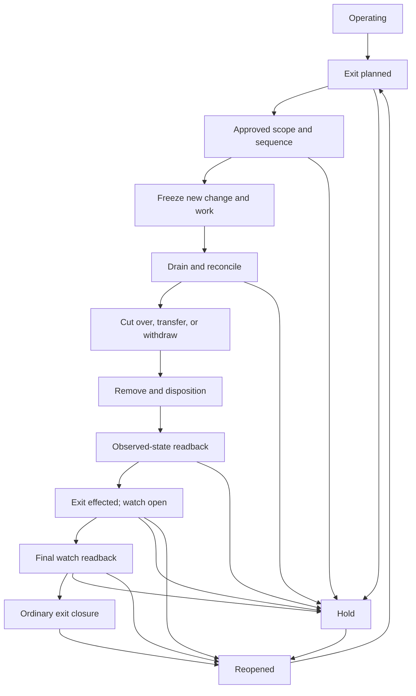

# Transfer, decommissioning, and retirement record

Complete one versioned record for each AI system, use case, repository,
service, supplier boundary, or public artifact being transferred, superseded,
decommissioned, retired, archived, withdrawn, or subject to a combined exit. A
portfolio program may provide the method, but each affected operating boundary
needs its own inventory, decisions, owners, and readback.

!!! warning "This record does not authorize transfer or destruction"
    Completing the worksheet does not grant a right to transfer data or
    assets, terminate a service, revoke access, destroy a copy, change
    repository ownership, or close an obligation. Qualified owners must
    approve the exact scope and sequence under current law, contract, records,
    privacy, security, finance, and organizational policy. Unknown scope,
    unresolved legal hold, missing successor acceptance, or an ambiguous
    destructive target fails closed.

This record consolidates exit evidence from the
[AI system lifecycle](../delivery/ai-lifecycle.md),
[AI system card](system-card.md),
[data architecture](../architecture/data-architecture.md),
[third-party risk](../governance/third-party-risk.md),
[identity and permission matrix](identity-and-permission-matrix.md),
[model routing and agent dispatch plan](model-routing-and-agent-dispatch-plan.md),
[agent extension assessment](agent-extension-assessment.md),
[agent execution and telemetry contract](agent-execution-and-telemetry-contract.md),
[regulatory obligation register](regulatory-obligation-register.md),
[incident and corrective-action record](incident-and-corrective-action-record.md),
[resilience plan](../operations/resilience.md), and
[repository ownership plan](repository-ownership-and-deployment-plan.md), plus
the [public-release readiness record](public-release-readiness.md) when the
scope was distributed externally.
It links those authoritative records; it does not replace them.
Their owners retain authority over route approval and revocation, extension
admission, system-card lifecycle state, incidents and CAPAs, public channels,
and their own closure decisions. This record sequences and reconciles the exit;
it cannot close those records by changing an aggregate status here.

## 1. Record control and exact boundary

| Field | Value |
|---|---|
| Exit record ID / version | |
| Record-artifact state | draft / reviewed / approved / superseded / expired |
| Exact system, use case, repository, service, supplier, or artifact boundary | |
| Included environments, tenants, regions, channels, and legal entities | |
| Explicit exclusions and separately governed shared dependencies | |
| Runtime-authorization state | operating / hold / exit-authorized / frozen / draining / inactive |
| Exit-execution and closure state | not-started / deciding / inventory / quiescing / cutover / removing / verifying / watch-open / ordinary-closed / administratively-closed-with-owned-residual / reopened |
| Successor and custody state | not-applicable / proposed / partially-accepted / accepted / rejected |
| Intended outcome | transfer / supersede / decommission / retire / archive / withdraw / combined |
| Trigger and decision ID | |
| Risk tier / criticality | |
| Planned freeze, cutover, point-of-no-return, and final-service dates | |
| Accountable owner and backup | |
| Successor or explicit no-successor decision | |
| Obligation-register snapshot / digest | |
| System card, architecture, data, identity, route, extension, execution, supplier, incident / CAPA, repository, and public-release record IDs | |
| Evidence location, classification, access, retention, and integrity control | |
| Next review / plan expiry | |

Record control identifiers rather than raw credentials, protected personal
data, confidential contract text, or destructive commands. Store restricted
evidence in its governed system and link it by stable ID and digest.

## 2. Distinguish the outcomes

These terms are related but not interchangeable:

| Outcome | Required meaning in this record | What it does not prove |
|---|---|---|
| **Transfer** | Defined accountability, custody, operation, support, or asset scope is accepted by a named successor and reconciled in both parties' authoritative records | Legal title, data-transfer authority, or completion merely because files were copied |
| **Supersede** | A replacement path is approved, operating, and identified to every affected consumer | Removal of the prior path or safe migration of historical state |
| **Decommission** | The scoped capability no longer accepts or initiates work, and its access, integrations, jobs, and infrastructure are removed or explicitly retained | Deletion of all data, closure of contracts, or end of every retained obligation |
| **Retire** | The accountable lifecycle decision ends ordinary operation or support and assigns final disposition and post-exit duties; exit closure is separately evidenced after the applicable gates and watch | Erasure, completed exit closure, recall of public copies, or closure of incidents, CAPAs, appeals, holds, or records duties |
| **Archive** | A defined artifact is retained under approved access, integrity, retention, and non-runnable controls | A safe default for every model, credential, environment, or executable package |
| **Withdraw** | Publisher-controlled distribution is deprecated, restricted, corrected, or removed where authorized | Recall of forks, downloads, caches, registries, mirrors, or recipient actions |

Transfer in this worksheet means the precise accountability, custody, or
operating change recorded above. It does not imply a legal ownership transfer
unless the qualified owner and controlling instrument say so.

### Separate state projections

Do not compress the exit into one `retired: true` field or derive an aggregate
green status from unlike states. Record one current value, accountable owner,
observation time, and evidence ID for every applicable projection. An asset,
execution, cost, or obligation with a different state gets its own row rather
than a forced common value.

| Projection | Allowed atomic current values | Current value | Accountable authority | Observed at / evidence ID | Invariant |
|---|---|---|---|---|---|
| Record artifact | draft / reviewed / approved / superseded / expired | | exit-record owner | | an approved record is not permission for an action outside its exact authority and scope |
| Runtime authorization | operating / hold / exit-authorized / frozen / draining / inactive | | service and policy owners | | inventory, notice, cutover, or retirement decision does not prove enforcement |
| Exit execution and closure | not-started / deciding / inventory / quiescing / cutover / removing / verifying / watch-open / ordinary-closed / administratively-closed-with-owned-residual / reopened | | accountable exit authority | | ordinary closure follows accepted watch and final readback; administrative closure remains visibly distinct |
| Successor and custody | not-applicable / proposed / partially-accepted / accepted / rejected | | sending and receiving authorities | | copy or export is not transfer; `accepted` requires matching two-sided scope and readback |
| Asset disposition, one row per asset or homogeneous set | discovered / planned / exported / transfer-accepted / revoked / sanitized / destroyed / retained-controlled / shared-retained / outside-publisher-control / external-copy-status-unknown | | asset and disposition owners | | export, accepted transfer, revocation, sanitization, destruction, retention, and loss of publisher control are different claims with different evidence |
| Executions and cost, one row per root, effect, reservation, or account boundary | open / draining / reconciled / owned-residual | | workflow, system-of-record, and finance owners | | cancellation, timeout, account closure, or workflow terminality does not prove no effect or no cost |
| Obligations and cases, one row per duty or case | open / transferred / fulfilled / continuing | | qualified obligation, incident, CAPA, appeal, and records owners | | an exit state cannot close another workflow |

### Record and operating states

Emergency containment may deactivate capability before the orderly sequence.
It must still preserve required evidence, reconcile in-flight work and
effects, and complete the applicable exit gates. A kill switch is not a
completed exit record.

`Exit effected; watch open` is intentionally not a closure state.
Ordinary closure follows the approved watch window and its final readback.
Administrative closure remains a separate, explicitly authorized outcome when
an owned residual prevents ordinary closure; it cannot silently shorten the
watch or remove the evidence plane.

## 3. Trigger, decision, and stop conditions

| Trigger | Observed fact / threshold | Decision owner | Required response time | Evidence / incident link |
|---|---|---|---|---|
| Planned end of life or replacement | | | | |
| Business-value stop threshold | | | | |
| Risk, safety, privacy, or quality threshold | | | | |
| Incident, compromise, or prohibited use | | | | |
| Supplier deprecation, insolvency, termination, or material change | | | | |
| License, rights, contract, or obligation change | | | | |
| Unsupported component or unpatchable vulnerability | | | | |
| Ownership loss, acquisition, divestiture, or team departure | | | | |
| Cost, capacity, or concentration threshold | | | | |
| User, community, or downstream-impact concern | | | | |

Define:

- **decision requested:** transfer / supersede / temporary bypass /
  decommission / retirement / emergency stop / hold;
- **reason and alternatives considered, including continued operation and a
  non-AI or manual path:**
- **affected people, customers, tenants, teams, and downstream services:**
- **expected benefit, risk reduction, disruption, and stranded cost:**
- **conditions that stop the exit, require containment, or trigger incident
  handling:**
- **conditions that require a new applicability, privacy, records, security,
  architecture, or supplier decision:**

An exit decision is not complete when its scope depends on an unresolved
inventory, an unverified successor, or an uncertain right to transfer, retain,
or delete.

## 4. Ownership and decision rights

| Decision or duty | Accountable owner | Operator | Required reviewer / discipline | Backup | Accepted date | Evidence |
|---|---|---|---|---|---|---|
| Business and lifecycle decision | | | | | | |
| Technical sequence and service continuity | | | | | | |
| Successor acceptance or no-successor decision | | | | | | |
| Data export, retention, correction, deletion, and backup | | | | | | |
| Privacy and affected-person treatment | | | | | | |
| Legal, regulatory, contract, trade, and IP determination | | | | | | |
| Records, legal hold, investigation, and evidence custody | | | | | | |
| Security containment, access revocation, and sanitization | | | | | | |
| Supplier termination, transition, and deletion evidence | | | | | | |
| Repository, registry, domain, and public-artifact disposition | | | | | | |
| Finance, commitment, billing, and reserve closure | | | | | | |
| User, workforce, customer, and public communication | | | | | | |
| Readback verification and closure | | | | | | |

No model, agent, tool, telemetry event, supplier attestation, or scanner output
can accept a successor duty, resolve legal applicability, authorize a
destructive action, or independently approve closure.

## 5. Freeze the inventory and dependency graph

Freeze an exact manifest before cutover. Reconcile the declared inventory with
discovery from authoritative registries, deployed state, identity systems,
data catalogs, suppliers, billing, and observed traffic. An undocumented asset
does not become safe because it is absent from the plan.

### Required inventory classes

- users, affected people, active cases, appeals, complaints, support queues,
  and manual or replacement workflows;
- applications, APIs, endpoints, routes, model deployments, weights, adapters,
  prompts, policies, guardrails, workflows, evaluation assets, and release
  manifests;
- agent roots and children, route grants, reservations, approvals, skills,
  tools, plugins, hooks, helpers, MCP servers, capability schemas, memory, and
  learning candidates;
- source, training, tuning, evaluation, retrieval, feedback, incident, and
  telemetry data; documents, labels, embeddings, feature stores, vector
  indexes, caches, queues, logs, snapshots, replicas, and backups;
- people and workload identities, groups, roles, sessions, tokens, secrets,
  certificates, encryption and signing keys, deploy keys, break-glass access,
  and supplier support access;
- repositories, branches, issues, pull requests, releases, packages,
  containers, SBOMs or AI component inventories, attestations, licenses,
  domains, DNS, registries, mirrors, and documentation;
- compute, storage, networks, gateways, schedulers, jobs, webhooks, topics,
  queues, serverless functions, monitoring, alerting, and recovery resources;
- providers, subprocessors, datasets, open-source components, contracts,
  subscriptions, commitments, quotas, invoices, support and security routes;
  and
- decisions, exceptions, incidents, problems, CAPAs, known errors, rights
  requests, investigations, holds, audit records, and required evidence.

### Frozen asset and disposition manifest

| Asset / dependency ID | Class and authoritative source | Current owner / location / state | Upstream and downstream consumers | Data, authority, consequence, and criticality | Chosen disposition | Successor / destination | Order and prerequisite | Reversible until / point of no return | Expected final state | Readback source | Evidence / residual owner |
|---|---|---|---|---|---|---|---|---|---|---|---|
| | | | | | | | | | | | |

Allowed dispositions are `transfer`, `supersede`, `continue-shared`,
`retain-controlled`, `archive-non-runnable`, `return`, `revoke`, `sanitize`,
`destroy`, or `not-applicable-with-reviewed-reason`. Define the exact meaning
for the organization. A shared asset stays only when its remaining purposes,
owners, access, costs, and final disposition are explicit.

### Dependency and consumer reconciliation

| Producer / dependency | Consumer or affected group | Contract / interface / channel | Required replacement, notice, export, or closure | Owner | Acceptance evidence |
|---|---|---|---|---|---|
| | | | | | |

- [ ] Every declared producer has a consumer or an approved no-consumer state.
- [ ] Every observed consumer resolves to the frozen manifest.
- [ ] Shadow, fallback, evaluation, recovery, and test paths are included.
- [ ] Fourth parties, shared services, personal or team integrations, and
      dormant credentials are included where discoverable.
- [ ] Open issues and downstream commitments are transferred or closed; they
      are not lost when a repository, queue, or account becomes read-only.

## 6. Obligation, records, privacy, and rights gate

Bind this plan to a current
[regulatory obligation register](regulatory-obligation-register.md) snapshot.
Qualified owners decide which sources apply and how conflicts are resolved.

| Obligation / decision ID | Source and role | Asset / people / territory / activity scope | Required transfer, notice, access, correction, portability, retention, deletion, return, or preservation | Event / deadline | Evidence and owner | Decision state |
|---|---|---|---|---|---|---|
| | | | | | | |

- [ ] Current legal, regulatory, contract, records, privacy, IP, license,
      export, sanctions, sector, labor, and investigation decisions are linked.
- [ ] Active complaints, appeals, access/correction/deletion requests,
      incidents, CAPAs, litigation or legal holds, audits, and vulnerability
      disclosures retain an owner and response clock.
- [ ] The successor's permitted purpose, location, access, onward transfer,
      subprocessors, and retention are approved before protected data moves.
- [ ] Preservation and deletion conflicts have a qualified decision and do not
      default to either indefinite retention or convenient erasure.
- [ ] Required notices and choices are accessible, versioned, delivered
      through approved channels, and evidenced.
- [ ] Records remain readable, integrity-protected, discoverable, and
      accessible only to authorized roles for the adopted period.

### Data, derived store, backup, and key disposition

| Data / store / backup / key ID | Purpose and classification | Controller / owner / custodian | Current and successor locations | Retain / transfer / return / correct / sanitize / destroy | Method and authority | Backup / replica / cache propagation | Restore or deletion readback | Hold / expiry / final disposition |
|---|---|---|---|---|---|---|---|---|
| | | | | | | | | |

Do not claim deletion from an API response, expired account, supplier
certificate, missing query result, or key deletion alone. Define the
organization's evidence standard for the data class, media, replicas, backups,
provider boundary, and threat model. Cryptographic erase is appropriate only
when the approved sanitization design, key isolation and destruction,
remaining copies, and verification satisfy the adopted policy.

Test that restoration, failover, replay, reindexing, cache warming, or a
supplier recovery process cannot silently resurrect data, access, routes,
jobs, or expired authority that should remain revoked, inactive, or absent in
the exited boundary.

## 7. Continuity, affected people, and successor plan

| Workflow / population / consumer | Current service and risk | Replacement, manual path, or no-successor outcome | Capacity, accessibility, quality, safety, security, and recourse acceptance | Notice / training / support | Owner and evidence |
|---|---|---|---|---|---|
| | | | | | |

- [ ] Critical functions have a tested alternate, manual, or intentionally
      discontinued outcome.
- [ ] The transition preserves required human oversight, correction, appeal,
      support, accessibility, and non-AI alternatives.
- [ ] The successor or replacement meets the applicable service, recovery,
      data, security, evaluation, and capacity thresholds.
- [ ] Downstream users understand changed behavior, limitations, provenance,
      interfaces, dates, and support.
- [ ] A no-successor decision identifies who bears the impact, what records
      remain available, and how open cases and disputes will be handled.

## 8. Exit gates and safe sequence

Tailor the sequence to the boundary, but do not omit a gate silently.

| Gate | Required outcome | Minimum evidence | Stop condition |
|---|---|---|---|
| **T0 Design and exercise before need** | Criticality, triggers, exit objectives, alternate or manual path, portability, recovery limits, irreversible points, and test cadence are designed while the system is changeable | Architecture and supplier exit plan, last exercise, measured recovery and migration result | Critical exit has no viable or explicitly accepted continuity path |
| **T1 Decide and bound** | Trigger, exact scope, outcome, owners, authority, alternatives, dates, and stop conditions are approved | Decision, boundary, owner acceptance, obligation snapshot | Scope, authority, or applicability is unknown |
| **T2 Freeze and reconcile inventory** | Frozen manifest covers declared and observed assets, consumers, dependencies, active work, records, and costs | Signed or tamper-evident manifest, discovery reconciliation, dependency graph | Unowned or unexplained component, consumer, identity, data, or effect |
| **T3 Prove continuity and successor readiness** | Replacement or manual path passes; successor accepts its exact scope, obligations, open work, support, and evidence custody | Evaluation, recovery exercise, acceptance record, no-successor decision where applicable | Critical workflow, recourse, recovery, or successor duty is unready |
| **T4 Approve disposition and point of no return** | Every asset has a lawful, policy-conforming disposition; irreversible actions have exact targets, prerequisites, approvers, rollback limit, and forward recovery | Disposition manifest, hold check, export/restore proof, destructive-action approval | Hold, right, target, backup, successor, or recovery is unresolved |
| **T5 Freeze, quiesce, and reconcile work** | New work and ingestion stop; in-flight work, effects, approvals, reservations, queues, and learning candidates are resolved or visibly owned | Freeze readback, root and queue inventory, authoritative effect and cost reconciliation | Unknown consequential effect or unowned in-flight work |
| **T6 Cut over or transfer** | Replacement operates or successor accepts; authoritative ownership, routing, support, records, and communications agree | Cutover result, two-sided acceptance, service readback, notices | Split authority, failed acceptance, or unsafe outcome |
| **T7 Remove capability and disposition assets** | Old routes, identities, integrations, jobs, infrastructure, supplier paths, and eligible data are revoked, disabled, returned, sanitized, destroyed, or retained as approved; least-privileged watch, evidence, alert, billing and supplier readback, and recovery capabilities remain until final closure | Change records, revocation and sanitization evidence, supplier and billing state, explicit retained-watch inventory | Destructive target drift, premature removal of the proof plane, new hold, incident, or unexpected dependency |
| **T8 Read back, watch, and close** | Independent observed state matches the manifest; the watch window completes and receives final readback; approved residual assets and duties have owners, access, thresholds, review, expiry, and reopen rules before ordinary or administrative closure | Cross-system readback, negative tests, watch results, residual register, final closure decision | Unexplained, unauthorized, unowned, out-of-threshold, or overdue activity, cost, access, copy, duty, finding, or failed test |

The point of no return is asset- and action-specific. Do not use one project
date to imply that every data deletion, credential revocation, supplier
termination, repository transfer, and infrastructure removal has the same
reversibility.

## 9. Quiesce active and autonomous work

Before ordinary capability removal:

- stop new user requests, route grants, child creation, tool calls, scheduled
  work, ingestion, feedback promotion, training, tuning, evaluation
  publication, and automated learning;
- freeze configuration and detect drift while exit work proceeds;
- inventory root and child executions, approvals, route leases, tool attempts,
  transactions, queues, reservations, retries, fallbacks, and late results;
- request cancellation, but do not treat the request or acknowledgement as
  proof that committed work stopped;
- reconcile every consequential effect with its system of record and preserve
  unknown effects in quarantine with an owner and response objective;
- settle or retain cost reservations for in-flight and delayed-billing work;
  and
- block automatic recovery, failover, restore, or fallback from re-enabling
  the retiring path.

Use the
[agent execution and telemetry contract](agent-execution-and-telemetry-contract.md)
for authoritative execution, effect, cancellation, budget, reconciliation,
and closure states. A workflow may be terminal while its effect, cost, or
incident remains open.

| Active-work class | Expected at freeze | Observed | Terminal or transferred state | Authoritative readback | Owner / evidence |
|---|---|---|---|---|---|
| User and batch requests | | | | | |
| Agent roots, children, and retries | | | | | |
| Tool calls and business effects | | | | | |
| Queues, schedules, webhooks, and events | | | | | |
| Data ingestion and feedback / learning candidates | | | | | |
| Reservations, invoices, and delayed usage | | | | | |

## 10. Successor and custody acceptance

Transfer is incomplete until the sending and receiving authoritative records
agree. Define a single owner during each transition phase to prevent split
authority.

| Acceptance domain | Exact scope sent | Sender evidence | Successor owner and acceptance | Successor readback / test | Rejected or deferred items | Final sender revocation condition |
|---|---|---|---|---|---|---|
| Business and product accountability | | | | | | |
| Service, on-call, incident, and communications | | | | | | |
| Architecture, configuration, release, and recovery | | | | | | |
| Data, keys, records, holds, and evidence custody | | | | | | |
| Repositories, registries, domains, packages, and signing | | | | | | |
| Suppliers, contracts, support, commitments, and billing | | | | | | |
| Open incidents, CAPAs, exceptions, complaints, and rights requests | | | | | | |

- [ ] The successor identity, authority, capacity, competency, support, and
      recovery path are verified.
- [ ] Integrity, completeness, provenance, rights, classification, and
      restorability of transferred assets are tested.
- [ ] Temporary migration access is least-privileged, monitored, and has an
      expiry and revocation owner.
- [ ] Source access is revoked only after acceptance and readback, unless
      emergency containment requires an earlier cut.
- [ ] Rejected, unavailable, or non-transferable items receive a lawful
      return, retention, destruction, substitute, or no-successor decision.

## 11. Capability, identity, and infrastructure removal

| Surface | Exact removal or retained state | Sequence / dependency | Expected denial or absence | Observed readback | Residual owner / expiry |
|---|---|---|---|---|---|
| User, administrator, support, and break-glass access | | | | | |
| Workload identities, roles, groups, sessions, tokens, certificates, and secrets | | | | | |
| Encryption, signing, deployment, and recovery keys | | | | | |
| Model deployments, serving-boundary revisions/digests, route approvals, fallback aliases, model/runtime artifacts and measurements, offline packages and local state, quotas, final invocation PEPs, provider credentials, and enterprise invocation-admission and serving-runtime identities | | | | | |
| Skills, plugins, hooks, helpers, tools, MCP servers, schemas, grants, and startup paths | | | | | |
| Applications, endpoints, gateways, network rules, DNS, domains, and webhooks | | | | | |
| Jobs, schedulers, functions, queues, topics, workflows, and automation | | | | | |
| Compute, storage, indexes, caches, and backups | | | | | |
| Least-privileged evidence, alert, billing / supplier readback, watch, and recovery resources retained until final closure | | | | | |
| Repositories, branches, actions, apps, deploy keys, packages, containers, and registries | | | | | |

Revocation evidence must show the relevant enforcement point observed the new
state. Removing a record from a catalog does not prove that a credential,
route, process, endpoint, cached grant, restored backup, or external
integration can no longer operate.

## 12. Suppliers, commercial commitments, repositories, and public copies

| Boundary | Required decision and action | Expected final state | Evidence / limitation | Owner |
|---|---|---|---|---|
| Provider and subprocessors | transition support, export, stop processing, account or service closure, return or deletion evidence, continuing incident cooperation | | | |
| Contracts, licenses, support, and commitments | termination or amendment, surviving duties, fees, credits, renewals, support and vulnerability route | | | |
| Billing, quotas, reservations, and delayed charges | stop new usage, close commitments where authorized, retain reserve, reconcile late charges | | | |
| Repository and organization ownership | accepted successor or archival, teams and apps, branches and releases, issue and security-report custody, rulesets, deploy and signing access | | | |
| Packages, containers, models, datasets, and namespaces | deprecate, transfer, yank or restrict where safe and authorized; preserve required provenance and notices | | | |
| Domains, DNS, certificates, documentation, and redirects | successor, expiry, sinkhole, redirect, or withdrawal with recovery and abuse monitoring | | | |
| Public releases, forks, downloads, caches, archives, and mirrors | correct or withdraw publisher-controlled state; communicate known persistent-copy limits | | | |

Use the
[public-release readiness record](public-release-readiness.md#r8-monitoring-takedown-and-retirement)
for externally distributed artifacts. Withdrawal or namespace transfer cannot
erase independent copies or undo recipient actions.

For a repository, preserve accepted security-reporting and vulnerability
handling while supported versions or embargoed reports remain. Archive or
transfer only after issue, pull-request, release, package, integration,
credential, domain, and downstream-consumer custody is resolved.

## 13. Irreversible actions, rollback, and forward recovery

Destructive execution procedures must resolve exact targets from an approved
manifest and re-read them immediately before action. This worksheet is not a
shell command, cloud-console instruction, or substitute for required
dual-control.

| Action / target ID | Why irreversible or hard to recover | Preconditions and hold check | Last safe rollback point | Backup / export / restore proof | Abort threshold | Forward recovery / compensation | Approver / operator / verifier |
|---|---|---|---|---|---|---|---|
| | | | | | | | |

- [ ] Wildcards, unresolved variables, mutable aliases, broad account targets,
      and stale inventories are prohibited for destructive selection.
- [ ] Backups or exports needed for continuity or records are complete,
      integrity-checked, access-tested, and restorable before eligible source
      destruction.
- [ ] The plan distinguishes rollback of configuration from compensation for
      transactions, external recipient actions, deletion, and transferred
      custody that ordinary rollback cannot reverse.
- [ ] The freeze and rollback window has monitoring, expiry, and an owner.
- [ ] The point-of-no-return decision is recorded immediately before the
      applicable destructive action.
- [ ] Failed or partial destruction enters incident or corrective-action
      handling and does not receive a successful closure label.

## 14. Observed-state readback and negative tests

Use independent queries from the systems that own deployed state. Do not rely
only on the same plan, script, or operator that performed the change.

| Readback source | Expected state | Query / test and time window | Observed state | Mismatch action | Evidence / verifier |
|---|---|---|---|---|---|
| AI system and dependency inventory | | | | | |
| Model gateway, route policy, provider, and usage | | | | | |
| Agent workflow, grant, tool, extension, and schema registries | | | | | |
| System-of-record transactions and active-work ledger | | | | | |
| Identity, access, session, secret, certificate, and key systems | | | | | |
| Data catalog, stores, indexes, caches, replicas, and backups | | | | | |
| Compute, network, DNS, endpoint, scheduler, queue, and recovery planes | | | | | |
| Source control, CI/CD, registries, packages, domains, and public channels | | | | | |
| Supplier consoles, contracts, support, deletion, and subprocessor records | | | | | |
| Billing, commitments, quotas, invoices, and cost telemetry | | | | | |
| Incidents, CAPAs, exceptions, rights requests, holds, and evidence stores | | | | | |

Minimum negative and recovery tests, as applicable:

- old user, workload, deploy, provider, tool, extension, and emergency
  credentials are denied at the enforcement point;
- new requests, routes, scheduled work, ingestion, learning, fallback, and
  recovery cannot reactivate the exited scope;
- direct endpoint, alternate region, mutable alias, shadow, test, and
  break-glass bypasses are denied or explicitly retained;
- restored backups preserve deletion, revocation, tenant, purpose, hold, and
  exit state;
- a retained archive is non-runnable and cannot mint authority or reach
  production resources;
- the successor can restore and operate the accepted scope while the sender no
  longer can after final revocation;
- provider, network, queue, storage, and billing observations show no
  unexplained residual activity during the watch window; and
- public and supplier limitations are documented instead of reporting
  unverifiable erasure.

## 15. Residual assets, post-exit monitoring, and reopen

| Residual asset, duty, or uncertainty | Why it remains | Owner and backup | Purpose and access | Monitoring / response threshold | Review / expiry | Final disposition |
|---|---|---|---|---|---|---|
| | | | | | | |

Define the post-exit watch window from risk, billing delay, backup cycles,
supplier behavior, incident needs, and applicable obligations. Keep the
least-privileged evidence, alert, billing and supplier readback, watch, and
required recovery capabilities available until the watch window and final
readback are accepted. Only then apply their own authorized disposition.

Reopen the record when any of these occur:

- an old route, endpoint, credential, job, queue, integration, model,
  extension, or fallback accepts work;
- a restored backup, cache, replica, registry, mirror, or downstream consumer
  reveals an unplanned copy or resurrected authority;
- a late tool result, transaction, agent effect, provider usage record,
  invoice, or supplier event changes the final state;
- a successor rejects custody, fails its accepted service or recovery test, or
  discovers an incomplete transfer;
- a new rights request, complaint, incident, vulnerability, hold, audit,
  investigation, contract claim, or regulatory event affects the retained
  scope; or
- a residual owner, access approval, review date, retention period, exception,
  domain, namespace, or support route expires.

## 16. Closure decisions

### Ordinary closure gate

- [ ] The frozen manifest reconciles declared and observed assets,
      dependencies, consumers, active work, records, and costs.
- [ ] Every asset has an authorized disposition and observed final state.
- [ ] All new work and ingestion are blocked; active roots, tool attempts,
      effects, queues, approvals, reservations, and late results are
      authoritatively resolved.
- [ ] The replacement or manual path works, or the no-successor outcome and
      affected-person treatment are approved.
- [ ] Both sides accepted every transferred duty and their authoritative
      records agree.
- [ ] Eligible identities, routes, extensions, jobs, infrastructure, supplier
      paths, and data are revoked, disabled, returned, sanitized, or destroyed
      with required readback.
- [ ] Retained assets and open incidents, CAPAs, exceptions, complaints,
      rights requests, holds, investigations, and records have an owner,
      access rule, review date, and final disposition.
- [ ] Required notices, support, recourse, security reporting, records
      availability, financial settlement, and post-exit monitoring operated for
      the approved watch window.
- [ ] Final watch readback is accepted, and retained proof-plane resources have
      an authorized disposition that does not erase required evidence or
      continuing monitoring.
- [ ] No organization-defined exit-closure-blocking or highest-severity
      finding, failed required test, missed obligation, unknown consequential
      effect, or unexplained, unauthorized, unowned, out-of-threshold, or
      overdue residual remains.

Ordinary exit closure does not close an incident, CAPA, legal matter,
right request, contract, financial reserve, retention schedule, or successor
duty. It proves only that the scoped exit record passed its adopted gate.
An approved retained asset or continuing duty may pass ordinary closure when
its authority, owner, access, threshold, review, expiry, and final disposition
are all accepted; mere existence of that governed residual is not failure.

### Administrative closure with an owned residual

If adopted policy permits closure with a residual that cannot be resolved,
record:

- the administrative-closure decision ID, named exit or
  administrative-closure authority, adopted-policy authority basis, date,
  exact scope, result, and validity window;
- the asset, effect, copy, cost, supplier limitation, or evidence uncertainty;
- why ordinary closure is impossible and which safer alternatives were tried;
- for every retained risk, every applicable current category-bound
  residual-risk decision ID, category, exact scope, result, named authority and
  authority basis, conditions, validity, expiry, invalidation trigger, and
  supersession state;
- any separate policy-exception decision plus linked loss, incident, contract,
  legal, privacy, and records decisions;
- containment, monitoring, owner, response objective, review date, expiry,
  and reopen rule; and
- the retained evidence, access, hold, and final-disposition path.

Administrative closure cannot fabricate successor acceptance, deletion,
revocation, sanitization, rights, legal compliance, or a resolved effect. It
cannot waive a prohibition, extinguish a continuing duty, or count as ordinary
successful closure. The exit or administrative-closure authority accepts no
residual risk and grants no exception; residual-risk, exception, and closure
authorities do not inherit one another. A missing, invalid, expired,
superseded, out-of-scope, or held required decision keeps the affected exit
scope open or held.

### Final decision

| Decision | Exact scope | Named exit / administrative-closure authority and policy basis | Date | Conditions / residuals | Monitoring end / next review | Evidence |
|---|---|---|---|---|---|---|
| Hold / proceed / watch open / ordinary close / administrative close / reopen | | | | | | |

## 17. Conformance and exercise record

Record `pass`, `fail`, or `unsupported` for every applicable path.
Unsupported required behavior is a gap, not an omitted test.

| Scenario | Expected result | Environment / supplier / boundary | Observed result | Evidence ID | Owner | Verifier and independence | Freshness |
|---|---|---|---|---|---|---|---|
| Planned transfer with successor restore and operating acceptance | both authoritative records agree before sender revocation | | | | | | |
| No-successor retirement | safe discontinuation, notices, support, records, and residual ownership | | | | | | |
| Emergency deactivation with in-flight consequential work | new work stops; committed work, effects, cost, and evidence reconcile | | | | | | |
| Shared dependency used by another approved system | only retiring scope is removed; shared state remains owned and isolated | | | | | | |
| Legal hold conflicts with scheduled deletion | destructive action blocks; qualified decision and retained access apply | | | | | | |
| Eligible data across primary, cache, replica, index, and backup | disposition propagates and restore cannot resurrect prohibited state | | | | | | |
| Old identity, grant, route, extension, endpoint, job, and recovery path | every unapproved path denies or remains absent | | | | | | |
| Supplier deletion or return | provider evidence and customer-side readback meet the adopted standard; limitations remain visible | | | | | | |
| Late provider usage, invoice, tool result, or transaction | record reopens or residual process owns reconciliation | | | | | | |
| Public artifact withdrawal | canonical state and notices update; persistent-copy limitations remain explicit | | | | | | |
| Partial destructive action or target drift | stop, preserve evidence, contain, and enter incident/CAPA path | | | | | | |
| Post-exit watch, final readback, and expiry | no unexplained or out-of-threshold activity; retained duties progress to final disposition before closure | | | | | | |

AI-generated review and protected model verification may supplement this
evidence. They do not provide independent approval or prove the deployed,
supplier, successor, or public state.

## 18. Evidence package and sign-off

The final package should bind:

- approved record version, boundary, manifest digest, decision, and sequence;
- inventory and dependency discovery, reconciliation, and exclusions;
- obligation snapshot and qualified retention, transfer, notice, hold,
  rights, and destruction decisions;
- continuity, evaluation, successor, restore, and no-successor evidence;
- freeze, active-work, authoritative effect, cost, cutover, revocation,
  sanitization, supplier, repository, public, and financial records;
- expected-versus-observed readback, negative tests, mismatches, incidents,
  CAPAs, and closure;
- residual register, watch window, alerts, expiry, reopen events, and final
  disposition; and
- evidence classification, access, integrity, custody, retention, deletion,
  and verifier independence.

| Role | Name / team | Decision and exact scope | Date | Evidence / conditions / expiry |
|---|---|---|---|---|
| Business / product owner | | | | |
| Service / technical owner | | | | |
| Successor owner or no-successor authority | | | | |
| Data / privacy / records owner | | | | |
| Security / identity / incident owner | | | | |
| Legal / regulatory / contract / IP owner, as applicable | | | | |
| Supplier / finance / procurement owner | | | | |
| Repository / publication owner, as applicable | | | | |
| Independent verifier, when required | | | | |

## Standards and evidence boundary

This worksheet operationalizes, without replacing:

- [NIST AI RMF 1.0](https://www.nist.gov/publications/artificial-intelligence-risk-management-framework-ai-rmf-10)
  Govern 1.7 and Manage 2.4 lifecycle outcomes and the voluntary
  [AI RMF Playbook](https://airc.nist.gov/airmf-resources/playbook/)
  decommissioning suggestions;
- [NIST SP 800-53 Rev. 5 release 5.2.0](https://csrc.nist.gov/pubs/sp/800/53/r5/upd1/final)
  as a tailorable control catalog for inventory, account lifecycle, media,
  records, external services, and supply-chain control families;
- [NIST SP 800-88 Rev. 2](https://csrc.nist.gov/pubs/sp/800/88/r2/final)
  for an organization-defined media-sanitization program;
- [NIST SP 800-161 Rev. 1 Update 1](https://csrc.nist.gov/pubs/sp/800/161/r1/upd1/final)
  for lifecycle cybersecurity supply-chain risk management; and
- the public scope of
  [ISO/IEC 5338:2023](https://www.iso.org/standard/81118.html)
  for AI system lifecycle processes.

The AI RMF and Playbook are voluntary, SP 800-53 is tailorable, SP 800-88 is
media-sanitization guidance, SP 800-161 is supply-chain guidance, and a public
ISO page does not reproduce licensed requirements. These mappings do not
establish certification, legal sufficiency, secure deletion, effective
control operation, or permission to transfer or destroy an asset. Adopted
organization policy and source-specific obligations determine the actual
requirements and evidence.
